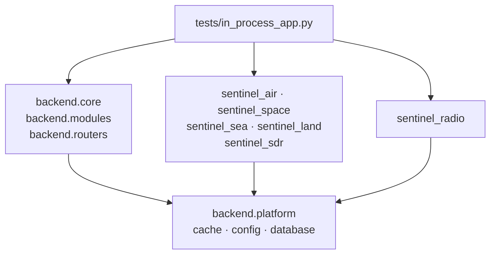
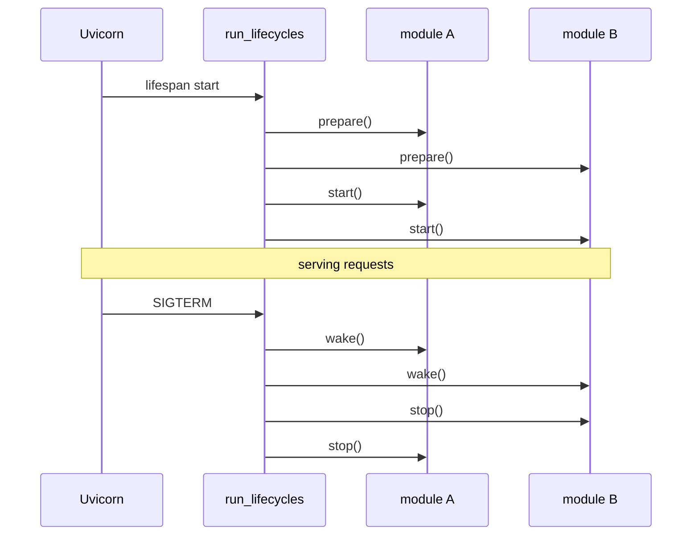

# Backend code

This page explains how the Python backend is organised: the packages, the rules about who may import whom, how a process is put together, and how its modules start and stop. Read [System overview](overview.md) first.

New to a term on this page? See [Words used on these pages](overview.md#words-used-on-these-pages).

## The packages

Every service runs from the same image and the same Python environment (`backend/pyproject.toml`), but each imports only what it is.

| Package | Folder | What it holds |
|---|---|---|
| `backend.core` | `backend/core/` | Core only: the app factory, service registry, gateway sync, notifications, internal auth, SPA serving. |
| `backend.platform` | `backend/platform/` | Shared by every service: the event bus and NATS transport, module lifecycles, the service SDK, the settings client, credentials, service manifests. |
| `backend.modules` | `backend/modules/` | Core's own lifecycles (`bus`, `core`) and the section manifest helper. |
| `backend.routers`, `backend.services` | `backend/routers/`, `backend/services/` | Core's settings and offline-map routers and the code behind them (config file, offline map jobs). |
| `backend.cache`, `config`, `database`, `utils` | `backend/*.py` | The fresh/stale cache helpers, Pydantic settings (`.env`), the async SQLAlchemy engine, connectivity helpers. |
| `sentinel_<id>` | `services/sections/<id>/backend/sentinel_<id>/` | One section: `router`, `services/`, `models`, `database` (its tables and seeders), `module` (lifecycle and manifest), `service` (its uvicorn entry point). Tests sit beside it in `tests/`. |
| `sentinel_radio` | `services/radio/backend/sentinel_radio/` | The radio hub, same layout plus `routers/` and `radios.py`. |

Each section package is an editable path dependency of `backend/pyproject.toml`, so `uv run --project backend …` and the image see it like any installed package.

## Import rules

The boundaries are checked by import-linter (`PYTHONPATH=. uv run --project backend lint-imports --config backend/pyproject.toml`), which gates CI:

- **Nothing in `backend` imports a section or the radio hub.** Core never even loads their code: sections subscribe to bus events when imported, so a copy inside core would handle events meant for the service. `tests/backend/test_core_entry_point.py` checks this in a fresh interpreter.
- **No section imports another section.** Sections talk through the event bus and HTTP, never by calling each other.
- **Only the test app imports everything.** `tests/in_process_app.py` builds one app with every router so the backend tests can use one client. No deployment runs it.

*Figure: Which packages may import which. Arrows point from the importer to what it imports.*

**In words:**

- Core (`backend.core`, `backend.modules`, `backend.routers`) imports the shared platform.
- Every section package, and the radio hub, imports the shared platform.
- Core and the sections never import each other, and sections never import each other.
- Only the test suite's in-process app imports core, every section and the hub together.

## How a process is put together

There are two composition roots, one per kind of process:

- **Core**: `backend/main.py` is uvicorn's target. It calls `create_core_app()` (`backend/core/app.py`), which mounts core's routers (settings, notifications, offline maps, `/api/app/sections`, `/internal/registry/register`, secret settings), then `/health`, then the static mounts (`/assets/**`, `/spa-assets/**`, `/fonts/**`), and finally a catch-all that serves the shell's `index.html` for any other path, so vue-router can handle it.
- **A section or the hub**: `sentinel_<id>/service.py` calls `create_service()` (`backend/platform/sdk/`) with the section's routers, lifecycle and manifest. That gives the service its `/health`, its UI remote under `/remotes/<id>/`, a NATS connection, registration with core, and a hold on start-up until core answers.

Every file the browser loads must sit under one of core's mounts. Anything else at the site root falls through to `index.html`, and the browser rejects it as a module script with a `text/html` type error. That is why the shell's federation entry is `spa-assets/remoteEntry-[hash].js`.

## Module lifecycles

Each module declares a `ModuleLifecycle` (`backend/platform/lifecycle.py`) with up to four optional hooks:

| Hook | Runs | Used for |
|---|---|---|
| `prepare` | At start-up, for **every** module before any `start` | Tables, migrations, seed data |
| `start` | After all `prepare`s, in list order | Background tasks: pollers, sockets, resumed decodes |
| `stop` | At shutdown, in reverse order | Stopping and awaiting what `start` began |
| `wake` | On SIGTERM or SIGINT, before uvicorn's own handler | Unblocking long-lived waiters so shutdown and `--reload` don't hang |

*Figure: Start-up and shutdown of one service with two modules.*

**In words:**

1. Every module's `prepare` runs first, in order, so no background task starts against a half-built database.
2. Then every module's `start` runs, in the same order.
3. On a shutdown signal, every `wake` hook runs first. It nudges things that wait forever, such as SDR WebSocket queues, decode bridges, the AIS reader and a running `pmtiles extract`.
4. Then every `stop` runs, in reverse order.

Don't remove the wake chain: without it, long-lived SDR sockets and subprocesses deadlock `uvicorn --reload`.

For a section service, `create_service()` puts its own hooks around the section's: first a wait for core (a section can't read its settings until core answers), then the NATS connection, and registration last.

## Settings from a service

Settings belong to core. A section reads and writes them through the settings client (`backend/platform/settings_client.py`), which goes over HTTP to core's `/api/settings` when `SENTINEL_CORE_URL` is set. Never read the `user_settings` table from section code. Secrets are handled differently; see [Security](security.md#secrets). How a settings change travels is in [Data stores](data-stores.md#a-settings-change).

## Adding to the backend

- **A route on an existing section:** add it to that section's `router.py`. Its manifest already claims the prefix.
- **A new path prefix:** add it to the section's manifest `routes` in `module.py`. The gateway picks it up when the service next registers.
- **A new bus subject:** add it to `backend/platform/nats_permissions.py`, or the broker refuses it. See [Event bus](event-bus.md).
- **A new service or decoder kind:** give it a row in `backend/platform/service_access.py` and a compose mount of its credentials. See [Security](security.md).
