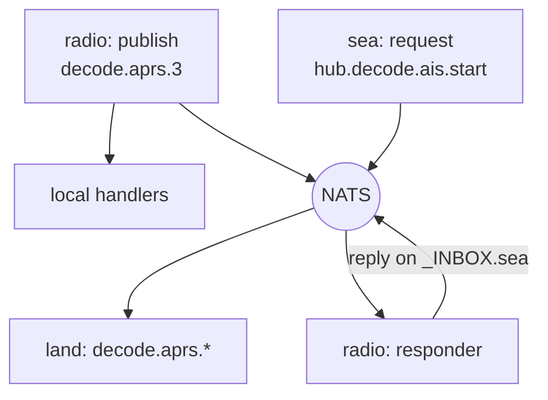

# Event bus and security

Sections never import each other: they talk over the event bus (`backend/platform/bus.py`, carried by NATS) and HTTP. Every service proves who it is with its own credential.

## Event bus

- `publish(subject, payload)`: every local handler runs and is awaited, then it goes to NATS.
- `subscribe(pattern, handler)`: `*` matches one part, `>` the rest.
- `request(subject, payload)`: a local responder answers, else it crosses NATS and replies on `_INBOX.<user>`.

*Figure: A publish runs local handlers first, then reaches other processes through NATS.*

Rules:

- **Low-rate control events only.** Never FFT, IQ or PCM.
- Payloads are JSON; the `db` session is stripped and re-injected, so handlers keep their signature.
- A remote exception arrives as `RemoteHandlerError`.
- `no_echo` is on: local handlers already ran. Removing it handles every event twice.
- A missing broker never blocks start-up or a publish.

| Subject | From | Means |
|---|---|---|
| `settings.changed.<ns>` | core | A setting changed |
| `registry.changed` | core | A service came, went, or changed availability |
| `notifications.raise` | a section | Store and push an alert |
| `decode.<kind>.<radioId>` | radio hub | A decoder heard something |
| `hub.decode.<kind>.{start,stop,status}` | a section | Control a decoder |
| `hub.sentry.…` | air | Reserve a Sentry dongle, receiver location |
| `hub.iq-capture.{locate,list,discard}` | sdr | IQ capture hand-over |
| `air.squawk.changed` | air | A squawk changed |

**Adding a subject:** add it to the user's row in `backend/platform/nats_permissions.py`, `docker compose up -d`, then `docker compose restart nats`. Otherwise the broker refuses it (`permissions violation`).

## Security

No user logins: anyone who reaches :8080 can use Sentinel, so keep it on a trusted network.

| Crossing | Protected by |
|---|---|
| Browser → gateway | Your network; `/internal/…` refused |
| Service → core internal routes | Its own token, `Authorization: Bearer` |
| Decoder → radio hub | Its own token, `X-Decode-Secret` |
| Anything → NATS | TLS with the install's own CA, one NATS user each |
| Radio host → core | TLS on :8443 and :4222, plus its own credentials |

- `service-credentials` creates, on every `up` and only what is missing: a CA, TLS certs, per-caller tokens and NATS logins, and `accepted-callers.json` for core and the hub holding only **SHA-256 hashes**.
- Each container mounts only `credentials/<caller>/`. To replace one, delete its folder and `docker compose up -d`.
- `backend/platform/service_access.py` says what each caller may do: register itself; `sea` reads the AISStream key; `sdr` fetches IQ captures; decoders act as their own kind only.
- Guards (`backend/core/internal_auth.py`): 503 no caller list, 401 unknown token, 403 not allowed.
- **A new service or decoder kind** needs a row in both tables and a credentials mount.

In the browser:

- Core sets the CSP on `index.html` (`backend/core/spa_csp.py`), allowing its inline boot scripts by hash. It keeps `blob:` and `'unsafe-eval'` for SDR audio.
- Remotes load only from same-origin `/remotes/<id>/`.
- Docs render with markdown-it (`html: false`) then DOMPurify; Mermaid runs `securityLevel: strict`.

Every route validates input at the edge (Pydantic, bounds, allow-lists); queries go through SQLAlchemy. Add a test proving bad input is refused.
