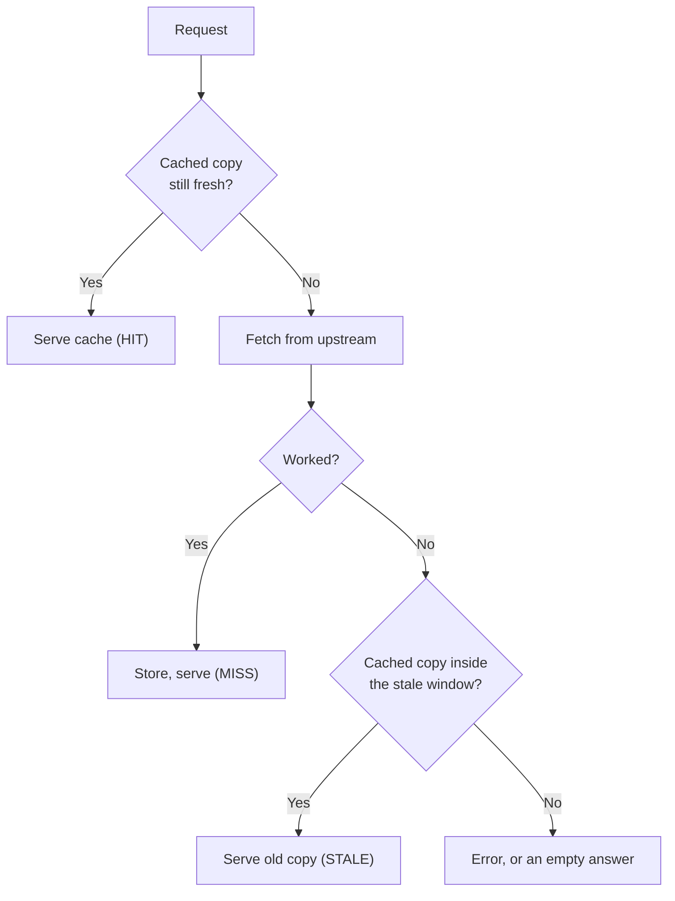
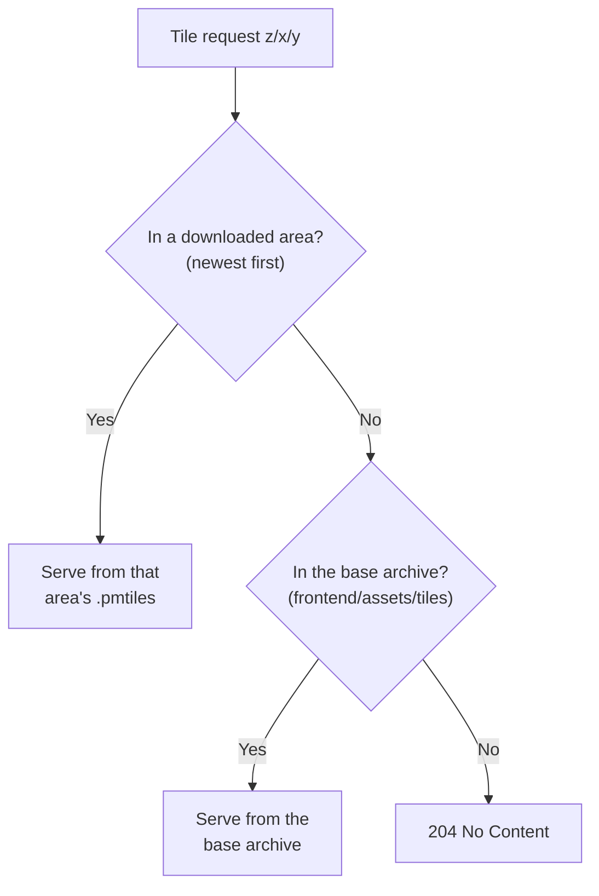

# Caching

Sentinel caches what it fetches so it keeps showing something useful when a feed is slow, rate-limited or gone. This page explains the general pattern and each cache.

New to a term on this page? See the [Glossary](../reference/glossary.md).

## Fresh, stale, gone

Most caches use the helpers in `backend/cache.py` (`now_ms`, `is_fresh`, `is_within_stale`) with two windows: a **fresh** window, during which the cached copy is served without asking upstream, and a longer **stale** window, during which the cached copy is still served if upstream fails.

*Figure: How a cached request is answered.*

**In words:**

1. If the cached copy is still inside its fresh window, it is served at once.
2. Otherwise upstream is asked. A good answer is stored and served.
3. If upstream fails, a copy still inside the stale window is served instead.
4. Only if there is nothing usable does the request fail.

The windows are settings in `backend/config.py`, overridable from `.env`.

## The caches

| What | Where | Fresh / stale | Notes |
|---|---|---|---|
| ADS-B aircraft | `air.db`, keyed by point and radius | 10 s / 60 s (`ADSB_TTL_MS`, `ADSB_STALE_MS`) | Response header `X-Cache` says how it was answered (below) |
| TLEs | `space.db` | 6 h / 12 h (`TLE_TTL_MS`, `TLE_STALE_MS`); 30 days for uploaded TLEs | An unreachable host is skipped for a while rather than retried for every satellite |
| UK repeaters | `land.db`, `repeater_cache` | refreshed daily; stale copy used up to 30 days | Then the built-in copy |
| Vessels | Sea's memory, snapshot in `sea.db` | 30 min retention | Snapshot every 30 s, loaded at start |
| Offline map tiles | `.pmtiles` files | never expire | See below |

### ADS-B's `X-Cache` header

Air's `/api/air/adsb/point/…` says in `X-Cache` how it answered, which helps when the map looks wrong:

| Value | Meaning |
|---|---|
| `HIT` | Fresh cached snapshot |
| `MISS` | Fetched from upstream now |
| `BYPASS` | Fetched, but the cache write failed (database busy); served anyway |
| `NEARBY` | No snapshot for this exact point, so the nearest recent one was served |
| `STALE` | Upstream failed; an older snapshot inside the stale window was served |
| `RATED` | Upstream answered 429 (rate limit); cached snapshot served |
| `THROTTLED` | Sentinel's own rate limiter held the request back; cached snapshot served |
| `FALLBACK` | The main source failed and the other mode's source answered |

`X-Snapshot-Age-Ms` gives the snapshot's age, which the map uses to place aircraft where they are now rather than where they were.

## Offline map tiles

Maps read tiles through two core endpoints, `GET /api/offline-map/basemap/{z}/{x}/{y}` and `/api/offline-map/terrain/{z}/{x}/{y}`, which look in tiers.

*Figure: Where an offline map tile comes from.*

**In words:**

1. Downloaded areas are checked newest first; the first one that has the tile serves it.
2. Otherwise the base archive placed by hand in `frontend/assets/tiles/` is tried.
3. If neither has it, the answer is `204 No Content` and the map leaves that square blank.

Open `.pmtiles` readers are kept between requests (`tile_tier_resolver.py`). When a download finishes, `/api/offline-map/status` reports a new `tiers_version`; the map then calls `setTiles()` on its sources with a `?v=` cache-buster, so it refetches without a full restyle. Don't replace this with `map.setStyle()`: it doesn't refetch an unchanged source, and a full restyle wipes the overlay layers.
