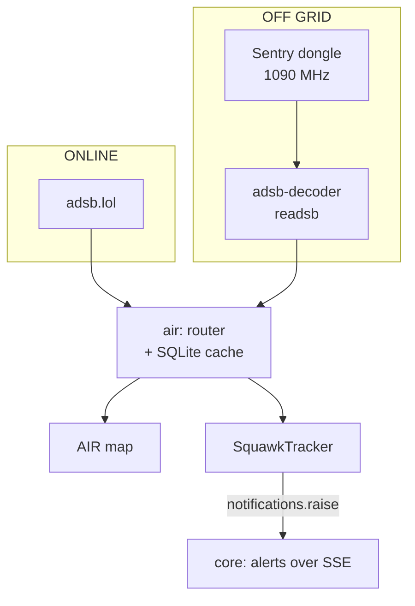
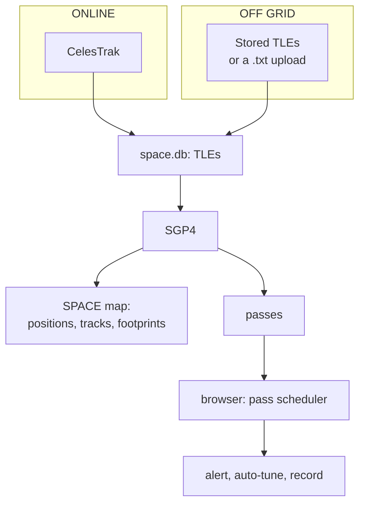
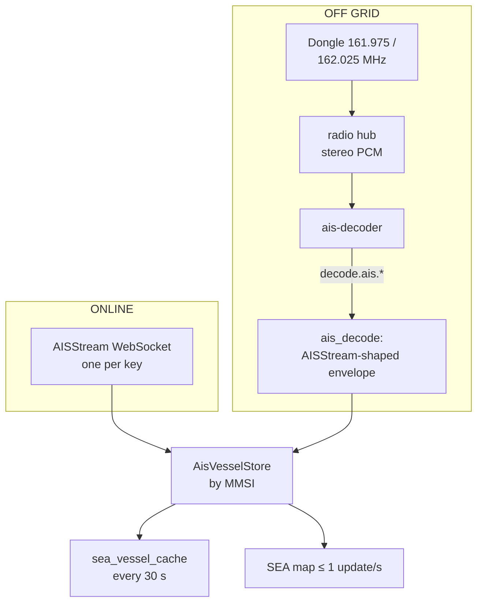
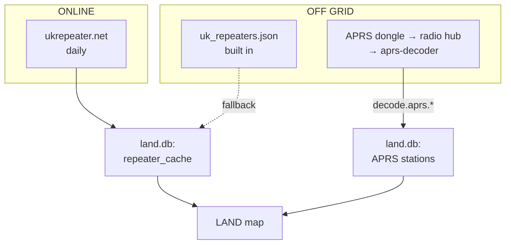
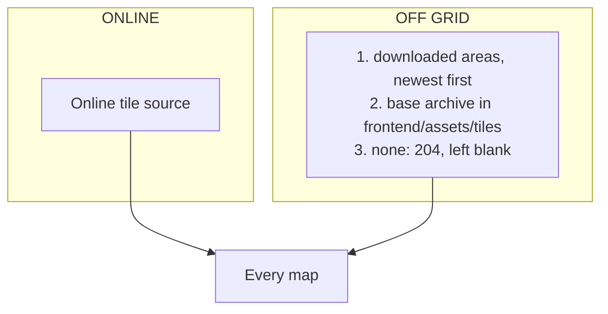

# Data flows

Each section's data from source to map, with the **ONLINE** and **OFF GRID** paths drawn apart. Which one is live: the section's **Source Override**, else **Connectivity Mode** (`resolve_effective_mode`, `resolve_domain_urls` in `backend/utils.py`).

## Air

*Figure: Aircraft from adsb.lol online or your own receiver off grid, through Air's cache, to the map and to emergency alerts.*

- The map asks Air for aircraft within 250 nm of its centre every few seconds; Air answers from cache or the live source ([Storage](storage.md#caching)).
- Off grid, opening Air reserves the Sentry dongle through the hub and tunes it to 1090 MHz. readsb reads IQ directly; the decoder finds its dongle via `/api/sdr/adsb/config`.
- Every snapshot feeds the `SquawkTracker`. With no map open, `AdsbWatcher` fetches on its own interval, so emergencies are still caught. The map only highlights; it never raises the alert.

## Space

*Figure: TLEs from CelesTrak online or a stored or uploaded copy off grid, propagated with SGP4.*

- SGP4 runs in the Space service, so positions and passes need no internet once TLEs are stored.
- The pass scheduler runs in the browser: alerts and auto-tune need a tab open.

## Sea

*Figure: AISStream online or the AIS decoder off grid, both feeding one vessel store.*

- Both sources feed **one** store, so tracks, types and the cache are identical either way. Don't add a second ingest path.
- Off grid, never start the AISStream reader: it burns the reconnect ladder.
- Online, a watchdog reports silence after 2 minutes but reconnects slowly. Don't speed it up: a reconnect storm locks the key out.
- The map pushes to MapLibre at most once a second, and only when the source has loaded.

## Land

*Figure: Repeaters from a daily download online or the built-in copy off grid; APRS always from your radio.*

- `backend/scripts/refresh_repeaters.py` regenerates the built-in copy.
- A cleanup loop deletes old stations at start and every 24 h.

## SDR

Always your own radios. Live data goes through the radio hub ([Radios and decoding](radios.md)); saved frequencies, groups, ranges and recordings through the SDR service to `sdr.db`.

## Maps

*Figure: Online, tiles come from the internet. Off grid, core looks in your downloaded areas, then the base archive, and otherwise leaves the square blank.*

Off grid, tiles come from core's `/api/offline-map/{basemap,terrain}/{z}/{x}/{y}` ([Storage](storage.md#offline-map-tiles)).
