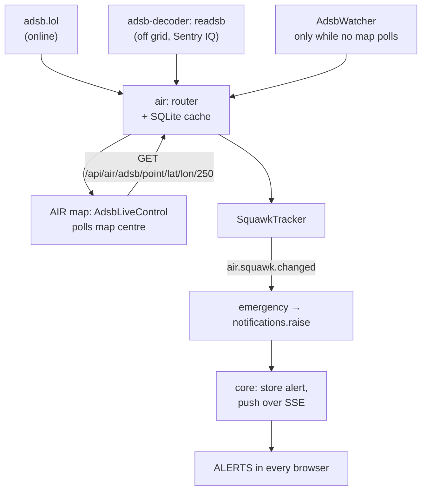
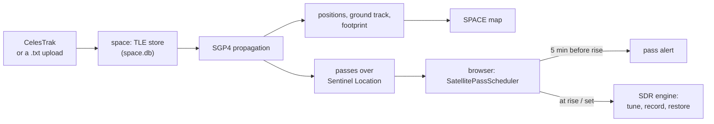
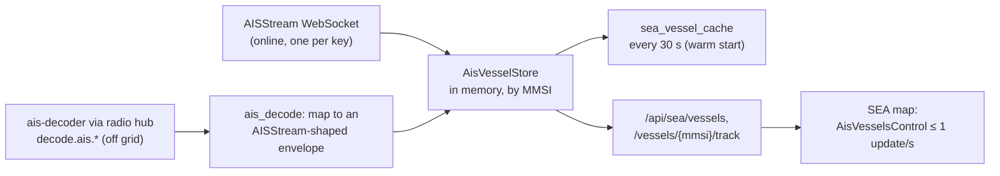
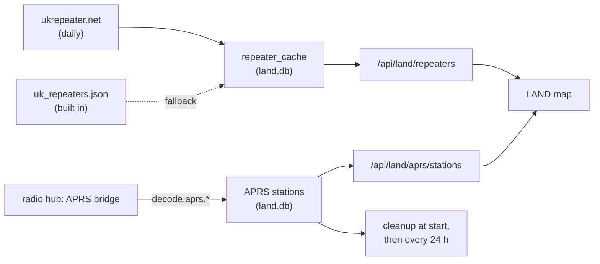

# Section data flows

This page follows the data of each section from its source to the map. Each section is a backend package (`services/sections/<id>/backend/sentinel_<id>/`) plus a frontend package (`services/sections/<id>/frontend/`); the map features are MapLibre controls under the frontend's `src/controls/`.

New to a term on this page? See the [Glossary](../reference/glossary.md).

## Air

*Figure: Where aircraft come from, online and off grid, and how emergency squawks become alerts.*

**In words:**

1. The Air map's `AdsbLiveControl` asks the Air service for aircraft within 250 nautical miles of the map centre every few seconds.
2. The Air router answers from its SQLite cache if fresh, otherwise fetches from the active source: adsb.lol online, or the `adsb-decoder` off grid (centred on the receiver instead, because a receiver only hears around itself). See [Caching](caching.md).
3. Every snapshot it gets feeds the `SquawkTracker`, which publishes `air.squawk.changed` when an aircraft's squawk changes.
4. A change to or from 7700, 7600 or 7500 becomes `notifications.raise`, which core stores and pushes to every open browser over server-sent events (`GET /api/air/messages/stream`).
5. When no browser is polling, the `AdsbWatcher` fetches around your location (or the receiver) on its own interval, so emergencies are still noticed. The map only highlights emergencies; it never raises the alert itself.

Off grid, opening Air reserves the chosen Sentry dongle through the hub (`hub.sentry.…` requests) and tunes it to 1090 MHz. The `adsb-decoder` polls `/api/sdr/adsb/config` through the gateway to learn which dongle to read.

## Space

*Figure: From TLE text to positions, passes and an automatic tune.*

**In words:**

1. TLEs come from CelesTrak (**UPDATE TLE**, by category) or an uploaded file, and are stored in `space.db` with their category.
2. The Space service propagates orbits with SGP4 to give current positions, the ground track over several orbits, the footprint, and passes over the observer's location.
3. In the browser, a `SatellitePassScheduler` per watched satellite fetches its passes, refreshes them every 5 minutes, raises a heads-up alert 5 minutes before rise, and, if auto-tune is on, tunes the SDR engine at rise (and records if asked) and restores it at set.
4. The day/night line comes from `/api/space/daynight`.

Because the scheduler runs in the browser, pass alerts and auto-tune need a browser with Sentinel open.

## Sea

*Figure: Two sources of vessels feed one store, so everything after it is the same whichever is live.*

**In words:**

1. **Online**, one AISStream WebSocket per process (the service allows one per key) delivers messages for the coverage area. A watchdog reports silence after 2 minutes but reconnects slowly, on a back-off ladder, because a reconnect storm gets the key locked out.
2. **Off grid**, the AIS decoder's messages arrive from the radio hub as `decode.ais.<radioId>`. `ais_decode` turns each into the same envelope shape AISStream sends.
3. Both feed one `AisVesselStore`, keyed by MMSI: static details merged in, a track kept per vessel, vessels dropped after 30 minutes unheard.
4. The store is snapshotted to `sea_vessel_cache` every 30 seconds so a restart starts warm.
5. The map fetches vessels and pushes them to MapLibre at most once a second, and only when the source has finished loading; faster starves MapLibre's worker and the map stops drawing.

Off grid, Sea must never start the AISStream reader: there is no internet, and trying burns the reconnect ladder.

## Land

*Figure: Repeaters from a daily download with a built-in fallback; APRS stations from the radio hub.*

**In words:**

1. The UK repeater directory is downloaded from ukrepeater.net once a day and cached in `land.db`. With no internet it falls back to the copy built into Sentinel (`backend/data/uk_repeaters.json`, regenerated by `backend/scripts/refresh_repeaters.py`).
2. APRS packets arrive from the radio hub's APRS bridge as `decode.aprs.<radioId>`; Land stores each station.
3. The map reads both through Land's API and shows one layer at a time. A cleanup loop runs at start and then every 24 hours to delete old stations; it reads the retention setting from core, and retries after a minute if core isn't ready.

## SDR

The SDR section's own data (saved frequencies, groups, search ranges, recordings) goes through its API to `sdr.db`; the live radio data goes through the radio hub. Both are covered in [Radios and the SDR pipeline](sdr-pipeline.md).
