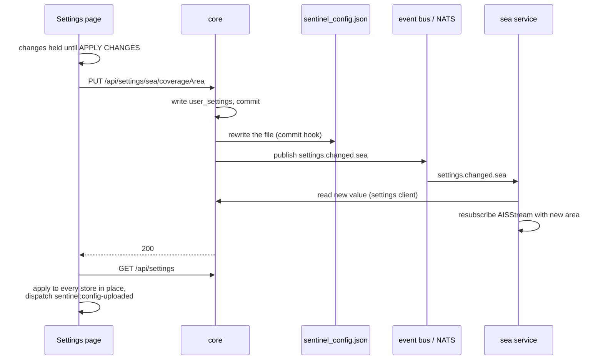

# Data stores

Every service keeps its own data, and only settings are shared. This page lists what is stored where and who owns it, then follows a settings change from the browser to every service that cares.

New to a term on this page? See [Words used on these pages](overview.md#words-used-on-these-pages).

## Who owns what

All databases are SQLite, used through SQLAlchemy 2.0 in async mode. Each service creates its own tables at start-up, in its lifecycle's `prepare` hook; there are no separate migration files.

| Store | Owner | What is in it |
|---|---|---|
| `sentinel.db` | core | `user_settings` (every setting, as namespace / key / JSON value, including the list of radios, `sdr.radios`), alerts, the list of offline map areas |
| Offline map files (`tiles/`, beside `sentinel.db`) | core | One `.pmtiles` file per downloaded area, plus terrain |
| `backend/data/sentinel_config.json` | core | A live copy of every setting (see below) |
| `space.db` | space | Satellite catalogue and TLEs (the satellite frequencies are a core setting) |
| `air.db` | air | ADS-B snapshot cache, tracked aircraft |
| `sea.db` | sea | `sea_vessel_cache` (a snapshot every 30 s, for warm starts) and `sea_vessel_static` (names, callsigns and types) |
| `land.db` | land | APRS stations, `repeater_cache` (the daily repeater directory) |
| `sdr.db` | sdr | Saved frequencies, groups, search ranges, recordings' details |
| Recording files | sdr | `<id>.wav` and `<id>.u8` |
| `radio.db` | radio | Sentry hosts |
| In memory only | each service | The service registry (core), live vessels (sea), radio connections (radio) |

Which file and Docker volume each database lives in, and how tables and starting data are created, is in [Databases](databases.md); the volumes are also in [How Sentinel runs in Docker](docker.md#where-data-is-kept).

## Settings belong to core

A section's settings are stored by core, not by the section. Sections read and write them over HTTP through the **settings client** (`backend/platform/settings_client.py`), never by opening `user_settings` themselves. That keeps one copy of every setting, which the config file and every browser can see.

## A settings change

*Figure: What happens between selecting APPLY CHANGES and every part of Sentinel using the new value.*

**In words:**

1. Controls on the Settings page **stage** their change; nothing is sent until **APPLY CHANGES**.
2. Applying sends each change to core, which writes it to `user_settings`.
3. A hook on that database commit rewrites `sentinel_config.json`.
4. Core publishes `settings.changed.<namespace>` on the bus.
5. Any service that subscribed (here Sea) reads the new value through the settings client and acts on it.
6. The browser reloads all settings and applies them to its stores **in place**, with no page reload, then fires a `sentinel:config-uploaded` event.

Anything in the frontend that reads a setting only once (when it mounts, for example) must also re-read it on `sentinel:config-uploaded`, or it stays stale until the next full page load.

## Editing the config file

The config file is two-way. Core polls it every second (polling, because file-change events don't cross a Docker Desktop bind mount). A saved edit is validated and applied through the same code as an upload in **Settings › App Settings › Application Config**; core then marks the settings as externally edited, and open browsers refresh in place (`useConfigFileSync`). A file that doesn't parse or validate is logged and ignored, and is overwritten by the next settings change.

## Secrets

Secret settings (today only the AISStream key) are kept out of the public settings API, the config file and exports. How they are stored and who may read them is in [Security](security.md#secrets).
