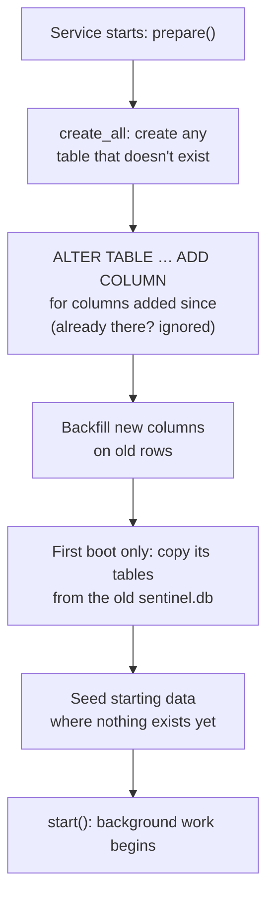
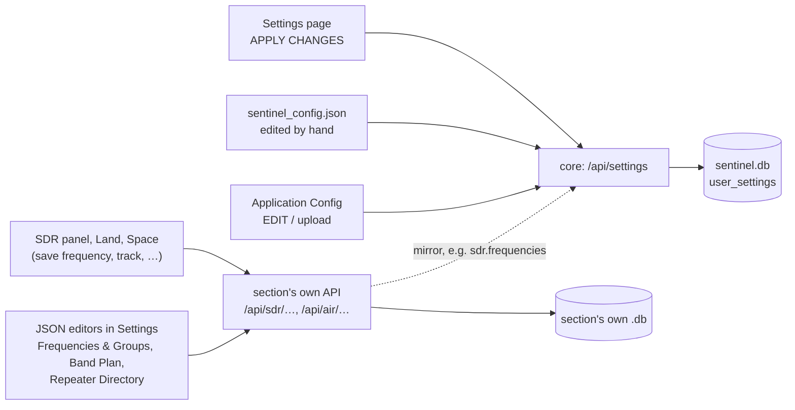

# Databases

This page explains how Sentinel's databases are set up, filled with their starting data, changed when the code changes, edited, and backed up. [Data stores](data-stores.md) has the list of what each one holds.

New to a term on this page? See [Words used on these pages](overview.md#words-used-on-these-pages).

## One SQLite file per service

Every service has its own SQLite database file, on its own Docker volume:

| Service | File (inside its container) | Volume |
|---|---|---|
| app (core) | `/app/data/sentinel.db` | `sentinel_db` |
| space | `/app/data/space.db` | `space_data` |
| land | `/app/data/land.db` | `land_data` |
| air | `/app/data/air.db` | `air_data` |
| sea | `/app/data/sea.db` | `sea_data` |
| sdr | `/app/data/sdr.db` | `sdr_data` |
| radio | `/app/data/radio.db` | `radio_data` |

The file is set by the `DB_PATH` environment variable in `docker-compose.yml`. No service opens another service's file: if Sea needs a setting, it asks core over HTTP.

### How a connection is set up

`backend/database.py` builds one async SQLAlchemy engine per process (`sqlite+aiosqlite:///<DB_PATH>`), and every connection it opens sets three SQLite options:

- `journal_mode=WAL` (write-ahead logging: changes go to a side file, `<name>.db-wal`, and are folded into the database later), so readers aren't blocked while something writes;
- `busy_timeout=5000`, so a writer waits up to 5 seconds for the lock instead of failing with "database is locked";
- `synchronous=NORMAL`, a safe, faster setting for WAL.

Request handlers get a session with `Depends(get_db)`. Background tasks open their own with `AsyncSessionLocal()`. Models are declared on one shared `Base` (`backend/database.py`), but each service creates only its own tables.

## How tables are created and changed

There are no migration files. Each service builds its schema from its ORM models every time it starts, in its lifecycle's `prepare` hook, before anything else runs.

*Figure: What a service does to its database on every start, in order.*



**In words:**

1. **Create.** `Base.metadata.create_all` creates every table of this service that doesn't exist yet. Core uses `create_tables()`; a section uses `create_section_tables(<its tables>)` (`backend/database.py`), called from its own `database.py`, such as `create_sdr_tables()`.
2. **Add new columns.** `create_all` never changes an existing table, so each column added after a table's first release is listed as an `ALTER TABLE … ADD COLUMN` statement (for example `SDR_ADDED_COLUMNS` in `sentinel_sdr/database.py`). Each runs on every start; if the column is already there, SQLite raises an error that is ignored.
3. **Backfill.** Rows created before a column existed are given sensible values, only where still empty, so this is safe to repeat.
4. **Copy legacy data, once.** Sections used to share core's database. On a section's first start, `import_legacy_tables` (`backend/platform/sdk/legacy_import.py`) copies each of its tables that is still empty from the old `sentinel.db`, mounted read-only at `/legacy`. A table that already has rows is never touched, so this does nothing after the first time.
5. **Seed** starting data (next section).

Removed features clean up after themselves the same way: core drops their tables (`_REMOVED_TABLES`) and deletes their settings (`prune_removed_settings`) on start.

### Changing the schema

- **New table:** add the model to the section's `models.py`, and its name to the section's table list (for example `SDR_TABLES`). It is created on the next start.
- **New column:** add it to the model **and** add an `ALTER TABLE … ADD COLUMN` line to the section's added-columns list, with a default. Without the `ALTER`, existing installs never get the column. Add a backfill if old rows need a real value.
- **Renamed or removed column:** SQLite can't do this in place safely. Add a new column and stop using the old one.
- **Test it** against a database made by the previous version, not only a fresh one.

## How data gets in at first

| Data | Source file | Loaded by | When |
|---|---|---|---|
| Every default setting | `backend/default_config.json` | `seed_default_settings()` (core) | Every start: only settings that have no row yet are added, so your values are never overwritten |
| Saved frequencies, groups, search ranges | `backend/data/sdr_frequencies.json` | `seed_sdr_data_from_files()` (sdr) | First start, while the tables are empty |
| SDR band plan | `backend/data/sdr_bandplan.json` | `seed_sdr_bandplan_from_file()` (sdr), into the `sdr.bandPlan` setting | First start |
| Satellite frequencies | `backend/data/satellite_radio.json` | `backfill_satellite_radio_store()` (space), into core's settings | Every start, reconciled |
| UK repeaters | `backend/data/uk_repeaters.json` (built-in copy) | Land | When there is no fresher download |

Some values in `default_config.json` can be overridden from `.env` when they are first seeded, such as the ADS-B feed (`ADSB_UPSTREAM_BASE`), the CelesTrak address and the APRS channel.

Everything else arrives while Sentinel runs: aircraft, ships, TLEs and repeaters from their feeds or your radios, and your own changes.

## How data is edited

*Figure: The ways data is changed, and which store each one writes.*



**In words:**

1. **Settings** go to core's `/api/settings`, whether from the Settings page, a hand edit of `sentinel_config.json`, or **Application Config**. Core writes them to `user_settings` in `sentinel.db`. The whole journey is in [Data stores: A settings change](data-stores.md#a-settings-change).
2. **A section's own data** (saved frequencies, tracked aircraft, recordings) goes through that section's API to its own database.
3. **The JSON editors** in Settings (**Frequencies & Groups (JSON)**, **Band Plan (JSON)**, **Satellite Frequencies (JSON)**, **Repeater Directory (JSON)**) replace a whole data set through the owning section's API.
4. Some section data is **mirrored** into a setting so the config file shows it: after every edit the SDR section writes its frequencies, groups and search ranges to `sdr.frequencies`, `sdr.groups` and `sdr.searchRanges`. The tables remain the source of truth.

### Looking inside a database

To read a database yourself, copy it out of its container and open it with any SQLite tool (the `sqlite3` command, or DB Browser for SQLite):

```bash
docker compose cp sea:/app/data/sea.db ./sea.db
sqlite3 ./sea.db ".tables"
```

Don't edit a live database by hand: the service caches some data in memory and would overwrite or ignore your change. Change data through the app, the config file, or the JSON editors. If you must edit a file directly, stop that service first (`docker compose stop sea`), and start it again afterwards.

## Backing up and restoring

All data is on Docker volumes. To back one up, stop Sentinel first so every database is closed and its WAL file folded back in, then archive the volume:

```bash
docker compose down
docker run --rm -v sentinel_sdr_data:/data -v "$PWD":/backup alpine \
  tar czf /backup/sdr_data.tgz -C /data .
```

Repeat for each volume you want (`docker volume ls` lists them; Compose prefixes each with the project name, usually `sentinel_`).

To restore, with Sentinel stopped, extract the archive into the volume. The volume should be empty, or freshly created:

```bash
docker compose down
docker run --rm -v sentinel_sdr_data:/data -v "$PWD":/backup alpine \
  tar xzf /backup/sdr_data.tgz -C /data
docker compose up -d
```

For settings alone, **Settings › App Settings › Export All Configuration** is simpler.

## In tests

Backend tests never touch a real database file. The root `conftest.py` swaps in an in-memory SQLite engine (one connection shared through `StaticPool`), overrides `get_db`, imports every section's models so all tables exist, and skips lifespans, so the seeders don't run unless a test calls them.
