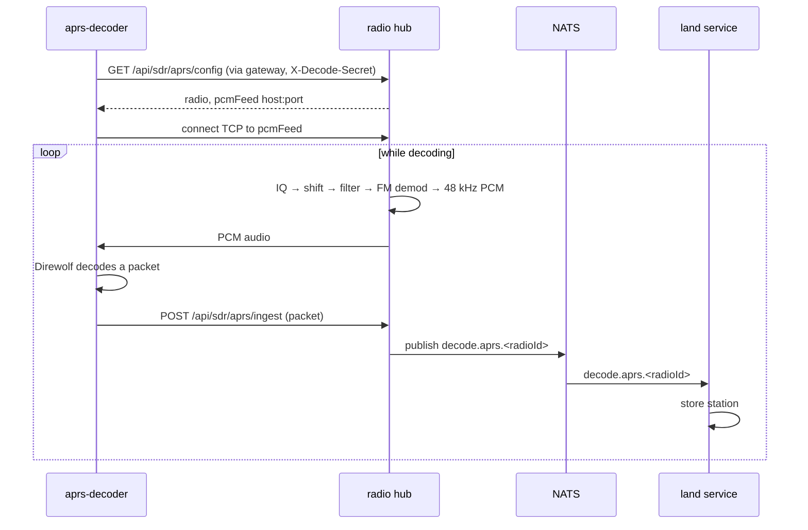

# Decoding

This page explains how decoders turn radio signals into data inside Sentinel. To use decoders, see [Decode digital signals](../use/sdr/decode.md); to install them, see [Install and run decoders](../decoders.md).

New to a term on this page? See the [Glossary](../reference/glossary.md).

## The idea

A dongle has one connection, and the radio hub already reads it. So decoders never connect to the dongle themselves. Instead the hub demodulates the signal and serves the decoder **audio**, the same way a scanner's speaker output would feed a decoder program. The decoder sends back what it decoded.

Three decoders work this way, through a shared **PCM bridge** in the hub (`sentinel_radio/services/sdr_decode.py`):

| Decoder | Program | Hub port | Audio | Sends back |
|---|---|---|---|---|
| Digital voice | dsd-fme | 7355 | 48 kHz mono | Call details, and decoded voice (UDP) |
| APRS | Direwolf | 7357 | 48 kHz mono | APRS packets |
| AIS | Direwolf 1.8 | 7358 | 48 kHz **stereo**: channel A left, B right | AIS messages |

The fourth, **ADS-B**, is different: 1090 MHz needs the raw samples, not audio, so `readsb` reads IQ straight from a Sentry dongle's `rtl_tcp` and serves aircraft as JSON, which Air polls (see [Section data flows](data-flows.md#air)).

## A decoder's life cycle

*Figure: An APRS decoder from start-up to a station appearing on the Land map.*

**In words:**

1. The decoder container starts and asks the hub, through the gateway, what to decode. It authenticates with its own credential in the `X-Decode-Secret` header.
2. The hub replies with which radio is assigned and the address of the PCM feed (`pcmFeed`). The decoder never needs to know which container runs the hub.
3. The decoder connects to that feed. The hub subscribes to the radio's IQ broadcaster (the same one the waterfall uses), demodulates the channel and streams 48 kHz audio.
4. Each time the decoder decodes something, it posts it to the hub's ingest route (`/api/sdr/aprs/ingest`; voice and AIS have their own).
5. The hub publishes it on the bus as `decode.<kind>.<radioId>`.
6. The section that cares (Land for APRS, Sea for AIS) receives it and stores it.

If the hub isn't up yet, the decoder retries quietly.

## Owning a channel

The voice decoder decodes whatever the radio panel is tuned to. APRS and AIS instead **own an absolute channel** (`ChannelOwningDecodeBridge`): they tune the dongle themselves when they start, and each chunk of audio is demodulated at the offset worked out from the frequency that chunk was actually captured on. So someone moving the view within the band does no harm. If something tunes the dongle away from the channel, the bridge pulls it back after about 15 seconds.

AIS owns **two** channels 50 kHz apart (161.975 and 162.025 MHz). The hub parks the dongle between them, demodulates both from the same samples and interleaves them as stereo, so one two-channel Direwolf hears both. Decoding only one would lose about half the traffic.

## Adding a new decoder kind

New decoders need no hub code. A decoder container registers a **decoder manifest** (`POST /api/sdr/decoders/register`, `sentinel_radio/services/decoder_manifest.py`) naming its kind, its channel or channels, and whether it owns them. The hub then runs a generic bridge for it (`manifest_decode.py`), starts and stops it through `/api/sdr/decoders/{kind}/…` or `hub.decode.<kind>.…` on the bus, and publishes its events as `decode.<kind>.<radioId>`. Registration is held in memory, so when a registered decoder's `/config` poll gets a 404 (the hub restarted), it registers again.

You still need to:

1. give the kind a row in `backend/platform/service_access.py` and a compose mount of its `credentials/<kind>-decoder/` folder, so it can authenticate ([Security](security.md));
2. add a subscriber for `decode.<kind>.*` where the data should go, and that subject to `nats_permissions.py` ([Event bus](event-bus.md)).

The **stub decoder** (`decoder/stub/`, compose profile `decoder-stub`) follows this contract without decoding anything. `tests/backend/test_decoder_stub_contract.py` runs it against the real app in CI, so it is a working template.
