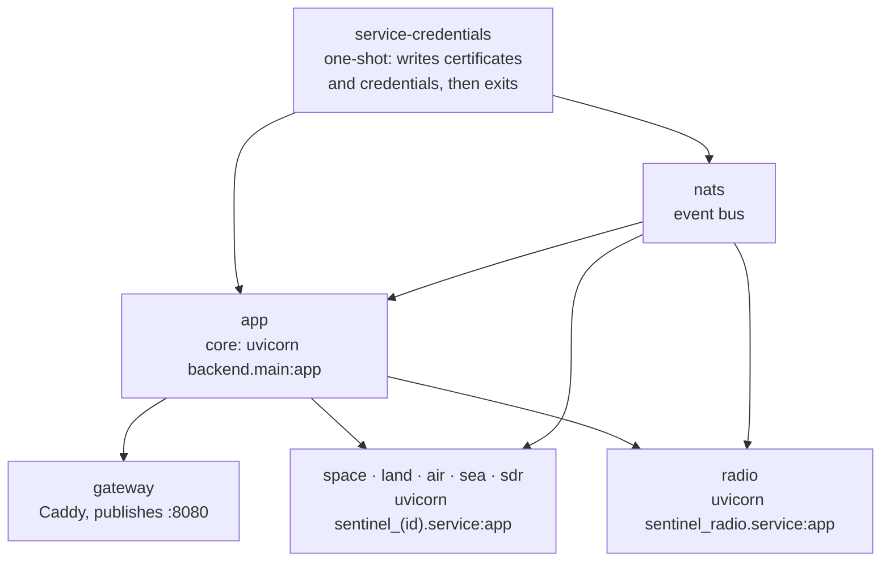
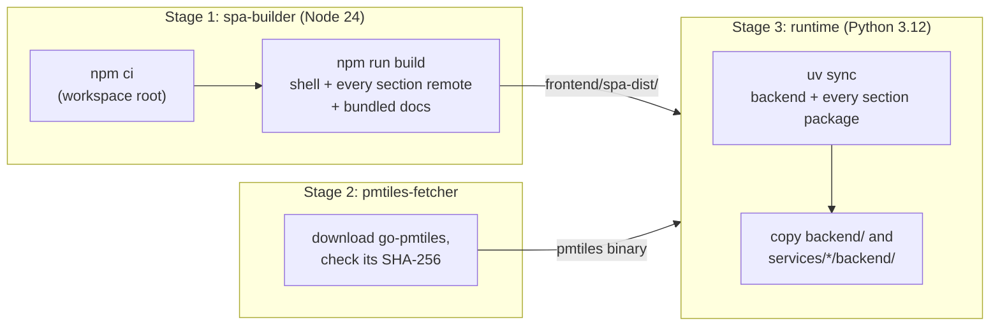
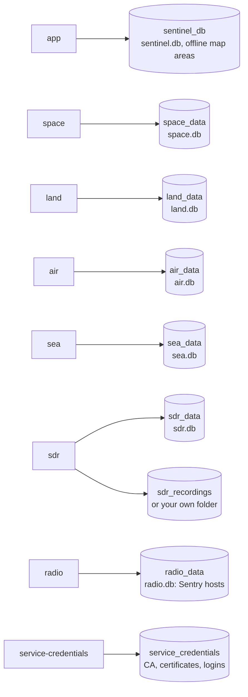
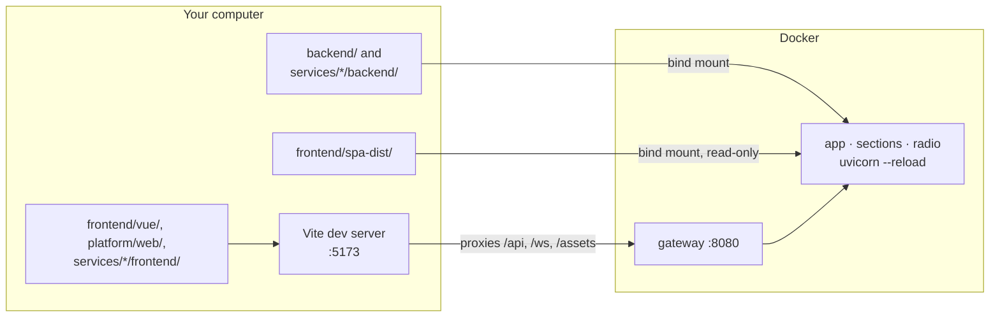

# How Sentinel runs in Docker

Sentinel runs entirely in Docker. This page explains, from scratch, what Docker Compose starts, how the images are built, where data is kept, and how your code edits reach the running app. If you have used Docker before, skim the first section.

New to a term on this page? See [Words used on these pages](overview.md#words-used-on-these-pages).

## Docker in two minutes

- An **image** is a packaged program with everything it needs: Python, libraries, Sentinel's code. It is built once from a recipe called a **Dockerfile**.
- A **container** is a running copy of an image. Several containers can run from one image, each doing a different job.
- **Docker Compose** starts a set of containers together from one file, `docker-compose.yml`. Each entry under `services:` there becomes one container.
- A **volume** is storage Docker keeps for a container, which survives when the container is removed or rebuilt. A **bind mount** instead shows a folder from your computer inside a container, so edits on your computer appear inside it straight away.
- A **network** lets containers reach each other by service name: the Sea container reaches core at `http://app:8000`.
- A **profile** marks a service as optional: it only starts when you ask for that profile.
- A **one-shot** container does one job and exits.
- A container is **healthy** when its health check (here, a request to `/health`) passes.
- `ports:` in the compose file publishes a container's port on your computer; `expose:` only opens it to other containers on the same network.

## What `docker compose up` starts

*Figure: The containers a plain `docker compose up` starts, what each runs, and the order they wait for each other.*

**In words:**

1. `service-credentials` runs first and exits. It creates a certificate authority for this installation, TLS certificates, and a separate login for every service and decoder, on the `service_credentials` volume.
2. `nats`, the event bus, starts with those certificates.
3. `app` (core) starts once both are ready.
4. The `gateway` starts and publishes port 8080, the only port a browser uses.
5. Every section (`space`, `land`, `air`, `sea`, `sdr`) and the radio hub (`radio`) start once core reports healthy. Each one still waits for core to answer before it does any work (see [Services and start-up](services.md)).

All of them are on one Docker network called `sentinel`.

### Ports

| Port on your computer | Service | Who uses it |
|---|---|---|
| `8080` | gateway | Your browser |
| `127.0.0.1:8443` | gateway (TLS service entrypoint) | Services on a second machine, such as a radio host |
| `127.0.0.1:4222` | nats | Services on a second machine |
| `127.0.0.1:8090` | adsb-decoder (when running) | Reading the ADS-B decoder directly |

Core and the sections listen on port 8000 **inside** the network only (`expose`, not `ports`), so a browser can't reach them except through the gateway. Caddy's admin API (`:2019`) is also network-only.

### Optional containers (profiles)

| Profile | Starts | Built from |
|---|---|---|
| `voice-decoder` | `voice-decoder` (dsd-fme) | `decoder/` |
| `aprs` | `aprs-decoder` (Direwolf) | `decoder/aprs/` |
| `ais` | `ais-decoder` (Direwolf 1.8, built from source) | `decoder/ais/` |
| `adsb` | `adsb-decoder` (readsb) | `decoder/adsb/` |
| `all` | all four decoders above | |
| `decoder-stub` | `stub-decoder`, a test double that decodes nothing | `decoder/stub/` |

## One image for every Python service

`app`, every section, the radio hub and `service-credentials` all run the **same image**, built from `backend/Dockerfile`. Only the start command differs: `uvicorn backend.main:app` for core, `uvicorn sentinel_sea.service:app` for Sea, and so on. The gateway and NATS use stock images (`caddy`, `nats`); each decoder has its own small Dockerfile.

*Figure: The three stages of `backend/Dockerfile` and what each passes to the next.*

**In words:**

1. **Stage 1** installs the JavaScript workspace and builds the browser app: the shell, each section's UI remote, and these docs. It runs on your own machine's architecture even when building for another, because the output is plain JavaScript and CSS.
2. **Stage 2** downloads the `pmtiles` tool used for offline map downloads, and checks it against a pinned checksum.
3. **Stage 3** is what runs. It installs the Python dependencies with `uv` (dependency files first, so Docker can reuse that layer when only code changes), copies in the backend and every section package, and takes the built app from stage 1 and `pmtiles` from stage 2. It runs as an unprivileged user, with a health check on `/health`.

## Where data is kept

*Figure: Each service and the volumes it writes to. Every service owns its own database; only core's is read by the others, once.*

**In words:**

| Volume | Written by | Holds |
|---|---|---|
| `sentinel_db` | app | Core's `sentinel.db` (settings, alerts, offline map areas list) and downloaded map files |
| `space_data`, `land_data`, `air_data`, `sea_data` | that section | Its own `<id>.db` |
| `sdr_data` | sdr | `sdr.db` and older recordings |
| `sdr_recordings` | sdr | Recordings, unless `SENTINEL_RECORDINGS_DIRECTORY` points at a folder on your computer |
| `radio_data` | radio | `radio.db`: the Sentry hosts |
| `service_credentials` | service-credentials | Each service's credentials, in its own `credentials/<name>/` folder; each container mounts only its own |

`docker compose down` keeps volumes. `docker compose down -v` deletes them, and with them every setting, recording and download.

Each section also mounts `sentinel_db` read-only at `/legacy`: on its first start it copies its own tables out of the old single database, from before sections had databases of their own.

## How your edits reach the running app

The compose file is set up for development as well as use, so you don't rebuild images while you work.

*Figure: The development loop. Backend code is bind-mounted and reloads itself; frontend code is served by Vite with hot reload.*

**In words:**

1. Backend folders are bind-mounted into the containers, and every Python service runs `uvicorn --reload`. Save a `.py` file and that service restarts itself in a second or two.
2. For frontend work, run `cd frontend/vue && npm run dev` and open **http://localhost:5173**. Vite serves the Vue code with hot reload and passes API and WebSocket calls through to the gateway on :8080.
3. What :8080 serves is the **built** app in `frontend/spa-dist/`, bind-mounted read-only. `npm run build` in `frontend/vue` regenerates it; reload the browser to see it. That folder is committed, because it is what a deployment serves.

You need `docker compose up --build` only when dependencies change (`pyproject.toml`, `package.json`) or for the docs and other files copied into the image.

## Everyday commands

The commands you'll use most (start, rebuild, check, follow logs, restart one service) are in [Check logs, health and backups](../operations.md#everyday-commands).
