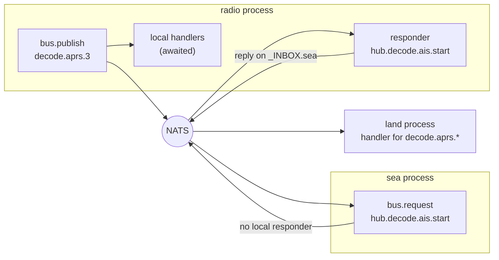

# Event bus

Sections never import or call each other. When one needs to tell another something, or ask it to do something, it goes through the **event bus**: `backend/platform/bus.py`, carried between processes by [NATS](https://nats.io). This page explains how it works and how to add an event.

New to a term on this page? See the [Glossary](../reference/glossary.md).

## Publish, subscribe, request

Events have dotted names called **subjects**, such as `settings.changed.sea` or `decode.ais.3`. A handler subscribes to a pattern: `*` matches one part, `>` matches the rest.

- `bus.publish(subject, payload)`: tell anyone interested. Every handler in **this** process runs, and is awaited, before `publish` returns. Then the event goes to NATS for other processes.
- `bus.subscribe(pattern, handler)`: run `handler` for every matching event, from this process or another.
- `bus.request(subject, payload)`: ask for an answer. A responder in this process answers directly; otherwise the request goes over NATS and the reply comes back on the requester's own inbox.

*Figure: One publish reaches local handlers first, then other processes through NATS. A request with no local responder crosses NATS to the service that answers it.*

**In words:**

1. The radio hub publishes `decode.aprs.3` (an APRS packet heard on radio 3). Its own handlers run first, then the event goes to NATS.
2. NATS delivers it to the Land service, which subscribed to `decode.aprs.*` and stores the station.
3. Sea asks the hub to start its AIS decoder with a request on `hub.decode.ais.start`. Sea has no local responder, so the request crosses NATS.
4. The hub's responder handles it and replies on Sea's private inbox, `_INBOX.sea`.

## Rules that keep it working

- **Low-rate control events only.** Settings changes, decoded packets, start and stop requests. Never put spectrum, IQ or audio data on the bus; those have their own paths ([Radios and the SDR pipeline](sdr-pipeline.md)).
- **Payloads are JSON.** A handler may receive a `db` session: it is stripped before the event leaves the process, and the receiving process injects its own, so handlers keep the same signature either way.
- **Errors come back.** A remote responder's exception arrives as `RemoteHandlerError`.
- **No echo.** Each process connects with NATS's `no_echo`, because its local handlers have already run. Removing it would handle every event twice.
- **A missing broker never blocks.** Services start without NATS and connect when it appears; publishing never waits for it.

## Who may use which subject

Under Docker the broker requires TLS, and each process signs in as its own NATS user: `core` for the app, otherwise the service's id. The broker only allows each user the subjects listed in `backend/platform/nats_permissions.py`:

| User | Publishes | Subscribes to | Requests |
|---|---|---|---|
| `core` | everything | everything | (answers requests) |
| `radio` | `decode.>` | `hub.>`, `settings.changed.land`, `sdr.decode.radio-reassigned` | (answers requests) |
| `air` | `notifications.raise`, `air.squawk.changed` | `air.squawk.changed` | `hub.sentry.>` |
| `sea` | — | `decode.ais.*`, `settings.changed.sea`, `settings.changed.app` | `hub.decode.ais.>` |
| `land` | — | `decode.aprs.*` | — |
| `sdr` | — | — | `hub.iq-capture.>` |
| `space` | — | — | — |

## Common subjects

| Subject | Published by | Means |
|---|---|---|
| `settings.changed.<namespace>` | core (and the settings client) | A setting in that namespace changed |
| `registry.changed` | core | A service registered, or became available or unavailable |
| `notifications.raise` | a section | Store this alert and push it to browsers |
| `decode.<kind>.<radioId>` | radio hub | A decoder heard something (`aprs`, `ais`, or a registered kind) |
| `hub.decode.<kind>.{start,stop,status}` | a section (request) | Start, stop or query a decoder |
| `hub.sentry.…` | air (request) | Reserve a Sentry dongle, or ask where a receiver is |
| `hub.iq-capture.{locate,list,discard}` | sdr (request) | Find, list or drop a raw IQ capture |
| `air.squawk.changed` | air | An aircraft's squawk code changed |

## Adding a subject

1. Publish or subscribe to it in code.
2. Add it to the right user's row in `backend/platform/nats_permissions.py`. Without this the broker refuses it: the service logs a NATS **permissions violation** and the event never leaves its process.
3. Run `docker compose up -d` (rewrites `nats.conf`), then `docker compose restart nats` (the broker reads its config only at start).
