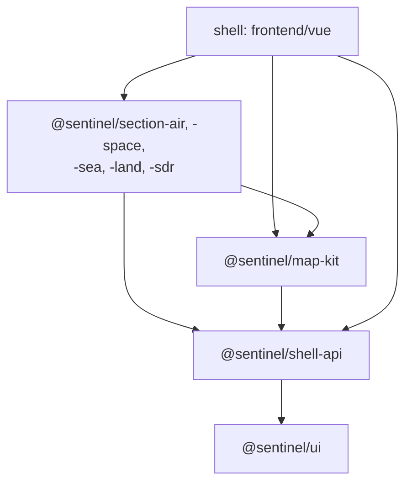
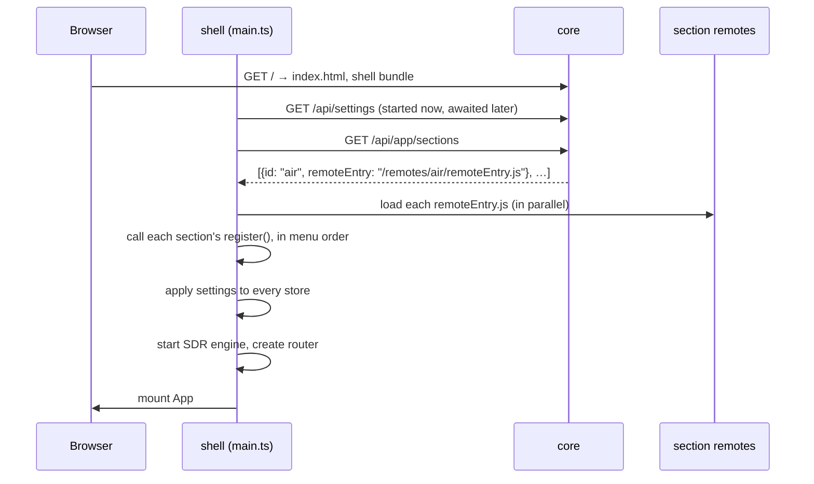

# Frontend

The frontend is a Vue 3 single-page app written in TypeScript, built with Vite, with Pinia for state and vue-router for pages. Maps are MapLibre GL. This page explains how it is split into packages, how it boots, how sections plug into it, and where state lives.

New to a term on this page? See the [Glossary](../reference/glossary.md).

## Packages

The frontend is an **npm workspace**: one `npm ci` at the repository root installs everything into one `node_modules`, and the packages import each other from source (no build step between them).

| Package | Folder | What it holds |
|---|---|---|
| The **shell** (the app) | `frontend/vue/` | `App.vue`, the router, the section menu, sidebar, footer, the Settings and Docs pages, and the code that loads sections |
| `@sentinel/ui` | `platform/web/ui/` | Generic building blocks: `Base*` components (buttons, fields, accordions, data grids), icon rail, overlays, DOM composables. Depends only on Vue. |
| `@sentinel/shell-api` | `platform/web/shell-api/` | The contract between shell and sections: registries, capabilities, the shared Pinia stores (`app`, `settings`, `theme`, `basemap`, `notifications`, `offlineMaps`, `sentrySites`, `tracking`), the settings kit sections build their settings from |
| `@sentinel/map-kit` | `platform/web/map-kit/` | `MapLibreMap.vue`, `SentinelControlBase`, map controls more than one section uses (names, roads, terrain, range rings, Sentry sites, zoom), map composables |
| `@sentinel/web-config` | `platform/web/config/` | Shared TypeScript, ESLint, Prettier and Vitest configuration |
| `@sentinel/section-<id>` | `services/sections/<id>/frontend/` | One section's views, map controls, stores, settings and its `src/section.ts` |

*Figure: Which packages may import which. Arrows point from the importer to what it imports.*



**In words:**

- `@sentinel/ui` depends on nothing but Vue.
- `@sentinel/shell-api` builds on `ui`; `@sentinel/map-kit` builds on both.
- Each section imports only `ui`, `shell-api`, `map-kit` and itself: never another section, never the shell. The ESLint rule `noSectionImports` fails the build if one tries.
- Only the shell's composition root, `frontend/vue/src/shell/sections.ts`, imports the section packages (and only in development and tests; see below).
- Packages use relative imports internally, never the shell's `@/` alias.

## How the shell boots

*Figure: What happens between opening Sentinel and the first page appearing.*



**In words:**

1. The browser loads `index.html` and the shell's bundle from core.
2. The shell starts fetching all settings, and at the same time asks core which sections this deployment has (`/api/app/sections`).
3. It loads each section's **remote** (a separately built bundle, served by that section's own service at `/remotes/<id>/remoteEntry.js`) with Module Federation, in parallel. Only same-origin `/remotes/<id>/` entries are trusted.
4. It calls each section's `register()` in order. Registration adds the section's route, menu entry, settings, sidebar buttons and so on to the shell's registries.
5. It applies the settings to every store, including each section's, through the hydrators the sections registered.
6. It starts the SDR engine (the always-present radio pane), creates the router, waits for the first navigation, and mounts the app.

If a section's remote fails to load, or its `register()` throws, the shell registers a stand-in so its menu entry still shows and its page says it is unavailable; the rest of the app is unaffected.

**In development and tests** there is no federation: `src/shell/sections.ts` imports the section packages directly, so Vite hot-reloads them like the rest of the app. The production build swaps in `sections.federated.ts` (an alias in `vite.config.ts`). The shared packages are provided by the shell to every remote, so sections never carry their own copies of Vue, Pinia or the `@sentinel/*` packages.

## How a section plugs in

A section's `src/section.ts` exports `register(shell)`. Everything it adds goes through registries and capabilities in `@sentinel/shell-api/shell/`:

| Registry or capability | What a section adds |
|---|---|
| `sectionRegistry` | Its id, menu label and order, whether it is on by default, its route and view |
| `settingsRegistry` | Its Settings menu entry and each setting row (label, description, search terms, control) |
| `settingsHydration` | A function that applies its settings from `/api/settings` to its stores |
| `sidebarRegistry` | Its **FILTER** sub-buttons, and extra rail buttons such as **PASSES** |
| `footerRegistry` | Items shown in the footer on every page, such as SDR's tuned frequency |
| `notificationRegistry` | How to find an alert's subject, and the alert subscriptions listed in Settings |
| `backgroundServices` | Work that runs whatever page is open, such as Space's pass scheduler |
| `capabilities` (`radio`, `radioSites`) | Services one section offers others. SDR provides `radio`, so Air, Sea, Land and Space can tune it without importing SDR. |

Cross-section needs always go through a capability. That is how selecting an airport frequency in Air tunes the radio in SDR.

## Pages and routes

| Route | Shows |
|---|---|
| `/<id>/` | A section's view, such as `/air/` |
| `/settings/<section>` | The Settings page (`router/settingsRoute.ts`). It is a real page: the section view unmounts (the SDR engine, outside `<RouterView>`, keeps playing) and closing returns to where you were. |
| `/doc/<path>` | These docs (`router/docsRoute.ts`, code in `src/docs/`). The markdown in `docs/` is bundled at build time with `import.meta.glob`, rendered with markdown-it and DOMPurify, with Mermaid loaded only for pages that have a diagram. The menu is `docs/nav.json`. |

A navigation guard sends a disabled section's route to the first enabled section instead.

## State

- **Shared stores** (`@sentinel/shell-api/stores/*`): `app` (enabled sections, connectivity mode), `settings` (the raw settings and whether Settings is open), `theme`, `basemap`, `notifications`, `offlineMaps`, `sentrySites`, `tracking`.
- **Section stores** live in the section package (`src/stores/`).
- **Persisted choices**: `_persist` backs selected store state with `localStorage`, reconciled against the backend at load. The backend is authoritative for settings.
- **State that must survive a remount** (which pane or tab is open) belongs in a store, not in a component's local refs: sidebar panes are teleported, and remounts happen.
- **Settings refresh in place.** After **APPLY CHANGES** or a config-file edit, `refreshSettingsFromBackend` re-applies all settings and fires `sentinel:config-uploaded`. Anything that reads a setting once must listen for that event. See [Data stores](data-stores.md#a-settings-change).

## Maps

Each map is `MapLibreMap.vue` from `@sentinel/map-kit`. Every map feature (aircraft, vessels, range rings, terrain…) is a MapLibre `IControl` class extending `SentinelControlBase`, in `services/sections/<id>/frontend/src/controls/<feature>/`, or in `map-kit/controls/` when several maps use it. Add a feature as a control, not as code inside a view. Map tiles come from core's offline tile endpoints when off grid (see [Caching](caching.md#offline-map-tiles)).

Canvas maps are invisible to screen readers, so every map has an accessible equivalent: the **FILTER** list.

## Building and testing

Every package has its own lint, type check and 100% coverage gate, and the shell is built into the committed `frontend/spa-dist/`. The commands, and the two browser test suites, are in [Run tests and quality checks](../development/testing.md); the dev server is in [Set up for development](../development/setup.md#the-dev-loop).

## Screenshots in these docs

The images in `docs/images/` are taken by a script, never by hand, so they can be retaken whenever the UI changes. `frontend/vue/e2e/docs-screenshots.spec.ts` drives the built app against the e2e suite's mocked API with fixed, fictional data (it is skipped in normal e2e runs). This rebuilds the bundle and retakes every screenshot:

```bash
cd frontend/vue && npm run build && npm run docs:screenshots
```

Maps get their background from the online basemap, so the script needs an internet connection. Locally, add `PLAYWRIGHT_CHANNEL=chrome` if Playwright's own browser isn't installed. Commit the new images with the change that altered the UI.
