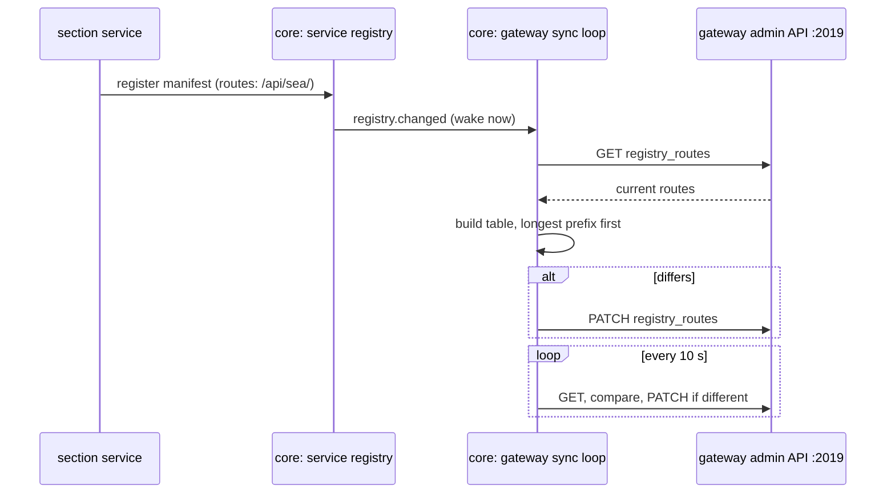

# Gateway and routing

The gateway is [Caddy](https://caddyserver.com), and it is the only address a browser uses. This page explains how it knows where to send each request, and why nobody edits its configuration when a section is added or moved.

New to a term on this page? See the [Glossary](../reference/glossary.md).

## Two kinds of route

**Static routes** live in `gateway/caddy.json` and never change at run time:

1. `/internal/…` always gets a JSON 404. Internal routes are for services only; the gateway never exposes them.
2. An empty slot, `registry_routes`, that core fills in.
3. Everything else goes to core (`app:8000`).
4. If Caddy can't reach a service it proxies to, it answers `503 {"detail": "Service unavailable"}`.

**Registry routes** are pushed into that empty slot by core, built from what services have registered (`backend/core/gateway_routes.py`).

## Route sync

*Figure: How a registration becomes a gateway route, and how the gateway heals itself after a restart.*

**In words:**

1. A service registers with core, listing the path prefixes it serves.
2. The registry announces `registry.changed`, which wakes core's gateway sync loop at once.
3. The loop reads the routes Caddy currently holds through its admin API (port 2019, reachable only on the compose network).
4. It builds the table the registry says there should be, and replaces Caddy's copy if they differ.
5. Every 10 seconds (`GATEWAY_SYNC_INTERVAL_S`) it checks again. A restarted gateway comes back with only its static routes, and the next check fills them in.

Core owns the table; Caddy only holds a copy. With `GATEWAY_ADMIN_URL` empty (the test app) there is no gateway and the loop doesn't run.

## Longest prefix wins

Some prefixes sit inside others, so routes are ordered longest first and the first match wins:

| Path | Goes to | Because |
|---|---|---|
| `/api/air/messages…` | core | Alerts are core's, kept under the old Air path; core reserves it |
| `/api/air/…` | air | |
| `/api/sdr/adsb/…` | air | Off-grid ADS-B config belongs to Air |
| `/api/sdr/radios`, `/api/sdr/connect`, `/api/sdr/decode/…`, `/api/sdr/aprs/…`, `/api/sdr/ais/…`, `/api/sdr/sentry-hosts`, `/api/sdr/decoders` … | radio | Anything touching a physical radio is the hub's |
| `/ws/sdr/…` | radio | The four SDR WebSockets |
| `/api/sdr/…` | sdr | Frequencies, groups, search ranges, band plan, recordings |
| `/api/space/…`, `/api/sea/…`, `/api/land/…` | that section | |
| `/remotes/<id>/…` | that section | Its UI remote |
| anything else | core | The default route |

A service that core has marked unavailable (three failed health probes) gets a static route answering `503 {"detail": "<id> is unavailable"}` instead of a proxy, so requests fail fast. A path whose service never registered matches no registry route and goes to core, which serves the shell's `index.html`. A manifest may not claim a prefix another live service holds, or one core reserves.

## Things to know when working on it

- **Streaming works through it.** Caddy flushes server-sent events and proxies WebSockets with no extra settings. Don't add buffering.
- **`/internal/` on port 8000 is not protected by the gateway.** If you run a service directly, a GET to `/internal/…` falls through to the shell's `index.html`. The internal routes themselves check credentials (see [Security](security.md)).
- **Second listener, :8443.** The gateway also serves a TLS **service entrypoint** for services on another machine, such as a radio host. It routes every path, `/internal/` included, to core. It is published on `127.0.0.1` unless `SENTINEL_SERVICE_ENTRYPOINT_ADDRESS` opens it.
