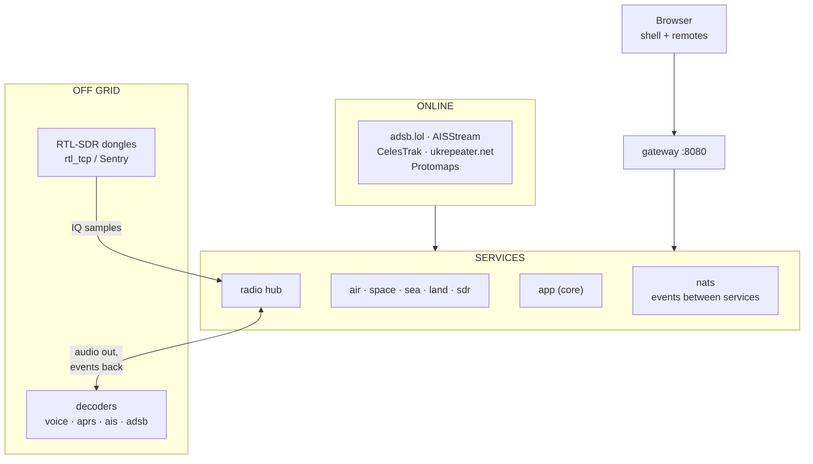

# How it works

A small **core** plus **one service per section**, all from one backend image, with a Vue app (the **shell**) in the browser. Decisions behind it: [ADR 0006](../adr/0006-section-containers.md).

## The parts

- **Core** (`app`, `backend/`): settings, alerts, offline maps, the service registry; serves the shell.
- **Sections** (`air`, `space`, `sea`, `land`, `sdr`): each its own FastAPI service, SQLite database and UI remote.
- **Radio hub** (`radio`): everything that touches a physical radio.
- **Gateway** (Caddy): the only address a browser uses.
- **NATS**: low-rate events between services.
- **Decoders**: optional containers that turn radio audio into data.

*Figure: The browser reaches the services only through the gateway. Online feeds flow into the services; off grid, your dongles feed the radio hub, which trades audio and decoded events with the decoders.*

- The browser reaches only the gateway, over HTTP, SSE and WebSockets.
- Services register with core and read settings over HTTP; events go over NATS.
- Online, sections and core fetch internet feeds. Off grid, data comes from your dongles through the radio hub and decoders.

## Start-up

1. `service-credentials` runs once: certificates and a login per service.
2. `nats`, then `app`, then the gateway and every section and the hub.
3. Each section waits for core (`waiting for core to answer`), connects to NATS, runs `prepare` (tables, first-boot import) and `start` (background work).
4. It registers its **manifest** (id, address, path prefixes) with core.
5. Core pushes the routes into Caddy, and health-probes the service every 10 seconds.

Three failed probes mark it unavailable: its route answers 503 and the shell greys it out. The registry is in memory; services re-register, so a restarted core relearns them in seconds.

## Routing

Core keeps the gateway's routes in step through Caddy's admin API (:2019, on the internal `gateway_admin` network that only core and the gateway join): at once on a registration, and every 10 seconds, so a restarted gateway heals itself. Longest prefix wins:

| Path | Goes to |
|---|---|
| `/api/air/messages…` | core (alerts) |
| `/api/air/…`, `/api/sdr/adsb/…` | air |
| `/api/sdr/radios`, `/connect`, `/decode/…`, `/aprs/…`, `/ais/…`, `/sentry-hosts`, `/decoders`, `/ws/sdr/…` | radio |
| `/api/sdr/…` | sdr |
| `/api/<id>/…`, `/remotes/<id>/…` | that section |
| anything else | core |

- `/internal/…` always gets a 404 from the gateway.
- Caddy streams SSE and WebSockets as is: don't add buffering.
- :8443 is a TLS entrypoint straight to core, for a [radio host](../radio-host.md).

## In Docker

- One image (`backend/Dockerfile`) for every Python service; only the `uvicorn` target differs.
- Its stages: build the SPA and docs (Node), fetch `pmtiles` (checksummed), then the Python runtime as an unprivileged user.
- Backend code is bind-mounted with `uvicorn --reload`; the built `frontend/spa-dist/` is mounted read-only.
- Every service has its own volume ([Storage](storage.md)).

## More

- [Data flows](data-flows.md): each section, online and off grid
- [Radios and decoding](radios.md)
- [Storage and caching](storage.md)
- [Event bus and security](bus-and-security.md)
- [Code map](../development/code-map.md)
