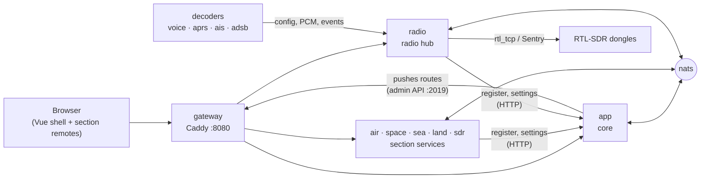
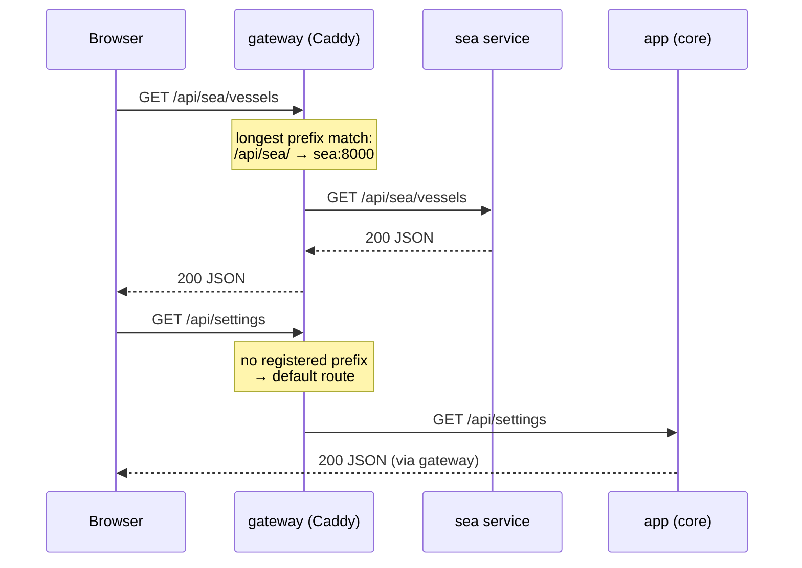

# System overview

This page is the map of Sentinel for a developer: which processes run, how they talk to each other, and how one browser request reaches the code that answers it. The other pages in **How it works** zoom in on each part.

## Words used on these pages

| Word | Means |
|---|---|
| **Core** | The `app` service: the part of Sentinel every section depends on (settings, alerts, offline maps, the list of running services). |
| **Section** | One of Air, Space, Sea, Land and SDR: a backend service plus its piece of the UI. |
| **Radio hub** | The `radio` service, the only one that talks to radios. |
| **Shell** | The Vue app that loads in the browser and hosts every section's UI. |
| **Remote** | A section's UI, built as its own bundle and loaded by the shell when the page opens. |
| **Module Federation** | The build feature that lets the shell load remotes at run time. |
| **Caddy** | A web server; here it forwards each request to the right container. It is the **gateway**. |
| **NATS** | A small message broker: services publish short messages to it, and others subscribe. It carries the **event bus**. |
| **FastAPI** | The Python web framework every backend service is written in. |
| **Uvicorn** | The program that runs a FastAPI service. |
| **SQLite** | A database that is a single file, with no database server to run. |
| **SQLAlchemy** | The Python library Sentinel uses to read and write SQLite; its **ORM models** are Python classes that describe tables. |
| **Vite** | The tool that builds the frontend and serves it, with **hot reload** (changes appear without a page reload), while you develop. |
| **Pinia** | Vue's state library; a **store** holds state that several components share. |
| **SSE** | Server-sent events: a one-way stream of updates from server to browser over ordinary HTTP. |
| **Manifest** | What a service tells core about itself when it registers: its id, address and the paths it serves. |
| **Hook** | A function a module hands over to be called at a set moment, such as start-up. |
| **SIGTERM** | The signal Docker sends a process to ask it to stop. |

## The shape of it

Sentinel is a small **core** plus **one service per section**, all built from one backend image, with a Vue single-page app (the **shell**) in the browser.

- **Core** (`app` service, `backend/`) holds what every section shares: settings, alerts, offline maps, the service registry, and serving the shell.
- **Each section** (`air`, `space`, `sea`, `land`, `sdr`) is its own FastAPI service, with its own SQLite database and its own piece of UI (a Module Federation **remote**).
- **The radio hub** (`radio`) owns everything that touches a physical radio.
- **The gateway** (Caddy) is the only address a browser uses. Core tells it at run time which path goes to which service.
- **NATS** carries low-rate events between the services.
- **Decoders** are optional containers that turn a radio's audio into data.

*Figure: The containers of a full deployment and how they connect. The browser only talks to the gateway; services talk to each other over HTTP and NATS.*

**In words:**

| Part | Connects to | Over |
|---|---|---|
| Browser | gateway only | HTTP, SSE, WebSockets on :8080 |
| gateway | app, every section, radio hub | HTTP; routes for sections and the hub are pushed by core |
| app (core) | gateway's admin API; NATS | HTTP (:2019, compose network only); NATS |
| Section services | core (registration, settings); NATS | HTTP with their own credential; NATS |
| radio (hub) | core; NATS; the dongles | HTTP; NATS; raw TCP to `rtl_tcp`, HTTP to Sentry |
| Decoders | radio hub | HTTP through the gateway for config; TCP for audio |

## One request's journey

*Figure: A browser asks for Sea's vessels. The gateway matches the longest registered prefix and proxies to the Sea service, which reads its own store.*

**In words:**

1. The browser asks the gateway for `/api/sea/vessels`.
2. The gateway finds the longest path prefix any service registered (`/api/sea/`, registered by Sea) and proxies the request to the Sea service.
3. Sea answers from its in-memory vessel store; the gateway passes the answer back.
4. A path no service registered, such as `/api/settings`, goes to core by default.

What happens when a service is down, or never started, is in [Gateway and routing](gateway.md#longest-prefix-wins).

## Where the code lives

| Folder | What it is | More |
|---|---|---|
| `backend/` | Core, plus the shared platform every service uses | [Backend code](backend.md) |
| `services/sections/<id>/backend/` | One Python package per section, `sentinel_<id>` | [Backend code](backend.md) |
| `services/radio/backend/` | The radio hub, `sentinel_radio` | [Radios and the SDR pipeline](sdr-pipeline.md) |
| `frontend/vue/` | The shell SPA | [Frontend](frontend.md) |
| `services/sections/<id>/frontend/` | Each section's UI package and remote | [Frontend](frontend.md) |
| `platform/web/` | Shared web packages (`ui`, `shell-api`, `map-kit`, `config`) | [Frontend](frontend.md) |
| `gateway/` | Caddy's static config | [Gateway and routing](gateway.md) |
| `docker-compose.yml`, `backend/Dockerfile` | Every container, and the image they run | [How Sentinel runs in Docker](docker.md) |
| `decoder/` | Decoder containers | [Decoding](decoding.md) |

The decisions behind this layout are in [ADR 0006: section containers](../adr/0006-section-containers.md).
