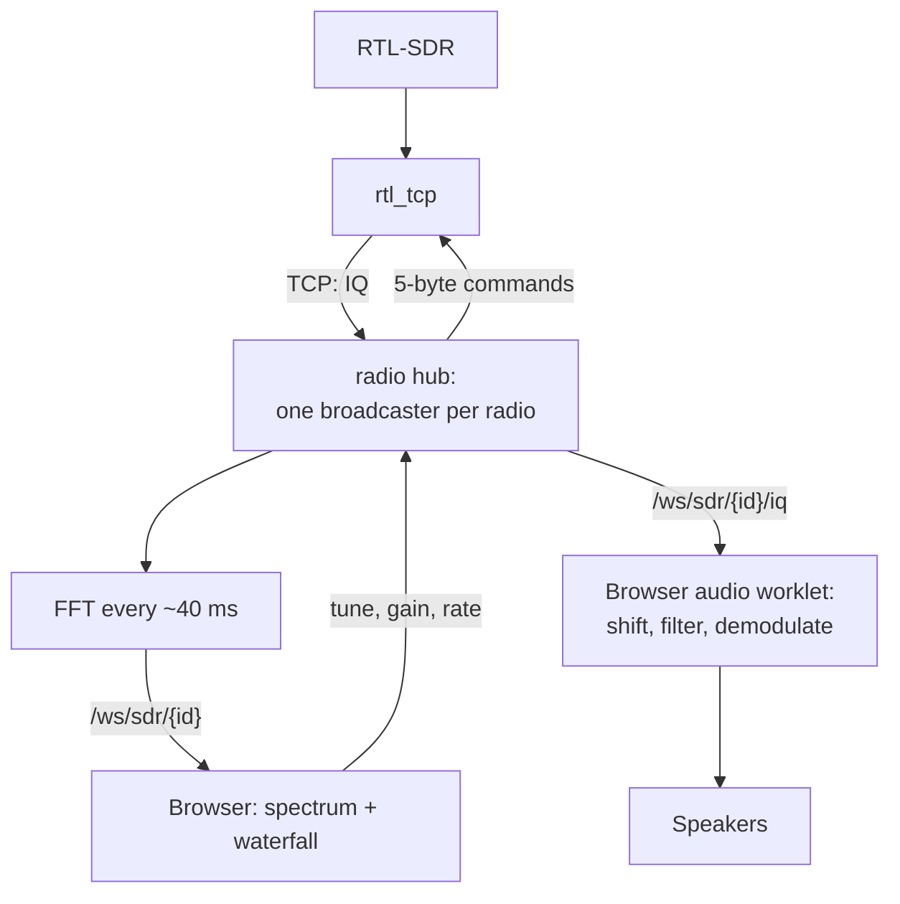
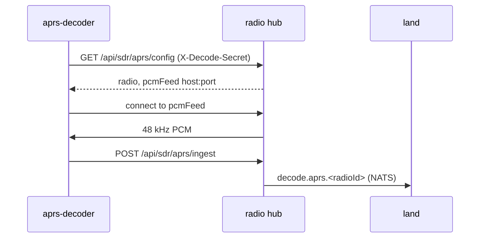

# Radios and decoding

From the dongle to the waterfall, the speakers, a recording and a decoder. Code: the radio hub (`services/radio/backend/sentinel_radio/`) and the SDR frontend (`services/sections/sdr/frontend/`).

## Dongle to screen and speakers

*Figure: One radio's samples: one reader in the hub, spectrum frames and raw IQ to the browser.*

- **One broadcaster task per radio** reads the TCP stream and fans out to every subscriber. Several readers on one socket would fail.
- Reads are sized **by time** (~40 ms, ~25 fps), so the frame rate holds when the sample rate changes. FFT size 1024–32768.
- `rtl_tcp` commands are 5 bytes: command byte plus a big-endian uint32.
- The browser demodulates (NFM, WFM, AM, USB, LSB, CW). The worklet's channel filter must always run, or the whole band plays.
- The SDR engine is mounted outside the page, so audio survives navigation.
- Two more sockets: `/ws/sdr/{id}/decode` (events, logs) and `/decode/audio` (decoded voice).

**SDR Manager** ([ADR 0007](../adr/0007-sdr-manager.md)): two services look after dongles, and the hub only streams them.

- `sdr-manager-local` (`services/sdr-manager-local/`) drives the dongles plugged into one computer: it finds them over USB, runs `rtl_tcp` behind a fan-out relay per dongle, and serves the SDR Manager API on `:8000`, both to this Sentinel (`/api/sdr-manager/local/…`) and to other Sentinels (`/api/…`). A container on Linux; a native process on a Mac.
- `sdr-manager-remote` (`services/sdr-manager-remote/`) keeps the list of SDR hosts (`sdr-manager-remote.db`), polls each one's status, answers Air's reservations (`sdr-manager.remote.reservation.*`) and the hub's host snapshot on the bus, and tells the hub about claims (the hub acknowledges `sdr-manager.claims.granted` before the claim's retune). It links this computer's `sdr-manager-local` as **This machine** with a service bearer token instead of the console password.
- The hub streams IQ from a dongle's `rtl_tcp` port; radios are core's `sdr.radios` setting (`sdr_manager_host_id`, `sdr_manager_device_id` for a host's dongle). The older lock-and-tune design: [ADR 0003](../adr/0003-sentry-sdr-lock-and-tune.md).

## Recordings

- The browser records the WAV (it has the audio, only while squelch is open); the hub captures IQ (it has the samples).
- On stop the browser uploads the WAV; the SDR service then fetches the `.u8` from the hub's `/internal/radio-hub/iq-captures/<id>` (only SDR's credential may) and clears **COPYING IQ…**.
- A 60-second reconcile loop retries copies, stops stray captures and discards uncollected ones. No shared volume, so the hub can run elsewhere.
- Always build paths with `sentinel_sdr.services.recording_folders`; each recording stores its own folder.

## Decoders

The hub demodulates and serves decoders **audio**, like a scanner's speaker output; decoders never touch the dongle.

| Decoder | Program | Hub port | Audio |
|---|---|---|---|
| Voice | dsd-fme | 7355 (+7356 UDP back) | 48 kHz mono |
| APRS | Direwolf | 7357 | 48 kHz mono |
| AIS | Direwolf 1.8 | 7358 | 48 kHz stereo: A left, B right |
| ADS-B | readsb | — | Reads the SDR host's IQ directly, serves JSON |

*Figure: An APRS decoder from start-up to a station on the Land map.*

- Decoders reach the hub through the gateway and learn the PCM socket from `/config`, so nothing hard-codes where the hub runs.
- **APRS and AIS own an absolute channel**: they tune on start, demodulate at the offset for each chunk's real capture frequency, and pull the radio back after about 15 seconds if moved.
- AIS decodes both channels 50 kHz apart as stereo; one channel loses half the traffic.

## A new decoder kind

No hub code. The container registers a manifest (`POST /api/sdr/decoders/register`): kind, channels, whether it owns them. The hub runs a generic bridge (`manifest_decode.py`) and publishes `decode.<kind>.<radioId>`. A 404 on `/config` means the hub restarted: register again.

You still add: a row in `service_access.py` plus a compose mount of `credentials/<kind>-decoder/`, and a subscriber with its subject in `nats_permissions.py`. Template: `decoder/stub/`, tested in CI by `tests/backend/test_decoder_stub_contract.py`.
