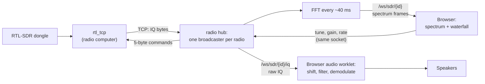
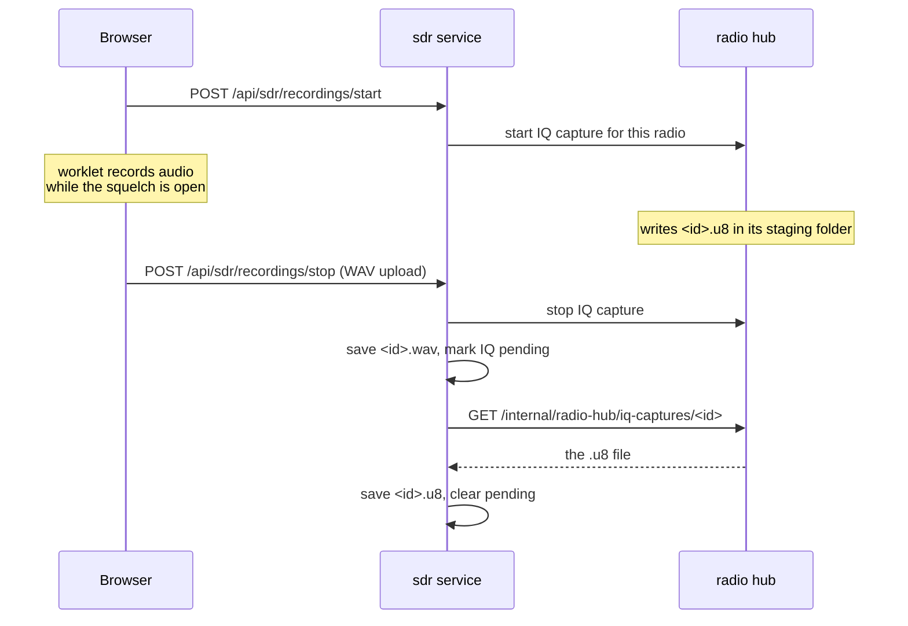

# Radios and the SDR pipeline

This page follows a radio signal from the dongle to the waterfall on screen and the sound in your speakers, then shows how a recording is made. The code is in the radio hub (`services/radio/backend/sentinel_radio/`) and the SDR section's frontend (`services/sections/sdr/frontend/`).

New to a term on this page? See [Words used on these pages](overview.md#words-used-on-these-pages).

## The parts

- **rtl_tcp** runs on the computer the dongle is plugged into. It streams the dongle's raw samples over TCP and accepts tuning commands.
- **IQ** is that raw stream: pairs of numbers (I and Q) that describe the signal across the whole band the dongle is receiving. An RTL-SDR sends them as unsigned 8-bit values.
- **The radio hub** keeps one connection to each radio, computes the spectrum, and passes IQ on to whoever needs it.
- **The browser** draws the spectrum and waterfall, and turns IQ into sound itself, in an audio worklet.

## Dongle to screen and speakers

*Figure: The path of one radio's samples, from the dongle to the waterfall and the speakers.*

**In words:**

1. `rtl_tcp` sends the dongle's IQ samples to the radio hub over one TCP connection.
2. In the hub, **one broadcaster task per radio** reads that connection. Only one task may read it; several WebSocket clients reading the same socket would fail.
3. Every ~40 ms (about 25 frames a second) the broadcaster turns the latest samples into a spectrum with an FFT (1024 to 32768 points) and puts the frame on the queue of every browser watching that radio. Reads are sized by time, not by number of samples, so the frame rate stays steady when the sample rate changes.
4. The browser draws each frame as a line on the spectrum and a row on the waterfall (`/ws/sdr/{radioId}`).
5. For sound, the browser opens a second socket for raw IQ (`/ws/sdr/{radioId}/iq`). An audio worklet in the browser shifts the chosen frequency to the middle, filters out everything outside the bandwidth, demodulates it (NFM, WFM, AM, USB, LSB or CW) and plays it.
6. Tuning, gain and sample-rate changes go back over the first socket. The hub turns each into a 5-byte `rtl_tcp` command: one command byte, then a 4-byte big-endian value.

Two more sockets carry decoder traffic: `/ws/sdr/{radioId}/decode` (decoded events and logs) and `/ws/sdr/{radioId}/decode/audio` (decoded voice). See [Decoding](decoding.md).

Because demodulation happens in the browser, the audio keeps playing while you move between sections: the SDR engine is mounted outside the page that changes. The worklet's channel filter must always run; skipping it plays the whole band at once.

## Sentry radios

A **Sentry** host shares several dongles. The hub talks to Sentry's HTTP API to list its dongles, claim one, tune it and release it, then streams IQ from that dongle's `rtl_tcp` port as above. Sentry hosts are stored in the hub's own `radio.db`; the radios themselves are the `sdr.radios` setting in core. The design is in [ADR 0003](../adr/0003-sentry-sdr-lock-and-tune.md).

## Making a recording

The WAV comes from the browser, which has the demodulated audio; the raw IQ comes from the hub, which has the samples.

*Figure: Starting and stopping a recording with raw IQ turned on.*

**In words:**

1. The browser asks the SDR section to start a recording. The SDR section creates the recording's row and, if raw IQ is on, asks the hub to capture IQ.
2. While recording, the browser keeps the demodulated audio (only while the squelch is open) and the hub writes raw IQ to a file in its own staging folder.
3. On stop, the browser uploads the WAV. The SDR section asks the hub to stop the IQ capture and saves the WAV into the recording's folder.
4. In the background, the SDR section fetches the IQ file from the hub over an internal route that only its credential may use, and saves it beside the WAV. Until then the recording shows **COPYING IQ…**.
5. A reconcile loop every 60 seconds retries copies that failed, stops captures nobody stopped, and has the hub discard captures that were never collected.

No volume is shared between the hub and the SDR section, so the hub can run on another machine. Where the files end up is explained in [Record what you hear](../use/sdr/record.md#where-recordings-are-saved); always build a recording's path with `sentinel_sdr.services.recording_folders`, never by hand.
