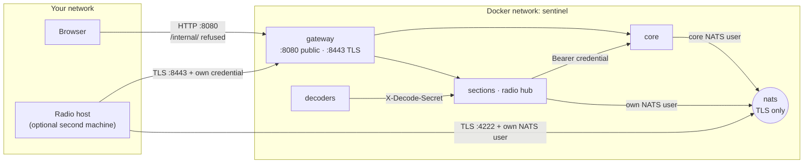

# Security

Sentinel has no user logins: anyone who can reach port 8080 can use it, so run it on a network you trust. This page explains how Sentinel's services prove who they are to each other, what each is allowed to do, and what protects the browser.

New to a term on this page? See the [Glossary](../reference/glossary.md).

## Trust boundaries

*Figure: What is reachable from where, and which credential protects each crossing.*

**In words:**

| Crossing | Protected by |
|---|---|
| Browser → gateway | Nothing beyond your network. `/internal/…` is refused with a 404. |
| Service → core's internal routes | The service's own HTTP credential, as `Authorization: Bearer` |
| Decoder → radio hub | The decoder's own credential, in the `X-Decode-Secret` header |
| Any process → NATS | TLS with the installation's own certificate authority, and a NATS user per process |
| Radio host → main machine | TLS on :8443 and :4222, plus the radio host's own credentials |

## Where credentials come from

On every `docker compose up`, the one-shot `service-credentials` service (`backend/scripts/generate_service_credentials.py`) makes sure these exist on the `service_credentials` volume, creating only what is missing:

- a **certificate authority** for this installation, and TLS certificates for NATS and the gateway's :8443 listener;
- for **every service and decoder**, a random HTTP token (`credentials/<caller>/http-credentials.json`) and a NATS login (`nats-credentials.json`);
- for core and the radio hub, the list of accepted callers (`accepted-callers.json`), holding only each token's **SHA-256 hash**, so neither holds anyone's actual token;
- NATS's `nats.conf`, with each user's allowed subjects.

Each container mounts only its own `credentials/<caller>/` folder. Nothing is shared and nothing is committed to git. To replace a credential, delete its folder on the volume and run `docker compose up -d`.

## What each caller may do

`backend/platform/service_access.py` is the table:

| Caller | May |
|---|---|
| `core` | Everything (except act as a decoder) |
| `air`, `space`, `land`, `radio` | Register itself, under its own id only |
| `sea` | Register itself; read and write its own secret, the AISStream key |
| `sdr` | Register itself; fetch the hub's staged IQ captures |
| `voice-decoder`, `aprs-decoder`, `ais-decoder`, `stub-decoder` | Act as a decoder of its own kind only: read its config, post its events |

The guards are in `backend/core/internal_auth.py`:

| Answer | Detail | Means |
|---|---|---|
| 503 | `Internal service access is disabled on this deployment` | This process has no accepted-callers list (not under Compose, or `service-credentials` didn't run) |
| 401 | `Invalid service credential` / `invalid decode secret` | The token isn't one it knows: credentials changed but the caller wasn't restarted |
| 403 | `This service may not do that` / `not a <kind> decoder` | A known caller trying something outside its row |

NATS enforces the same idea for events with its own table, `backend/platform/nats_permissions.py` (see [Event bus](event-bus.md#who-may-use-which-subject)).

**A new service or decoder kind** needs a row in both tables and a compose mount of its credentials folder, or it can't authenticate.

## Secrets

The only secret setting today is the AISStream key. The public settings API redacts it and refuses to write it; it is never in `sentinel_config.json` or an export. The Sea service reads it from core's `/internal/settings/secrets/sea/…`, which only Sea's credential may use. Keys you set in `.env` stay on that computer; `.env` is git-ignored.

## In the browser

- Core sets a **Content Security Policy** on `index.html` (`backend/core/spa_csp.py`). Its inline start-up scripts are allowed by a hash worked out from the file on disk. It keeps `blob:` and `'unsafe-eval'` because SDR audio needs them (a worklet loaded from a blob, and a fallback for plain-HTTP connections on a LAN).
- The shell only loads section remotes from the same origin, under `/remotes/<id>/` (see [Frontend](frontend.md#how-the-shell-boots)).
- The docs page renders markdown with HTML turned off, then sanitises it with DOMPurify; Mermaid runs with `securityLevel: strict`.

## Inputs

Every backend route validates its input with Pydantic models and bounds (for example, a recordings folder must be a relative subfolder that stays inside the recordings root, and a service manifest's route prefixes must match a strict pattern). Database queries go through SQLAlchemy, never string-built SQL from user input. When you add a route, validate every field at the edge and add a test that proves bad input is refused.
