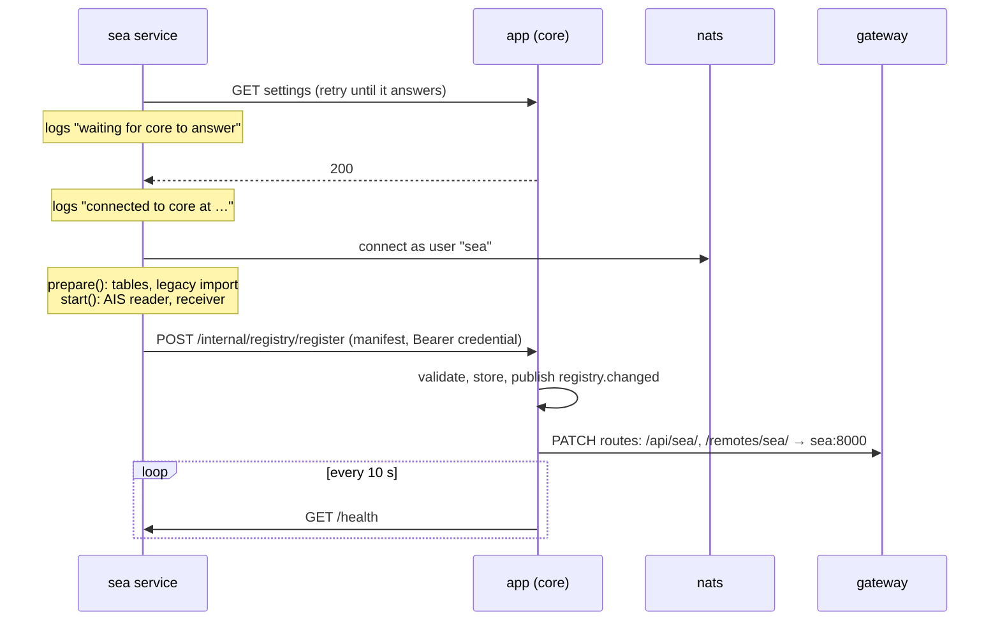
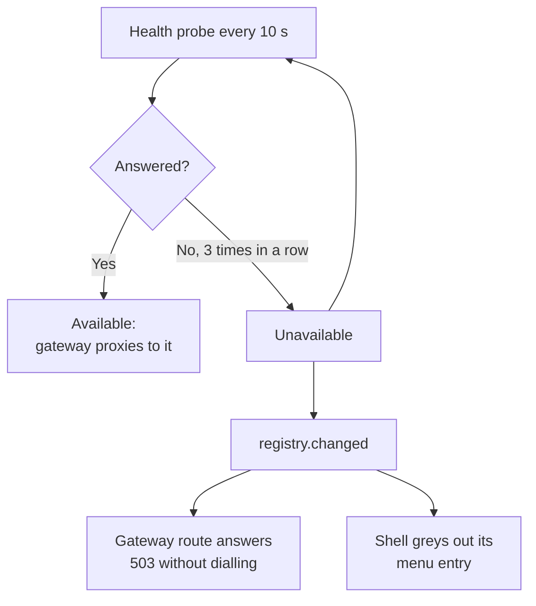

# Services and start-up

This page follows a section service from `docker compose up` to serving requests, and explains what happens when one stops or is never started.

New to a term on this page? See [Words used on these pages](overview.md#words-used-on-these-pages).

## Start-up and registration

`docker compose up` starts the sections at the same time as core, often before core is ready. Each section therefore waits for core before doing anything that needs settings, and only asks to be routed to once it is fully started.

*Figure: A section service starting up, from waiting for core to its first routed request.*

**In words:**

1. The section asks core for its settings (they are stored by core, not by the section), retrying quietly until core answers. While it waits it logs `<id> service startup: waiting for core to answer (…)`, then `… connected to core at <url>`.
2. It connects to NATS as its own user.
3. It runs its own `prepare` (tables, and on first boot a one-off copy of its tables from the old single database) and `start` (its background work).
4. It registers its **manifest** with core: its id, kind, address and the path prefixes it serves. The request carries the service's own credential.
5. Core validates the manifest, stores it in memory, and announces `registry.changed`.
6. Core's gateway sync pushes the new routes into Caddy, so `/api/sea/` and `/remotes/sea/` now reach the Sea service.
7. Core probes `GET /health` on the service every 10 seconds from then on.

The registry is held only in memory. A service re-registers on an interval, so a restarted core learns every running service again within seconds.

## Which sections the browser sees

`GET /api/app/sections` (`backend/core/app_sections.py`) lists the registered sections that have a built UI remote. The shell loads exactly those (see [Frontend](frontend.md#how-the-shell-boots)). A section that never registered doesn't appear anywhere.

## When a service stops

*Figure: What the registry and gateway do when a registered service stops answering, and when it comes back.*

**In words:**

1. Core probes every registered service's `/health` every 10 seconds (`REGISTRY_PROBE_INTERVAL_S`).
2. After three failures in a row (`REGISTRY_PROBE_FAILURES`), the service is marked unavailable and `registry.changed` is announced.
3. Its gateway route is replaced with a static 503, so requests fail fast instead of waiting on a dead address ([Gateway and routing](gateway.md#longest-prefix-wins)).
4. The shell greys out its menu entry and shows "<label> is unavailable" on its page. The other sections keep working.
5. Probes continue; the first good probe makes it available again.

Liveness is checked over HTTP only, never over NATS, so restarting the broker can't grey out healthy sections.

## What each service needs

| Service | Waits for | Needs NATS for |
|---|---|---|
| `space` | core | settings change events |
| `air` | core | Sentry reservations from the hub, squawk alerts to core |
| `sea` | core | off-grid AIS events from the hub, starting and stopping its receiver |
| `land` | core | APRS packets from the hub |
| `sdr` | core | IQ capture hand-over from the hub |
| `radio` | core | decode events out, requests from sections in |

The operator's view of the same thing (log lines of a healthy start, what to check when a section is missing) is in [Check logs, health and backups](../operations.md#a-healthy-start).
