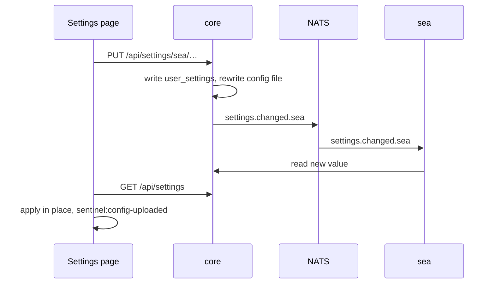

# Storage and caching

Every service owns its own SQLite database; only settings are shared, and they belong to core.

## Who owns what

| Store | Owner | Holds |
|---|---|---|
| `sentinel.db` (`sentinel_db`) | core | `user_settings` (every setting, incl. `sdr.radios`), alerts, offline map areas |
| `tiles/` beside it | core | Downloaded `.pmtiles` |
| `backend/data/sentinel_config.json` | core | Live two-way copy of every setting |
| `space.db` | space | Satellites and TLEs |
| `air.db` | air | ADS-B snapshot cache, tracked aircraft |
| `sea.db` | sea | `sea_vessel_cache` (30 s snapshot), `sea_vessel_static` |
| `land.db` | land | APRS stations, `repeater_cache` |
| `sdr.db` + recordings | sdr | Frequencies, groups, ranges, recordings |
| `radio.db` | radio | Sentry hosts |
| Memory | each | Service registry (core), live vessels (sea), radio connections (radio) |

- Async SQLAlchemy 2.0 on aiosqlite; every connection sets `journal_mode=WAL`, `busy_timeout=5000`, `synchronous=NORMAL`.
- No service opens another's file. Sections read settings through the **settings client** (HTTP to core), never `user_settings`.
- To look inside: `docker compose cp sea:/app/data/sea.db ./sea.db`. Stop a service before editing its file by hand.

## Schema changes

No migration files. On every start, a service's `prepare`:

1. `create_all` for its tables.
2. `ALTER TABLE … ADD COLUMN` for each column added since (already there: ignored).
3. Backfills empty new columns.
4. First boot only: copies its tables from the old `sentinel.db` (`/legacy`, read-only).
5. Seeds starting data where none exists.

- **New column:** add it to the model **and** to the section's added-columns list, or old installs never get it.
- **Rename / remove:** add a new column; stop using the old.
- **Test** against a database from the previous version.

Seed data: `backend/default_config.json` (every setting; add new ones here), `backend/data/sdr_frequencies.json`, `sdr_bandplan.json`, `satellite_radio.json`, `uk_repeaters.json`.

## A settings change

*Figure: From APPLY CHANGES to every service and browser using the new value.*

- Controls **stage** until **APPLY CHANGES**.
- The browser applies settings in place: anything that reads a setting once must re-read on `sentinel:config-uploaded`.
- Core polls the config file every second (inotify doesn't cross Docker Desktop mounts) and applies a valid edit like an upload.
- Secrets (the AISStream key) never reach the public API, the file or exports.

## Caching

Fresh window: serve the cache. Past it: fetch. Fetch failed: serve a copy inside the stale window. Helpers in `backend/cache.py`.

| What | Fresh / stale |
|---|---|
| ADS-B | 10 s / 60 s (`ADSB_TTL_MS`, `ADSB_STALE_MS`) |
| TLEs | 6 h / 12 h; uploads 30 days |
| UK repeaters | daily; stale up to 30 days, then the built-in copy |
| Vessels | 30 min retention; snapshot every 30 s |

Windows are in `backend/config.py`; override them in `docker-compose.override.yml` ([how](../configuration.md#anything-else)).

Air's `X-Cache` header: `HIT`, `MISS`, `BYPASS` (cache write failed), `NEARBY` (nearest recent point), `STALE`, `RATED` (upstream 429), `THROTTLED` (own limiter), `FALLBACK` (other mode's source). `X-Snapshot-Age-Ms` lets the map place aircraft where they are now.

## Offline map tiles

- `/api/offline-map/{basemap,terrain}/{z}/{x}/{y}`: downloaded areas newest first, then the base archive, then 204.
- Readers are cached across requests (`tile_tier_resolver.py`).
- A finished download bumps `tiers_version`; maps call `setTiles()` with `?v=`. Never `map.setStyle()`: it won't refetch, and wipes overlays.
