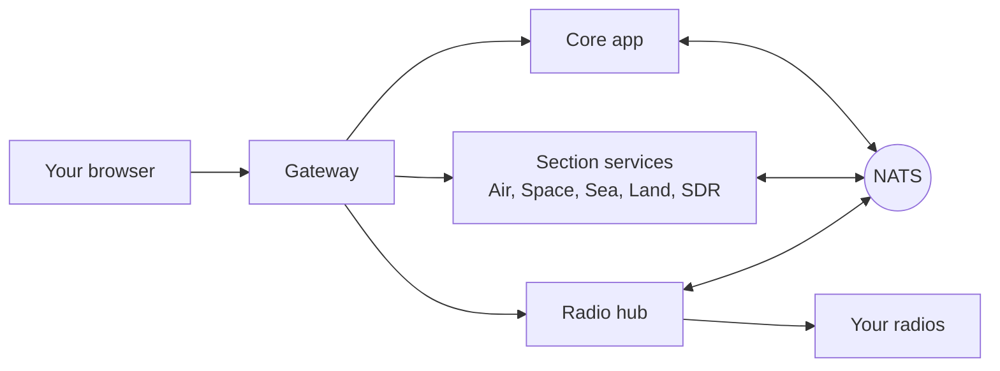

# Welcome to Sentinel

Sentinel is a live dashboard for what is in the air, in space, at sea and on the ground around you, and for the radios that listen to it. It runs on your own machine, and it keeps working with no internet when you have set up offline maps and a local radio.

> [!NOTE]
> This page is a placeholder while the documentation is being written. The pages listed here are the ones that exist today.

## Where to start

- **Find out what each part does.** [What each section does](sections.md) covers Air, Space, Sea, Land and SDR.
- **Use Sentinel with no internet.** [Download maps for offline use](offline-maps.md), then [install and run decoders](decoders.md) to read signals from your own radio.
- **Run it and look after it.** [Check logs, health and backups](operations.md), and [environment variables](configuration.md).
- **Put the radios on a second machine.** [Run the radios on a second machine](radio-host.md).
- **Work on the code.** [Contributing](../CONTRIBUTING.md), and the [design decisions](adr/0006-section-containers.md) behind how Sentinel is built.

## How the pieces fit together

*Figure: A browser talks to the gateway, which routes each request to the core app, to a section service or to the radio hub. NATS lets the services pass events to each other.*

**In words:**

- Your browser only ever talks to the gateway.
- The gateway sends each request on to the core app, to the section service that owns that part of the site, or to the radio hub.
- The core app, the section services and the radio hub pass events to each other over NATS, a small message broker.
- The radio hub is the only part that touches your radios.
