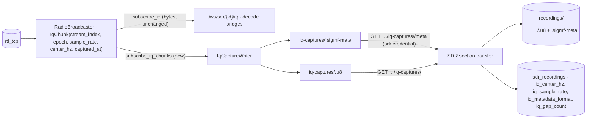
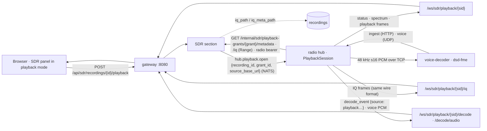

# Plan: play back a recorded raw IQ file through the SDR panel

**Status:** proposed, not started · **Date:** 2026-11-03 · **Cut against:** `main` @ `f505f369` · decision record: ADR 0009 (candidate, §12)
**Scope:** new feature. Live radio behaviour, existing WebSocket frame formats, the IQ download and every settings key stay
as they are; recordings gain IQ metadata and a playback mode.

## 0. Summary

Today a recording's raw IQ (`<id>.u8`) can only be downloaded and opened in SDR++/GQRX. This plan lets the user press
**PLAY IQ** on a recording and get the SDR panel back exactly as if the radio were live: audio, spectrum and waterfall
for the recorded band, re-tuning within it (offset, mode, bandwidth, squelch), and digital voice decode (DMR, P25 and
the rest through dsd-fme) on the recording.

It comes in three parts:

1. **Metadata first.** The radio hub already sees the real centre frequency and sample rate of every chunk, then strips
   them (`_drain_iq_to_file`, `sdr.py:795-811`). It will keep them in a **SigMF** `.sigmf-meta` sidecar: one capture
   segment per retune, sample-rate change or gap. The SDR section collects the sidecar with the `.u8`, and a few summary
   columns go on `sdr_recordings`.
2. **Playback is a virtual IQ source in the radio hub.** A `PlaybackSource` acts like `RadioBroadcaster`. It pulls the
   file from the SDR section in byte ranges, paced at 1×, and reuses `compute_fft_frame` and the voice decode bridge
   unchanged. The radio hub is the right place because the decode bridges, dsd-fme's PCM socket and the decoder wiring
   all live there.
3. **The frontend reuses its sockets.** A playback session is reached at `/ws/sdr/playback/{sessionId}` (plus `/iq`,
   `/decode` and `/decode/audio`), using the same frame formats as a radio. The panel enters a **playback mode**: a
   transport bar, a seek timeline, hardware controls disabled, and in-band re-tuning still allowed.

---

## 1. Goals and non-goals

**Goals**
- G1. Play a recording's IQ with audio, spectrum and waterfall at real time (1×), with play, pause, seek and stop, and
  show the position on a timeline.
- G2. Re-tune *within the recorded span*: demod offset, mode, bandwidth and squelch, using the same controls and
  waterfall click-to-tune as live.
- G3. Run digital voice decode (dsd-fme) on playback, with decoded audio and call details, clearly marked as playback.
- G4. Store the real centre frequency, sample rate, retunes and gaps for every new IQ recording, in a format other SDR
  tools read (SigMF).
- G5. Keep playing old recordings that have no metadata, marked **approximate**.
- G6. Security as tight as the live path: browsers never name a path, size or URL. Only the radio hub's credential can
  read recording IQ, and only under a short-lived grant.
- G7. WCAG 2.2 AA and mobile-first transport UI, built from small components.

**Non-goals (v1)**
- Speeds other than 1×. The audio worklet caps its buffer at about 150 ms and drops anything beyond that
  (`useSdrAudio.ts:131-133`, `:230`), so faster-than-real-time IQ comes out as chopped audio. "Fast-forward" is seek.
- APRS, AIS or manifest-decoder decode on playback (§7.3).
- Recording a new WAV/IQ *from* a playback, or editing and trimming IQ files.
- Playing IQ files uploaded from outside Sentinel (SigMF import). The metadata reader is written so this can follow.
- Retrofitting SigMF sidecars onto old recordings on disk. They stay approximate, and the user can still re-tune by eye.
- Playback when the radio hub runs on a separate radio host (`compose.radio-host.yaml`) is **not in v1**. See §11 Q1.

---

## 2. Current state (verified against the code)

### 2.1 Live pipeline (radio hub, `services/radio/backend/sentinel_radio/`)
| What | Where | Notes |
|---|---|---|
| Time-sized IQ read | `services/sdr.py:723-740` (`read_iq_chunk`) | about 40 ms per chunk (`READ_CHUNK_TARGET_MS`, `:88`), floor ≥ `fft_size` |
| One broadcaster per radio | `services/sdr.py:746-1018` (`RadioBroadcaster`) | `subscribe`/`subscribe_iq` queues maxsize 4 (`:761-781`); `connection` property (`:756-759`) |
| Fan-out with drop-oldest | `_put_dropping` `:990-999`, `_broadcast_iq` `:1005-1018` | IQ wire format `[u32 LE sample_rate][u32 LE center_hz][u8 IQ…]` |
| FFT | `compute_fft_frame` `:1035-1070` | pure function of `(raw_iq, n_fft, sample_rate, center_hz)`, run in a thread from `_run` `:978-982` |
| Idle release | `_run` `:928-945`, `IDLE_RELEASE_GRACE_S = 10` `:103` | the pattern playback sessions reuse |
| Control WebSocket | `routers/radio_control.py:186-416` | an `error` frame **closes the stream loop** (`:403-404`); closing the socket stops that radio's voice bridge (`:415-416`) |
| IQ WebSocket | `routers/radio_control.py:153-183` | forwards the queued bytes unchanged |
| Broadcaster lookup | `radios.py:131` (`resolve_broadcaster`) | keyed by radio id → `host:port` |
| Routers and order | `service.py` (`routers=[radios, radio_control, decode, decoders, iq_captures]`) | the gateway sends `/ws/sdr/` to the hub (`module.py` manifest `routes`) |

### 2.2 Browser
- **Audio demod runs entirely in the browser.** `_openIqSocket` (`useSdrAudio.ts:331-386`) opens
  `/ws/sdr/${radioId}/iq` (`:341`), converts the bytes to float and posts them to `PROCESSOR_SRC` (`:120-260`) together
  with mode, squelch, offset and bandwidth. It reads only the header's sample rate, not its centre.
- **Control socket.** `useSdrControlSocket.ts`: `POST /api/sdr/connect` first (`:208-240`), then `/ws/sdr/${radioId}`
  (`:253`). It is keyed on a numeric radio id throughout (`sdrLastRadioId`, `sdrInit_<id>`, the reachability probe).
- **Decode sockets.** `useSdrDecode.ts:129,143` open `/ws/sdr/${radioId}/decode` and `/decode/audio`. Events land in
  the in-memory Pinia list `decodeEvents` (`stores/sdr.ts:881`). They are **never persisted, and voice events never
  reach the bus**: `ingest_decode_event` only fans out to WebSocket subscribers (`routers/decode.py:84-104`).
- **Read-only gating already exists.** `tuningDisabled` (`SdrPanel.vue:664`) disables frequency, gain, sample rate,
  scan and search for a follower (`stores/sdr.ts:1080`). Playback mode reuses this seam.
- **Size.** `SdrPanel.vue` is 2043 lines and `SdrRecordingsSection.vue` 1248. Under the house rule, playback UI goes
  into **new** small components and composables, not into either file.

### 2.3 Recording today
- `useSdrRecording.ts:110-120` builds the start metadata, and `useSdrAudio.ts:787-823` POSTs
  `/api/sdr/recordings/start`. The SDR section (`sentinel_sdr/router.py:588-634`) creates the row and, with
  `sdr.recordRawIq` on, requests `hub.iq-capture.start` (reply `{ok}` only).
- The hub (`services/iq_capture.py:100-125`) calls `broadcaster.start_iq_recording` (`sdr.py:783-793`, queue
  **maxsize 8**). `_drain_iq_to_file` writes `payload[8:]`, which **drops the centre and sample rate** of every chunk.
  When the queue is full, chunks are dropped silently, so the file has **unmarked gaps**.
- Staging and collection: `iq_capture_dir()` = `<db dir>/iq-captures` (`iq_capture.py:64-69`). `list` globs only
  `*.u8` (`:155-160`) and `discard` unlinks only the `.u8` (`:163-168`). The SDR section copies through
  `/internal/radio-hub/iq-captures/{id}` (`routers/iq_captures.py:42-54`), which only the `sdr` credential may read
  (`backend/platform/service_access.py:60,107-110`), and stores it at `iq_path(recording)`
  (`recording_folders.py:145-147`). `iq_file_pending` = has IQ and the file is not there yet
  (`sdr_iq_capture_transfer.py:61-63`).
- **Schema changes are not Alembic.** The SDR section adds columns through `SDR_ADDED_COLUMNS` ALTERs
  (`sentinel_sdr/database.py:37-48`, applied by `create_section_tables`), so this plan does the same.
- Model: `SdrRecording` (`sentinel_sdr/models.py:86`). Per-recording limit: `backend/platform/recording_limits.py`
  (default 360 min ≈ 88 GB of IQ at 2.048 MS/s).

### 2.4 Digital decode
- `PcmDecodeBridge` (`sdr_decode.py:372`) subscribes with `broadcaster.subscribe_iq()` (`:421`). `_run` **skips
  chunks while no decoder is connected** (`:555`), and `_accept_chunk` trusts the offset it is given (`:485-492`).
- `DigitalDecodeBridge` (`:612`) adds the UDP voice return. `ChannelOwningDecodeBridge` (`:763`) retunes hardware
  through `broadcaster.connection` (`_tune_to_channel`, `:874-899`).
- Registry: `_bridge_key(host, port)` calls `int(port)` (`:1029-1030`). `get_or_create_bridge` **stops every other
  voice bridge** (`:1044-1053`), so only one voice decode runs at a time across all radios.
- APRS and AIS ingest publish `decode.aprs.<radioId>` / `decode.ais.<radioId>` on the bus (`routers/decode.py:233,501`)
  into Land's and Sea's **live** stores.

### 2.5 Topology
- Default `docker compose up`: hub and SDR section share the compose network, so the hub can reach the SDR section's
  registered `SERVICE_INTERNAL_URL` (e.g. `http://sdr:8000`).
- **Radio host:** the SDR section on the core host can reach the hub (the hub's registered TLS address). The reverse is
  not possible: core's `:8443` service entrypoint routes only `/internal/*`, `/api/settings*` and `/health` to
  `app:8000` (`gateway/caddy.json` `service_entrypoint`). See §11 Q1.

### 2.6 Findings that contradict or refine the starting assumptions
1. **`SdrRecording.frequency_hz` is the demod frequency, not the hardware centre.** With auto-centre off, a click sets
   `tuningOffsetHz = clicked − hwCenter` and requests `currentFreqHz = clicked` without retuning
   (`SdrWaterfall.vue:1129-1139`, `SdrPanel.vue:902-913`). The recording then stores `currentFreqHz`
   (`useSdrRecording.ts:114`). The legacy fallback "centre = `frequency_hz`" is therefore exact only when the offset was
   0; otherwise it can be off by up to ±sample_rate/2. That makes the **approximate** label essential.
2. **`SdrRecording.sample_rate` is not the real rate either.** The browser always sends `sample_rate: 2048000`
   (`useSdrRecording.ts:119`) whatever `sampleRateHz` is, so legacy recordings need a sample-rate estimate too (§4.4).
3. **Stale docstring:** `start_iq_recording` says "sample_rate and center_hz are stored in the SdrRecording DB row"
   (`sdr.py:787-788`), which is false. Fix it in P1. Also stale: the control-socket docstring says `fft_size` clamps to
   [1024, 8192] (`radio_control.py:221`); the code clamps to 32768 (`sdr.py:74`).
4. **Mid-recording changes really happen.** A *manual* retune ends a recording (`useSdrRecording.ts:84-94`), but
   scan/search stepping, satellite auto-tune, the sample-rate picker (`SdrPanel.vue:1630-1643`) and a follower adopting
   the owner's retune do not. A per-chunk change log is needed, not just a start centre.
5. **WAV duration ≠ IQ duration.** `duration_s` counts only squelch-open audio. IQ duration =
   `iq_file_size_bytes / 2 / sample_rate`.
6. **Voice decode events have no bus or DB destination**, so "tag them as playback" is a WebSocket-frame and
   Pinia-store change. APRS and AIS *do* reach live stores, which is one reason to defer them (§7.3).
7. **`_bridge_key` assumes a numeric port**, so a playback session needs a source-key refactor before it can own a
   bridge (P3).
8. **Pulling from the hub breaks on radio-host deployments** (§2.5). The pull design stays (§5.1) and that topology is
   flagged.

---

## 3. Architecture and data flow

### 3.1 Capturing metadata (P1–P2)


### 3.2 Playback (P4–P9)


### 3.3 Why these choices
- **Playback lives in the hub, not the SDR section.** Putting it in the SDR section would mean a second FFT, a second
  set of `/ws` handlers and a second PCM spine there, or shipping IQ back into the hub for decode. The hub already has
  all three, and the gateway already sends it `/ws/sdr/`.
- **The hub pulls ranges; the file is not copied.** Seek is a new `Range` request, pause closes the stream, and nothing
  is staged on the hub's disk (a 6 h recording is about 88 GB). The SDR section stays the only owner of recording
  files, as P7.3 decided.
- **The SDR section opens the session.** It already validates recordings and resolves paths (`recording_folders`). The
  browser only ever names an integer recording id there, and an opaque session id at the hub.
- **SigMF sidecar plus DB summary columns.** The sidecar travels with the file into SDR++, GQRX, URH and GNU Radio. The
  columns let the list show tuning and gaps without parsing JSON per row.

---

## 4. Data model and metadata

### 4.1 Broadcaster: per-chunk facts (P1)
`RadioBroadcaster` keeps `stream_sample_index` (IQ samples read since the broadcaster started) and `stream_epoch`
(incremented on every `_reconnect`). It fans an `IqChunk(stream_sample_index, stream_epoch, sample_rate, center_hz,
captured_at_utc, raw_iq)` to a **new** `subscribe_iq_chunks()` list. `subscribe_iq` and its byte format are
untouched, because the browser, decode bridges and `/iq` WebSocket depend on them. The recording queue grows from 8 to
**64** (about 2.5 s, about 10 MB) to absorb disk stalls. Drops are still possible, and they are now recorded.

Known limitation (document it, don't fix it): `center_hz` changes the moment `set_frequency` returns (`sdr.py:584-594`),
while samples already in the TCP pipe were captured at the old frequency. A segment boundary is accurate to about one
chunk (≈40–100 ms), the same as the live waterfall's labelling.

### 4.2 SigMF sidecar (`<id>.sigmf-meta`, written by the hub's `IqCaptureWriter`)
- `global`:
  - `core:datatype: "cu8"`, `core:sample_rate` = the **first** segment's rate, `core:version` (pin the SigMF 1.x minor
    at build time), `core:dataset: "<id>.u8"` (SigMF's field for a dataset not named `.sigmf-data`),
    `core:recorder: "Sentinel <version>"`.
  - `core:extensions: [{"name": "sentinel", "version": "1.0.0", "optional": true}]`.
- `captures`: a new segment at start, on a centre change, on a sample-rate change, on a gap (`stream_sample_index` jump
  within an epoch) and on a reconnect (epoch change). Each segment has `core:sample_start` (index in the file),
  `core:global_index` (the stream index, so dropped samples show as a jump: SigMF's own mechanism), `core:frequency`
  (hardware centre) and `core:datetime` (UTC). The optional fields are `sentinel:sample_rate` (only when it differs
  from global), `sentinel:dropped_samples`, and `sentinel:gap: "dropped" | "reconnect"` (a reconnect's missing length
  is unknown, so the datetime carries it).
- `annotations`: one per gap, with `core:comment`, so other tools display it.
- **Written atomically** (`.part` → rename) every 10 s while recording and on stop, so a hub crash leaves a usable
  sidecar.
- The SDR section **enriches** it on collect with `sentinel:demod_frequency`, `sentinel:mode`,
  `sentinel:squelch_dbfs` and `sentinel:gain_db` from the row, which only it knows, and rewrites it atomically.
- Caps: at most 10 000 captures (past that the writer stops splitting and logs it once), and the sidecar must stay under
  1 MiB.

> **Decision needed (§11 Q2):** SigMF core has one `sample_rate` for the whole dataset. A mid-recording rate change is
> recorded with the `sentinel:sample_rate` extension. Sentinel plays it correctly; other tools will mislabel the time
> axis after the change. The alternatives are to split the IQ file at a rate change, or to block sample-rate changes
> while IQ is recording.

### 4.3 `sdr_recordings` columns (P2, via `SDR_ADDED_COLUMNS`, idempotent ALTERs)
| Column | Type | Meaning |
|---|---|---|
| `iq_center_hz` | `INTEGER NULL` | first segment's hardware centre; NULL = unknown (legacy) |
| `iq_sample_rate` | `INTEGER NULL` | first segment's real rate; NULL = unknown |
| `iq_metadata_format` | `TEXT NOT NULL DEFAULT ''` | `''` none (legacy) · `'sigmf'` sidecar present |
| `iq_segment_count` | `INTEGER NOT NULL DEFAULT 0` | captures in the sidecar |
| `iq_gap_count` | `INTEGER NOT NULL DEFAULT 0` | gap annotations |

- `hub.iq-capture.start`'s reply gains `center_hz` and `sample_rate`, which fill the first two columns at start, so
  they are right even if the sidecar copy later fails.
- `_recording_to_dict` (`router.py:239-261`) gains those fields plus the derived `iq_duration_s` and
  `iq_tuning_approximate`.
- The browser sends its real `sampleRateHz` instead of the hard-coded 2048000 (fixes finding 2.6-2).
- New helper `iq_meta_path(recording)` in `recording_folders.py`. Never build the path by hand.
- `delete_recording` and `import_legacy_files` include the sidecar.

### 4.4 Old recordings (no sidecar)
When a grant is opened, the SDR section **synthesizes** normalized metadata (it does not write a file):
- **centre** = `frequency_hz`;
- **sample rate** = `iq_file_size_bytes / 2 / (ended_at − started_at)`, snapped to the nearest of 1.024/1.536/1.792/2.048
  MS/s (`sdrPanelUtils.ts:13`) when within ±10%, else the stored `sample_rate`;
- **one segment**, and `approximate: true`.

The UI says: *"Approximate tuning — recorded before Sentinel saved IQ details. Frequencies may be shifted by up to
±{rate/2} kHz."* The start and end timestamps come from two clocks (server start, browser end), which is one more reason
the label is "approximate".

### 4.5 Normalized metadata (SDR section → hub, and → browser in the open reply)
```jsonc
{ "recording_id": 42, "approximate": false, "total_samples": 245760000, "duration_s": 120.0,
  "segments": [ { "sample_start": 0, "sample_count": 98304000, "center_hz": 145300000, "sample_rate": 2048000,
                  "datetime": "2026-11-03T10:15:02.123Z", "gap_before": null },
                { "sample_start": 98304000, "sample_count": 147456000, "center_hz": 145300000, "sample_rate": 2048000,
                  "datetime": "…", "gap_before": { "kind": "dropped", "missing_samples": 81920 } } ],
  "demod": { "frequency_hz": 145337500, "mode": "NFM", "squelch_dbfs": -60.0, "bw_hz": null } }
```
- Produced by one Pydantic model, `PlaybackMetadata`, in the SDR section. It is parsed and bounds-checked from the
  sidecar, which is a file on disk that could be hand-edited.
- Segments must be contiguous and cover the file. Rates and centres must be inside `is_tunable` and the hub's
  `MIN_TUNE_HZ..MAX_TUNE_HZ`.
- Invalid metadata → 422 at open.

---

## 5. Contracts

### 5.1 SDR section (browser-facing, behind `/api/sdr/` → `sdr`)
| Method / path | Body / reply | Errors | Guard rule |
|---|---|---|---|
| `POST /api/sdr/recordings/{rec_id}/playback` | → `201 {session_id, recording_id, ws_path: "/ws/sdr/playback/<sid>", metadata}` (§4.5) | 404 recording or IQ missing · 409 recording in progress, or `iq_file_pending` · 422 bad metadata · 429 `too_many_sessions` · 503 hub unreachable or playback unavailable on this topology | `browser`, group `radio_control` |
| `GET /api/sdr/recordings/{rec_id}/iq-meta` | the `.sigmf-meta` (`application/json`, download filename `<safe>.sigmf-meta`) | 404 | `browser` (add to the GET rule, `guard-policy.json:668-680`) |

`rec_id` is `Path(ge=1)`. Error `detail`s are fixed strings, never paths or upstream messages.

### 5.2 SDR section (internal, radio hub only, never gateway-routed)
| Method / path | Reply | Auth |
|---|---|---|
| `GET /internal/sdr/playback-grants/{grant_id}/metadata` | normalized metadata (§4.5) | `require_caller` + new `may_fetch_recording_iq` (only `radio`; core excluded) + live grant |
| `GET /internal/sdr/playback-grants/{grant_id}/iq` | `206` slice of `iq_path(rec)` for a single `Range: bytes=a-b` (Starlette 1.3 `FileResponse` handles Range); `416` out of bounds | same |

- `grant_id` = `secrets.token_urlsafe(24)`, bound in memory to `{recording_id, created_at, last_used}`.
- Idle expiry is 15 min, reset on every fetch. There is an absolute cap of 2 × `recording_max_duration_seconds`.
- Grants are pruned by the existing 60 s reconcile loop against `hub.playback.list`.
- A deleted recording revokes its grants and calls `hub.playback.close`.
- Add explicit guard rules (access `service`, group `internal`) beside the IQ-capture rule (`guard-policy.json:360`).

### 5.3 Radio hub (internal)
- `GET /internal/radio-hub/iq-captures/{capture_id}/meta`: the staged sidecar; same auth as the `.u8` route.
- `locate` replies gain `meta_url`. `list` and `discard` include `.sigmf-meta` (and `.part`).

### 5.4 Bus subjects (low rate; no IQ or PCM on the bus)
| Subject | Payload → reply | Notes |
|---|---|---|
| `hub.iq-capture.start` | reply adds `center_hz`, `sample_rate` | backward compatible |
| `hub.playback.open` | `{recording_id, grant_id, source_base_url, label}` → `{ok, session_id}` or `{ok: false, reason: too_many_sessions \| source_unreachable \| invalid_metadata \| error}` | hub fetches the metadata before replying |
| `hub.playback.list` | `{}` → `{ok, sessions: [{session_id, recording_id, grant_id}]}` | grant reconcile |
| `hub.playback.close` | `{session_id}` or `{recording_id}` → `{ok}` | recording deleted, grant revoked |

NATS: the `sdr` user's `requests` gains `hub.playback.>` (`nats_permissions.py:65`). The `radio` user already
subscribes to `hub.>` and answers requests. Then `docker compose restart nats`.

### 5.5 Playback WebSockets (radio hub; `/ws/sdr/**` already routed and allowed for `browser`)
- `session_id` must match `^[A-Za-z0-9_-]{32}$`, else an `error` frame `SESSION_NOT_FOUND` and close.
- The playback router is included **before** `radio_control.router`, so `/ws/sdr/{radio_id}/iq` can never match
  `/ws/sdr/playback/iq` (this changes the route-inventory golden, which is expected).

**`/ws/sdr/playback/{sid}` (control). Outbound:**
- `status`: the live shape (`radio_control.py:235-258`) with `radio_id: null`, `radio_name: <recording name>`,
  `is_owner: true`, `control_available: false`, `locked: false`, plus `"source": "playback"`. These values make the
  existing ownership logic treat it as a single-instance owner.
- `spectrum`: identical to live.
- **`playback`**: `{state: "buffering" | "waiting_for_decoder" | "playing" | "paused" | "ended" | "error",
  position_s, duration_s, sample_index, total_samples, center_hz, sample_rate, approximate, recording_id}`. Sent at
  about 4 Hz while playing, and on every change. The first frame also carries `segments` and `gaps`.
- **`refused`**: `{cmd, reason}` for a hardware command (`tune`, `gain`, `sample_rate`, `claim`, `release`,
  `sweep_state`). It is deliberately **not** `error`, because an `error` frame closes the live stream loop.
- `error`: `{code, message}`, fatal, with codes `SESSION_NOT_FOUND`, `SOURCE_UNAVAILABLE` and `SESSION_EXPIRED`.

**Inbound:**
- Transport: `play`, `pause`, `seek {position_s}` (clamped to `[0, duration_s]`, aligned to a sample, coalesced to at
  most 4 seeks/s) and `stop` (ends the session).
- Same as live: `demod {offset_hz, mode, bw_hz}`, `mode`, `squelch`, `fft_size`, `digital_decode {enabled, offset_hz,
  bw_hz}`, `digital_channel` and `ping`.
- Bounds: `offset_hz` must be within ±sample_rate/2 of the current segment, `bw_hz` within (0, sample_rate], and
  `mode` one of the panel's `MODES`.

**`/ws/sdr/playback/{sid}/iq`, `/decode` and `/decode/audio`** use the live byte and JSON formats. Decode events from a
playback bridge also carry `{source: "playback", session_id, recording_id, position_s}`.

### 5.6 Hub internals
- **`services/iq_source.py`** holds the Protocols and the moved helpers:
  - `IqFanOut`: `subscribe_iq` / `unsubscribe_iq`.
  - `SpectrumFanOut`: `subscribe` / `unsubscribe`.
  - `TunableIqSource(IqFanOut)`: `.connection` with `host`, `port` and `set_frequency`.
  - `put_dropping` and `snap_fft_size`, moved out of `RadioBroadcaster` and `RtlTcpConnection.set_fft_size`, with no
    behaviour change.
  - Voice bridges take an `IqFanOut`. `ChannelOwningDecodeBridge` takes a `TunableIqSource`, so APRS or AIS on playback
    is a **type error**, not a runtime surprise.
- **`services/iq_playback.py`**: `PlaybackSession`. It holds a `PlaybackTuning` object (`center_hz` and `sample_rate`
  of the current segment, `fft_size`, `mode`, `demod_offset_hz`, `bw_hz`), and its reader task:
  - an `httpx.AsyncClient` stream (`follow_redirects=False`, TLS through `internal_verify`, `Authorization: Bearer <own
    token>`) feeding a read-ahead buffer of at most 2 s;
  - pacing on `time.monotonic()` deadlines in `READ_CHUNK_TARGET_MS` chunks;
  - chunks that **never straddle a segment boundary**, so each IQ header's centre and rate are right;
  - `compute_fft_frame` run in a thread only while spectrum subscribers exist;
  - fan-out with `put_dropping`;
  - on pause or seek, the upstream stream is closed. Resume or seek reopens it at `Range: bytes=<2·sample_index>-`, and
    the `DemodState` of any attached bridge is reset (`reset_filters`, `sdr_decode.py:152`).
- **Session registry:**
  - at most `RADIO_PLAYBACK_MAX_SESSIONS` sessions (default 2, `backend/config.py`);
  - idle release after `RADIO_PLAYBACK_IDLE_RELEASE_S` (default 30 s) with no control subscriber;
  - a paused cap of 30 min and an absolute cap equal to the grant's;
  - `wake` and `stop` hooked into the hub lifecycle (`module.py` `_wake`/`_stop`), as broadcasters are, or `--reload`
    hangs.
- **Decode bridge registry keyed by source key**, `"radio:<host>:<port>"` or `"playback:<session_id>"`. The behaviour
  stays the same, including "one voice bridge at a time".

---

## 6. Frontend

### 6.1 Seams (P7, no visible change)
- **`streamSource.ts`:** `type SdrStreamSource = { kind: 'radio'; radioId: number } | { kind: 'playback'; sessionId:
  string }`, plus `sdrSocketPath(source, suffix?)`. `useSdrAudio._openIqSocket`, `useSdrControlSocket` and
  `useSdrDecode` build their URLs from it.
- **Control socket in playback:** skip `POST /api/sdr/connect`, the reachability probe and the
  `sdrLastRadioId`/`sdrInit_<id>` session keys. Playback must never survive a reload, and the panel returns to live.

### 6.2 Playback mode (P8)
- **`useSdrPlayback.ts`** (composable) owns open, play, pause, seek, stop and exit. It switches the panel's source and
  restores the previous radio on exit. Store slice `playback` in `stores/sdr.ts`: `{sessionId, recordingId, name, state,
  positionS, durationS, approximate, segments, gaps, centerHz, sampleRate}`.
- **Gating:** `hardwareControlsDisabled = tuningDisabled || inPlayback` covers gain, sample rate, the hardware retune
  paths, scan, search, record and auto-centre retune.
  - Waterfall clicks always become an **offset**, as with auto-centre off. Clicks outside the span are ignored.
  - A typed frequency inside `centre ± rate/2` becomes an offset; outside it gives an inline "outside the recorded
    band" message.
  - Mode, bandwidth, squelch and volume stay enabled.
- **On open:** set `tuningOffsetHz = demod.frequency_hz − segment.center_hz` and set mode and squelch from the row, so
  the user hears the recorded channel straight away.
- **Live audio:** entering playback releases ownership (`cmd: release`), then closes the live control and IQ sockets,
  so the dongle idles out in 10 s. The WAV `<audio>` "playback" mute (`useSdrAudio.ts:740-758`) does not apply to IQ
  playback, because they are separate paths.
- **Components** (each small, scoped styles, TS strict):
  - `SdrRecordingIqPlayButton.vue`: the pill in a recording row, beside DOWNLOAD IQ. It is disabled while
    `iq_file_pending`, with the same reason pattern as `SdrRecordingsSection.vue:292-301`.
  - `SdrPlaybackBar.vue`: the container shown in place of the live radio header while in playback. It composes the
    next four.
  - `SdrPlaybackTransport.vue`: Play/Pause toggle (`aria-pressed`, a name that changes with state), Back 10 s,
    Forward 10 s and Stop. Uses `BaseIconButton`.
  - `SdrPlaybackTimeline.vue`: a native `<input type="range">` (step 1 s). Built by **extending `BaseSliderRow` with an
    optional track slot** for gap and segment ticks rather than a new slider. `aria-valuetext` reads "3 min 12 s of 10
    min".
  - `SdrPlaybackStatus.vue`: the recording name, recorded date and time at the playhead, a `role="status"` region that
    announces only state changes, not every tick, and the approximate notice (`BaseWarningNotice`).
  - `SdrPlaybackDecodeConfirm.vue`: the warning dialog (§7.2).
- **Keyboard:** every control is reachable by Tab. The slider gives Arrow ±5 s, PageUp/PageDown ±30 s and Home/End.
  Space and Enter work on buttons. **No global shortcuts**, so nothing collides with the waterfall's keys.
- **Touch and layout:** targets at least 44×44 CSS px. Mobile-first: the bar stacks (timeline full width, transport row
  below) and becomes one row at `sm`.
- **Motion:** with `prefers-reduced-motion`, the playhead jumps rather than animating, and no pulsing "playing" dot.
- **Decode dock:** a playback event shows a `PLAYBACK · <name> @ mm:ss` tag. The store keeps playback events in their
  own list, cleared on exit, so live history is never mixed with recorded calls.

### 6.3 Design direction (for sign-off with the structure)
**"Tape deck on the instrument panel."** Keep the SDR panel's existing look: uppercase micro-labels, the big-number
frequency readout and the pill buttons. Playback reads as a *different source*, not a different app:
- an **amber** `PLAYBACK` badge and timeline accent, kept distinct from live red REC and the green connection dot, so
  live and recorded can't be confused at a glance (contrast ≥ 4.5:1 on both themes);
- a tape-counter style monospaced `mm:ss / mm:ss`;
- gaps drawn as hatched notches on the track.

There are no new fonts or global tokens beyond one amber accent token, added to the shared tokens only if absent. The
`frontend-design` skill owns the detail.

---

## 7. Digital decode on playback

### 7.1 Flow
1. The user turns **DIGITAL** on while in playback. The control socket sends `digital_decode {enabled: true, offset_hz,
   bw_hz}`, and the hub calls `get_or_create_bridge("playback:<sid>", session)`. A
   `PlaybackDigitalDecodeBridge(DigitalDecodeBridge)` stamps the `source` fields onto every event (§5.5).
2. **Wait for the decoder.** The bridge drops IQ while no decoder is connected (`sdr_decode.py:555`). To keep the start
   of the recording, the session holds at `waiting_for_decoder` until `decoder_reachable`, for at most 20 s, then plays
   anyway with a notice.
3. Decode runs at 1× only, which is the only speed v1 has (§1). A seek resets the bridge's `DemodState`, and the dock
   shows a "resyncing" hint.

### 7.2 One voice decode at a time
`get_or_create_bridge` stops every other voice bridge (`sdr_decode.py:1046-1048`). Before the first enable, the UI
shows `SdrPlaybackDecodeConfirm`: *"Decoding this recording stops live digital voice decode on {radio} (and any other
radio)."* The hub also stops a playback bridge when its session closes. Starting live decode later stops the playback
bridge in the same way.

### 7.3 APRS, AIS and manifest decoders: deferred
- Their bridges retune hardware through `.connection` (`sdr_decode.py:874-899`).
- Only one bridge of each kind exists, persisted as `sdr.aprs_radio_id` / `sdr.ais_radio_id`, so starting one on
  playback would stop the unattended live receiver.
- Their events reach Land's and Sea's live stores and maps over `decode.aprs.*` / `decode.ais.*`.

A later version could add a `decode.<kind>.playback.<session>` subject that Land and Sea ignore and the playback dock
shows. The `TunableIqSource` Protocol (§5.6) keeps v1 honest.

### 7.4 Satellite auto-tune during playback
The `radio` capability's `tune` (Space AOS auto-tune) can fire mid-playback. **Proposed:** an external tune **ends
playback** and returns to live, with a notification, because missing an unattended pass is worse than interrupting a
replay. See §11 Q3.

---

## 8. Security

- **No client-supplied paths, sizes or URLs.**
  - The browser sends a recording id (`int ≥ 1`) to the SDR section.
  - The SDR section resolves the file with `iq_path` / `iq_meta_path` only, and checks the row is `complete`, has IQ,
    is not pending, and has a file on disk.
  - The hub receives `source_base_url` from the authenticated bus only. It accepts `http`/`https` with no userinfo and
    never follows redirects, so its bearer token can't be bounced elsewhere.
- **Least privilege:**
  - Recording IQ is served only to the `radio` caller (new `CallerAccess.fetches_recording_iq`, `may_fetch_recording_iq`;
    core excluded), and only under a live, unguessable, recording-bound grant.
  - A leaked hub token alone can't walk recording ids.
  - Explicit negative cases: no credential → 401, the `sdr` or `sea` credential → 403, unknown or expired grant → 404,
    bad Range → 416.
- **Never gateway-routed:** `/internal/` is a 404 at Caddy (`gateway/caddy.json`). Add explicit guard-policy rules and
  regenerate the artifacts (`guard_policy_artifacts`, `api-access-matrix.md`).
- **WebSocket inputs** are validated and clamped (§5.5). Unknown commands are ignored. Seek is coalesced, so a client
  can't turn the hub into a Range-request cannon. Session ids are 32-char tokens and never logged in full (first 6
  characters only).
- **Resource limits:**
  - session count, idle, paused and absolute caps;
  - read-ahead at most 2 s (about 8 MB) per session;
  - metadata at most 1 MiB and 10 000 segments;
  - FFT computed only while viewers exist.
- **Integrity:** the sidecar is parsed with Pydantic and bounds-checked, then rejected with 422 if invalid. Error
  bodies are fixed strings.
- **Data separation:** playback decode events are tagged and never published on the bus, so Land and Sea can't ingest
  historic data as live.
- **No new secrets.** The hub's existing HTTP credential is reused, with no `.env` change. The access table and the
  NATS permission table change, so both goldens move.

---

## 9. Delivery: one `feat/…` branch and PR each (Conventional Commits)

Tests are **not** part of these phases. They are written at commit/push time once the owner confirms (§10). Every PR
keeps lint, typecheck, import-linter, the guard-policy artifact check, the doc-link check and the existing suites green.
UI PRs run `npm run test:e2e` and rebuild and commit `frontend/spa-dist/`.

| # | Branch · PR title | Contents | Acceptance criteria |
|---|---|---|---|
| P0 | `docs/adr-iq-playback` · `docs(adr): 0009 recorded IQ playback in the radio hub` | ADR 0009 (§12) + link this plan | ADR accepted by the owner; open questions Q1–Q3 answered in the plan |
| P1 | `feat/iq-capture-sigmf` · `feat(radio): record IQ capture metadata as a SigMF sidecar` | `IqChunk`, `stream_sample_index`/`stream_epoch`, `subscribe_iq_chunks`, `IqCaptureWriter` (`services/iq_capture_writer.py`) replacing `_drain_iq_to_file`, queue 64, periodic atomic meta write, start reply adds `center_hz`/`sample_rate`, `…/iq-captures/{id}/meta` route + guard rule, `list`/`discard`/`locate` cover `.sigmf-meta`, fix stale docstrings (`sdr.py:787-788`, `radio_control.py:221`) | Recording with IQ on stages `<id>.sigmf-meta` beside `<id>.u8`; a retune, a sample-rate change and a forced drop (slow disk) each start a new capture; the file validates with the reference `sigmf` Python package (run ad hoc, not added as a dependency); `/iq` and decode byte formats unchanged |
| P2 | `feat/sdr-recording-iq-metadata` · `feat(sdr): collect and store IQ metadata with each recording` | transfer fetches meta first, then `.u8` (so "not pending" ⇒ meta present); enrich with demod facts; `iq_meta_path`; ALTERs (§4.3); `_recording_to_dict` fields; start stores hub reply; delete/legacy-import include sidecar; `GET …/{id}/iq-meta`; browser sends real `sampleRateHz` | New recording row shows real centre/rate; sidecar opens in SDR++/GQRX/`sigmf` tools with correct centre; deleting removes both files; old rows read `iq_metadata_format=''` |
| P3 | `refactor/radio-iq-source-protocol` · `refactor(radio): IQ source protocols and source-keyed decode bridges` | `services/iq_source.py`; bridges type-hint Protocols; `put_dropping`/`snap_fft_size` moved; bridge registries keyed by source key; no behaviour change | Live voice/APRS/AIS decode behave identically (manual: start/stop each, switch radios); ruff, import-linter, mypy no new errors in touched files |
| P4 | `feat/sdr-playback-grants` · `feat(sdr): playback grants and the internal IQ range route` | `PlaybackMetadata` model (sidecar + legacy synthesis §4.4), grant store, `/internal/sdr/playback-grants/{grant}/{metadata,iq}`, `fetches_recording_iq` access flag, guard rules, reconcile prunes grants (stub `hub.playback.list` → empty until P5) | With the radio credential: metadata + 206 ranges served; every negative case in §8 answers as specified; a legacy row yields `approximate: true` with a sane snapped rate |
| P5 | `feat/radio-playback-sessions` · `feat(radio): file-backed playback sessions and /ws/sdr/playback sockets` | `iq_playback.py` (session, pacing, read-ahead, segments, seek/pause), `routers/playback.py` (control + `/iq`, registered first), `hub.playback.{open,list,close}` responders, config caps, lifecycle wake/stop, `refused` frames | Against a P4 SDR section: spectrum + IQ frames at ~25 fps and 1× wall-clock; pause freezes, seek lands within one chunk, `ended` at EOF; third session → `too_many_sessions`; closing the tab releases the session after the idle grace; `--reload` doesn't hang |
| P6 | `feat/sdr-playback-open` · `feat(sdr): open a playback session from a recording` | `POST /api/sdr/recordings/{id}/playback`, `hub.playback.close` on delete, NATS `sdr` requests `hub.playback.>` | Open returns `session_id` + metadata; 409 while IQ copying; deleting a playing recording ends its session with `SESSION_EXPIRED` |
| P7 | `refactor/sdr-stream-source` · `refactor(sdr-ui): stream-source abstraction for SDR sockets` | `streamSource.ts`, URL builder in the three composables, playback branch of the control socket | No visible change; live e2e green |
| P8 | `feat/sdr-iq-playback-ui` · `feat(sdr-ui): play recorded IQ with a transport bar and timeline` | §6.2 components + `useSdrPlayback` + store slice + gating + recordings-row button + e2e mock routes (`frontend/vue/e2e/support/mockApi.ts`) | From RECORDINGS: PLAY IQ → audio, waterfall labelled with the recorded centre; click within band re-tunes audio; gain/sample-rate/scan/record disabled with a reason; keyboard-only and 360 px-wide passes; axe clean; reload returns to live |
| P9 | `feat/playback-voice-decode` · `feat(radio,sdr-ui): digital voice decode on playback` | `PlaybackDigitalDecodeBridge`, wait-for-decoder state, tagged events, confirm dialog, separate playback event list | A recorded DMR clip decodes with talk group/IDs and voice; live voice decode on another radio stops with the warning shown first; playback events never appear in the live list |
| P10 | `docs/iq-playback` · `docs: IQ playback guide and developer notes` | §13 | `npm run check:doc-links` green; nav entry renders in `/docs` |

**Parallelism**
- P1, P3 and P7 are independent and can start together.
- P2 needs P1. P4 needs P2 (legacy synthesis can start earlier).
- P5 needs P3 and only the §5.2/§5.4 contract, so it can be built against a stub and in parallel with P4.
- P6 needs P4 and P5. P8 needs P6 and P7. P9 needs P5 (hub half) and P8 (UI half).
- Backend (P4/P5) and frontend (P7/P8) engineers can work concurrently from §5.

**Follow-ups (not scheduled):**
- radio-host support (§11 Q1);
- a `.sigmf` archive download;
- APRS/AIS on playback through a playback subject;
- a waterfall-only fast scan;
- SigMF import of external files.

---

## 10. Test strategy (for when tests are written, at commit/push time after the owner confirms)

The bar is `testing-standards`: 100% coverage of new code, tests that can fail, and deliberate edge cases.
- **Hub writer (P1):**
  - segments on retune, rate change, drop (index jump) and reconnect (epoch change);
  - the 10 000-capture cap;
  - atomic rewrite (a crash leaves a valid file);
  - the meta validates against SigMF;
  - `/iq` bytes are unchanged (golden).
- **SDR transfer and model (P2):** the meta lands before the `.u8` rename; a failed meta copy retries; ALTERs are
  idempotent; enrichment; delete removes both files; legacy rows.
- **Metadata (P4):**
  - sidecar parsing rejects gaps or overlaps, out-of-range centres and rates, an oversize file and malformed JSON;
  - legacy rate snapping, inside and outside ±10%, and with `ended_at` missing.
- **Grants and route, negative security tests:** no credential → 401; wrong caller (`sdr`, `sea`, core) → 403; unknown,
  expired and revoked grant → 404; multi-range and out-of-bounds Range → 416; the gateway 404s `/internal/sdr/…`; the
  hub refuses a redirect and a non-http(s) `source_base_url`.
- **Sessions (P5):**
  - pacing with an injected clock (no real sleeps);
  - chunks split at segment boundaries;
  - seek alignment and clamping;
  - pause closes the upstream stream;
  - EOF → `ended`;
  - source errors → retry, then `SOURCE_UNAVAILABLE`;
  - the session cap, idle, paused and absolute caps;
  - wake and stop on shutdown;
  - an invalid session id format;
  - hardware commands → `refused`, never `error`;
  - route order (`/ws/sdr/playback/iq` doesn't reach the radio route);
  - the route-inventory golden, the guard-policy coverage check and the NATS permission table.
- **Decode (P9):** waits for the decoder, then times out and plays anyway; tagged events; the live voice bridge stops;
  the `DemodState` resets on seek; Protocol typing keeps APRS/AIS off playback.
- **Frontend:**
  - vitest at 100% per package, with role/name queries and a `vitest-axe` test per new component;
  - the slider's `aria-valuetext`; keyboard paths; reduced-motion branches;
  - URL building for both source kinds;
  - gating while in playback; exit restores the live radio;
  - decode-confirm cancel and accept.
- **E2E:**
  - Playwright `sdr-playback.spec.ts` against mocked open and WebSocket routes, with axe on the bar;
  - a 360 px viewport;
  - Playwright strict-mode care with the new `role="status"` (use `.first()` where intent is "any");
  - optionally a gateway-smoke leg replaying a tiny committed `.u8` through the real hub.

---

## 11. Risks and open questions

**Open questions (owner):**
1. **Radio-host deployments.** In those, the hub can't reach the SDR section. The options are:
   - **(a)** route `/internal/sdr/playback-grants/*` from core's `:8443` service entrypoint to the SDR section, as a
     registry-pushed route (a platform change);
   - **(b)** have the SDR section *push* a paced stream to the hub (it already reaches the hub), with seek as a bus
     round-trip;
   - **(c)** in v1, report "playback needs the radio hub on the core host" (503 from open).

   **Recommendation: (c) for v1, then (a)**, because (b) duplicates pacing and complicates seek. `GUARD_SERVICE_HOSTS`
   on the core host would also need the radio host's address for (a).
2. **Sample-rate changes mid-IQ** (§4.2): use the extension field (proposed), split the file, or block rate changes
   while IQ is recording?
3. **Auto-tune during playback** (§7.4): end playback (proposed) or defer the tune?
4. **Several viewers of one session:** the transport is shared and the last command wins, like `fft_size` today.
   Acceptable, or one controller and the rest read-only?
5. **Defaults:** 2 concurrent sessions, 30 s idle, 30 min paused, a 15 min grant idle expiry. Should any be settings
   rather than env?

**Risks:**
- **Bandwidth and CPU.** A session moves about 4 MB/s from the SDR section to the hub and the same again to each
  browser, which is the live cost, and FFT costs the same per viewer. Two sessions on a Pi-class hub may starve live
  FFT; the cap is the mitigation. Measure on the Pi before raising it.
- **Disk read on the SDR section.** Sequential range reads are cheap. Many seeks on a spinning disk may stutter, which
  the 2 s read-ahead absorbs.
- **dsd-fme sync after seek.** It takes a moment to relock. This is expected and the UI hints at it.
- **Centre-label lag at segment boundaries** (§4.1). Documented, about one chunk.
- **Legacy accuracy.** The rate heuristic can be fooled by clock skew or a recording ended by the safety stop. It is
  labelled approximate, and the user re-tunes by eye.
- **Route order** is now significant in the hub (§5.5). A comment and the route-inventory golden guard it.
- **Scope creep into `SdrPanel.vue`** (2043 lines). The plan forbids adding playback logic inline. Only wiring to
  `useSdrPlayback` and the new components goes there.

---

## 12. ADR candidate: `docs/adr/0009-iq-playback.md`

**Decision:**
- Recorded IQ is played back by the **radio hub** as a file-backed IQ source. It satisfies the same narrow Protocols as
  `RadioBroadcaster`, and the hub **pulls** byte ranges from the SDR section under a short-lived grant that only the hub's
  credential can use.
- The SDR section stays the only owner of recording files and the only place a browser names a recording.
- IQ captures carry a **SigMF** sidecar, written by the hub (which alone sees per-chunk centre, rate and drops) and
  enriched by the SDR section.

**Why:**
- The decode bridges, PCM sockets and `/ws/sdr/` already live in the hub.
- Copying multi-GB files to a hub-side stage was rejected: disk cost and staleness.
- Doing playback in the SDR section was rejected: a second FFT and socket stack, and no decode.
- SigMF lets other tools read the files.

**Consequences:**
- Recording IQ crosses services a second time.
- New grant and session state, with reconcile.
- Route order in the hub matters.
- Radio-host deployments need a follow-up.
- SigMF's single sample rate needs a Sentinel extension.

---

## 13. Documentation to update

- `docs/use/sdr/record.md`: "Play IQ" under Features and a short how-to, the approximate-tuning note for old
  recordings, and the sidecar file (`<id>.sigmf-meta`) under "Where files go". Alternatively a new
  `docs/use/sdr/playback.md` plus a `docs/nav.json` entry, if record.md gets long.
- `docs/use/sdr/decode.md`: decoding a recording, the "one voice decode at a time" warning, and playback-tagged calls.
- `README.md` "SDR recordings": IQ can be played back in the panel and is saved with SigMF metadata.
- `CLAUDE.md`, Architecture:
  - the hub owns playback sessions (`iq_playback.py`, `/ws/sdr/playback/*`, playback router registered first);
  - the SDR section owns grants and the `/internal/sdr/playback-grants/*` route (radio credential only);
  - the SigMF sidecar written by `IqCaptureWriter` and collected meta-first;
  - `hub.playback.*` subjects.
- `docs/development/code-map.md`: the new modules. `docs/radio-host.md`: the v1 limitation (§11 Q1).
- Regenerated `docs/reference/api-access-matrix.md`. `docs/reference/ports-and-services.md` needs no new ports.
- `CHANGELOG.md` is generated, so don't edit it.
