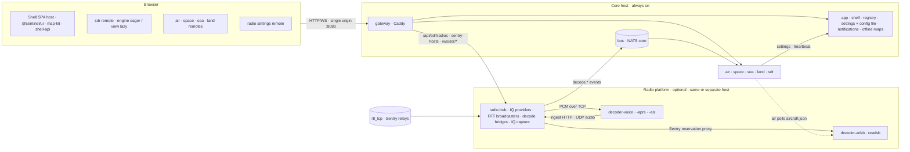

# Sentinel — Section Containers Plan

**Status:** accepted (rev 2, after architecture review; owner decisions resolved 2026-09-30) · **Date:** 2026-09-30 · **Cut against:** `main` @ `99325502`
**Scope:** code-structure and deployment change only — **zero functional or UI change**. Public API paths, WebSocket
protocols, settings keys and the `sentinel_config.json` shape all stay byte-identical.

## 0. Summary

Sentinel today is one FastAPI process serving one Vue SPA; every section shares one SQLite file, one settings router,
one Pinia instance and one bundle. This plan turns it into a **platform + plug-in sections** system:

- **Core (always on):** `app` (shell UI, settings + live config file, notifications, offline maps + tiles, section
  registry), `gateway` (Caddy — the single browser origin), `bus` (NATS core — low-rate events and request/reply).
- **Sections (optional, one container each):** `air`, `space`, `sea`, `land`, `sdr`. Each is a *mini-app*: a FastAPI
  service with its own SQLite DB **plus** a Module-Federation UI remote the shell loads at runtime.
- **Radio platform (optional):** `radio-hub` owns every IQ source (rtl_tcp and the Sentry fleet today; more later),
  the FFT broadcasters, tuning ownership, IQ capture and **all decode bridges**. **Decoder containers** (`decoder-voice`,
  `decoder-aprs`, `decoder-ais`, `decoder-adsb`, future kinds) stay thin native-tool wrappers that attach to the hub;
  decoded events fan out on the bus to **any** section that subscribes.

Adding a section = start its container (`docker compose --profile sea up -d`): it registers with `app`, the gateway
routes its paths, the shell loads its UI remote, and its nav item, sidebar tabs, settings rows and notification types
appear. Not starting it = the feature is absent. Services can run on different hosts.

**SDR keeps playing across sections** for the same reason it does today: the SDR engine is mounted by the shell
*outside* the router view and holds module-level singletons (AudioContext, worklet, sockets). Under federation the
`sdr` remote exposes an **eager `engine` entry** mounted into the shell's always-rendered `#radio` slot at boot, and a
**lazy `view` entry** (waterfall/decode dock) for `/sdr/` only.

The migration is a **strangler**: decouple inside the monolith first (bus abstraction, registries, contracts, boundary
lint rules), federate the UI while still one container, then extract containers one at a time behind the gateway.
Every phase ships on its own, keeps all gates green, and can be rolled back.

---

## 1. Codebase review — what stands in the way

Four parallel read-only reviews (backend, frontend, infra/CI, external research) and one independent architecture
review of this plan. Citations are against `99325502`.

### 1.1 Size
- Backend: **128 REST + 4 WS routes** across 9 routers (`routers/sdr.py`: 44 REST + all 4 WS); 19 tables in one `Base`;
  48 pytest files; one root `conftest.py` importing `backend.main.app` (every router).
- Frontend: ~580 files. `components/shared` 195 (≈50 settings controls), 16 stores + `_persist.ts`, 67 composables.
  Largest: `SdrWaterfall.vue` 3386 lines, `SdrPanel.vue` 1983, `stores/sdr.ts` 1338. 14 Playwright specs + `mockApi.ts`.

### 1.2 Backend coupling
| # | Coupling | Evidence | Resolution |
|---|---|---|---|
| B1 | Import cycle `routers/sdr` ↔ `routers/settings` ↔ `services/app_config` ↔ `database` | `sdr.py:744`, `settings.py:361`, `app_config.py:276-290`, `database.py:440` | Move `_reconcile_sdr_frequencies` into sdr; side effects become level-triggered reconcilers fed by `settings.changed` (§4.3) |
| B2 | Decode ingest writes straight into Land/Sea stores from the SDR router | `sdr.py:1490-1492` → `aprs_store.upsert_station`; `sdr.py:1681` → `ais_decode.ingest_event` | Hub keeps ingest + its 409 gate, then publishes `decode.<kind>.<radio>`; Land/Sea subscribe |
| B3 | Sea reads bridge state in-process | `sea.py:31,89` `get_active_ais_bridge()` | Bus request/reply `hub.decode.ais.status` |
| B4 | Settings written by a service that doesn't own the namespace: `sdr.aprs_radio_id` (Land's active APRS radio), `sdr.ais_radio_id` (Sea's *actively decoding* radio — distinct from the *designated* `sea.aisSdrRadioId`, see `useOffgridAisDecode.ts:12-16`), `app.instanceId` (written by Air, `adsb_source.py:99-104`) | — | **Keys are not renamed** (the config file shape is user-visible). Ownership of the *writer* moves: the hub persists `sdr.aprs_radio_id`/`sdr.ais_radio_id` and resumes decode itself; `app.instanceId` stays in core and is read verbatim by the hub |
| B5 | Every section's notifications live in Air's `air_messages` table | `air.py:262-312`; `stores/notifications.ts:188-262` | Table + `/api/air/messages*` endpoints move to **core**, same path and shape (gateway routes that prefix to `app`) |
| B6 | Air reads the hub's `sentry_hosts` table incl. `auth_token` | `adsb_source.py:131,256` | Hub exposes a Sentry-reservation proxy; Sentry stays the arbiter across Sentinel instances; Air never sees credentials |
| B7 | Fleet poller rewrites `sdr.radios` | `sentry_fleet.py:235,261` | `sdr.radios` **stays a core setting** (it is in the config file, `data/sentinel_config.json:190`); the hub reads it through the settings client and writes port-follow updates through core's settings API |
| B8 | Lifespan orchestrates every section | `main.py:59-131` | Each service owns its lifespan and the SIGTERM wake chain (pattern of `main.py:97-111`) |
| B9 | Live config file hooks the global SQLAlchemy `Session` | `app_config_file.py:233-258` | Settings remain in core's DB, so this stays in core unchanged |
| B10 | `app.connectivityMode` read by air/space/sea/offline maps | `utils.py:94-148` | SDK settings client: versioned cache + `settings.changed` invalidation + periodic resync |
| B11 | Sidecars hard-code host `app`, share a secret through a named volume; `adsb-decoder` hard-codes a LAN IP | `docker-compose.yml:61-199` | Env-configured endpoints, per-service credentials, no shared volume |
| B12 | Raw IQ recording runs inside the broadcaster | `routers/sdr.py:821-840`, `services/sdr.py:729-760` | Hub `iq-capture` API writes to the hub's volume; `sdr` keeps recordings metadata + browser-uploaded WAV (`sdr.py:848-886`) and proxies `GET /api/sdr/recordings/{id}/iq` |

### 1.3 Frontend coupling
| # | Coupling | Evidence | Resolution |
|---|---|---|---|
| F1 | Shell imports sections: all views statically (`router/index.ts:2-6`), air/land store hydration (`main.ts:23-28,128-176`), `SdrTabPanel` and air/space alert services (`App.vue:143-149`) | — | Registries filled by each remote's `register()`; hydration moves into `register()` and runs before first render |
| F2 | `MapSidebar.vue:204-395` hard-codes per-domain tabs, sub-tabs and store writes | — | Sidebar tab/sub-tab registry; existing Teleport targets unchanged |
| F3 | `SettingsPanel.vue:334-760` hard-coded `ALL_SETTINGS`; `SettingRow.vue:16-232` statically imports ~50 controls | — | Settings registry; each remote contributes items + lazy components |
| F4 | `SentinelControlBase` lives in `components/air/` and is imported by shared/space/sea/land | — | Move to `@sentinel/map-kit` |
| F5 | Cross-section imports: sea→air (`adsbSprites`), sea→land (`LandRangeRingsControl`), land→sdr (`SdrAprsSymbol`, `stores/sdr`), air/sea→`stores/sdr`, `stores/sdr`→air (`adsbSourceApi`) | frontend review §2 | Shared pieces to map-kit/ui; store reaches become capabilities |
| F6 | DOM `CustomEvent` bus `sentinel:sdr-tune-external/restore` from Air/Sea/Land filters and `SatellitePassScheduler.ts:289-300,341`; consumed by `SdrPanel.vue:1981-1982` | — | Typed `radio` capability (§3.6) |
| F7 | App-level background services import section internals: `useAirAlertsService` (pulls in `useNotificationSubscriptions`, `useOverheadAlertZones`) and `useSpaceAlertsService` | `App.vue:167-185` | Each remote exposes `./background`, started at boot |
| F8 | Notification click navigation hard-codes `/air/`, `/space/` and space auto-tune semantics (`passNotifStore` imported from *space*) | `NotificationsPanel.vue:97-172`; `stores/notifications.ts:82-127` | Per-section notification type + click-handler + dismiss-hook registry |
| F9 | **Pre-existing defect:** `AirMap` never clears its aircraft click handler; after leaving `/air`, clicking an aircraft alert silently does nothing | `AirMap.vue:243,524` | Fix in P2 (independent bug) |
| F10 | Radio/Sentry settings UI and the ADS-B/APRS/AIS radio pickers use `stores/sdr`/`sdrRadiosApi`; `useOffgridAisDecode` calls `sdrStore.startAis/stopAis`; `LandFilter.vue:311-410` writes SDR frequencies | — | A small `radio` settings remote from the hub; sea/land own their decode API clients; `radio.frequencies` capability |
| F11 | `<domain>.enabled` gating: `main.ts:56-104` (`DOMAINS_ON_BY_DEFAULT` = air, space, sdr), `router/index.ts:22-29`, `SettingsPanel.vue:762,785`; `/` redirects to `/air/` | — | Visible = **registered AND enabled** (§3.5) |

### 1.4 Where SDR playback actually lives
- `App.vue:113-119` mounts `MapSidebar` with `<SdrTabPanel/>` in the `#radio` slot; `MapSidebar.vue:184-190` renders the
  radio pane **unconditionally**, so the single `SdrPanel` lives for the page lifetime — even when SDR is *disabled*
  (which is why Space auto-tune works with SDR disabled today).
- `useSdrAudio.ts` / `useSdrDecode.ts` hold **module-level singletons** (AudioContext, worklet, IQ + decode sockets);
  `useSdrControlSocket` survives because the `SdrPanel` instance survives; `index.html:44-54` pre-creates an
  AudioContext when `sessionStorage.sdrPlaying` is set.
- The route-level `SdrView` only renders the waterfall from `stores/sdr` spectrum state.
- **No e2e currently asserts "audio survives navigation"** — P0 adds one.

### 1.5 Infra / CI
- One origin serves SPA, `/api`, `/ws`, `/assets`; Vite dev, the fullstack smoke and the a11y suite assume it.
- `frontend/spa-dist` is committed and CI fails if a rebuild differs; no Docker build in CI; decoder images must never
  be built in CI (mbelib).
- Offline tiles (2.2 GB) are bind-mounted; offline downloads and recordings live on the `sentinel_db` volume.
- Decoder images pin upstream **branches** (`master`, `audio_work`, `dev`), not SHAs.

---

## 2. Target architecture



### 2.1 Container catalogue

| Container | Profile | Owns (code) | Owns (data) | UI remote | Needs |
|---|---|---|---|---|---|
| `app` | core | registry, settings API + validation from manifests, `sentinel_config.json` sync, notifications (`/api/air/messages*`), offline maps + tile resolver, `/assets` (styles, fonts, sprites, pmtiles), shell SPA | `user_settings` (incl. `sdr.radios`, `app.instanceId`), `air_messages`, `offline_map_region`, offline tiles dir | — (host) | bus |
| `gateway` | core | Caddy; static Caddyfile with env-templated upstreams for known ids + admin API (internal only) for new ids; `handle_errors` 503 page | — | — | — |
| `bus` | core | NATS core (JetStream deferred) | — | — | — |
| `air` | `air` | `routers/air.py` (minus messages), `/api/sdr/adsb/*` logic (via hub reservation proxy), `adsb`, `upstream_rate_limit` | `adsb_cache`, `air_tracking` | `air` | core; optional hub + `decoder-adsb` |
| `space` | `space` | `space`, `tle`, `satellite`, `daynight`, `sat_radio` | `tle_cache`, `satellite_catalogue` | `space` | core; optional `radio` capability |
| `sea` | `sea` | `sea`, `ais_stream`, `ais_store`, `ais_decode` (bus subscriber), off-grid AIS start/stop client | `sea_vessel_cache` | `sea` | core; optional hub + `decoder-ais` |
| `land` | `land` | `land`, `repeaters`, `aprs_store` (bus subscriber), APRS cleanup, APRS start/stop client | `aprs_stations`, `repeater_cache` | `land` | core; optional hub + `decoder-aprs` |
| `sdr` | `sdr` | frequencies, groups, search ranges, band plan, `sdr_data`, recordings metadata + WAV | `sdr_frequency_*`, `sdr_search_ranges`, `sdr_recordings`, recordings volume; keeps writing its `user_settings` mirrors (`sdr.groups/frequencies/searchRanges/bandPlan`) into core as today | `sdr` (engine + view) | core, hub |
| `radio-hub` | `radio` | `services/sdr.py` (connections, broadcasters, `RelayControlClient`, tuning ownership), Sentry client/fleet/routes, **all `sdr_decode.py` bridges** incl. UDP voice return + 48 kHz resampler, decode ingest + 409 gating, `/ws/sdr/*` (all 4), IQ capture, Sentry reservation proxy | `sentry_hosts`, IQ capture files | `radio` (settings-only: radios + Sentry hosts) | core |
| `decoder-voice/-aprs/-ais` | `decoder-*` | unchanged native tool + entrypoint; only endpoint env vars change (hub instead of `app`) | — | — | hub |
| `decoder-adsb` | `decoder-adsb` | readsb; advertises its `aircraft.json` URL in the registry | — | — | hub (reservation) |

### 2.2 Deployments that must work
- **Core only:** shell, settings, offline maps, notifications, "no sections installed" state.
- **Core + sea:** Sea online via AISStream. Off-grid AIS appears once `radio-hub` + `decoder-ais` register — the SDR
  *section* is not required.
- **Core + sdr + radio:** SDR works; there are no "tune" buttons elsewhere because those sections are absent.
- **Core + space + sdr + radio:** pass auto-tune works through the `radio` capability; without `sdr`, Space hides its
  auto-tune / "& RECORD" toggles and auto-tune notifications.

---

## 3. Contracts

JSON Schema in `platform/contracts/`, generating Pydantic (Python SDK) and TS types (web SDK); versioned as
`contracts: 1.x`. CI fails a service or remote built against an incompatible major.

### 3.1 Service manifest
```jsonc
{
  "id": "sea", "kind": "section",               // section | radio-hub | decoder
  "version": "3.4.0", "contracts": "^1",
  "displayName": "SEA", "icon": "sea", "navOrder": 30,
  "internalUrl": "http://sea:8000",             // advertised address; may be another host
  "routes": ["/api/sea/"],                      // gateway prefixes (validated: must not collide)
  "ui": { "remoteEntry": "/remotes/sea/remoteEntry.js", "exposes": ["./register", "./view", "./background"] },
  "settings": { "namespace": "sea", "defaults": {"…": "fragment of default_config.json"}, "schema": {},
                "secretKeys": ["aisstreamApiKey"], "removedKeys": [], "renames": {} },
  "requires": [], "optional": ["radio-hub", "decoder:ais"],
  "provides": [], "consumes": ["event:decode.ais"],
  "health": "/health"
}
```
Decoders declare `kind: decoder`, `decoderKind: "ais"`, and their PCM spec (rate, channels, demod). `decoder-adsb` also
declares `endpoints: { aircraftJson: "http://adsb-decoder:8080/data/aircraft.json" }`.

### 3.2 Registry lifecycle
1. On start a service `POST`s its manifest to `app` `/internal/registry/register` with its own credential. The registry
   validates the schema, id pattern and route prefixes (no collisions, no `/api/app`), and **rejects re-registration
   of a live id from a different instance**.
2. `app` seeds settings defaults (idempotent), makes sure the gateway route exists, and publishes `registry.changed`.
3. Liveness: `app` **HTTP health-probes** every 10 s and marks a service unavailable after 3 failures. This does not
   depend on NATS, so a bus restart can't grey out healthy sections.
4. The shell reads `GET /api/app/sections` before mounting (as it waits for `/api/settings` today) and follows an SSE
   stream for changes.

### 3.3 Bus subjects (low-rate only)
| Subject | Publisher → consumers | Replaces |
|---|---|---|
| `registry.changed` | app → all | — |
| `settings.changed.<ns>` `{key, version}` | app → interested services | synchronous side effects in `app_config.py:276-290`, `settings.py:361` |
| `decode.<kind>.<radioId>` | hub (after the ingest gate) → sea / land / future | `sdr.py:1490-1492`, `:1681` |
| `hub.decode.<kind>.{start,stop,status}` (request/reply) | sea / land → hub | `/api/sdr/{aprs,ais}/{start,stop,status}` internals |
| `hub.iq-capture.{start,stop}` (request/reply) | sdr → hub | `sdr.py:821-840` |

FFT frames, browser IQ and PCM **never** go on the bus. They stay on WebSockets through the gateway and on
hub ↔ decoder TCP. Only NATS core is used; JetStream is deferred, because Sea already warm-starts from
`sea_vessel_cache` and consumers reconcile level-triggered on restart.

### 3.4 Radio hub
The hub is the current `services/sdr.py` + `services/sdr_decode.py` + Sentry code, **moved, not rewritten**:
- It serves the four WebSockets `/ws/sdr/{id}`, `/ws/sdr/{id}/iq`, `/ws/sdr/{id}/decode` and `/ws/sdr/{id}/decode/audio`
  byte-identically. The `digital_decode`/`digital_channel` control commands, `decode_status`/`decoder_reachable` and
  the resampler all stay local to the hub.
- It keeps the decode bridge contract to decoders (PCM TCP server, UDP voice return, `/ingest` + `/config` endpoints,
  409 when no bridge is active). Decoders only change the host they point at.
- **New decoder kinds** register a manifest with their PCM spec. The hub runs a generic `PcmDecodeBridge` for them
  (with `ChannelOwningDecodeBridge` semantics when the spec says `ownership: absolute`), and publishes their ingest
  events as `decode.<kind>.<radioId>` for any section. Several decoders of one kind are assigned per radio by the hub.
- **IQ providers:** `RtlTcpProvider` and `SentryProvider` (fleet poller + relay control) implement one `IqProvider`
  interface. New sources (SoapySDR, KiwiSDR, file replay) are new adapters, not new containers.
- **Sentry reservation proxy:** Air asks the hub, and the hub calls Sentry `acquire_reservation`/`patch_device` with
  the verbatim `app.instanceId` as holder. Sentry stays the lease authority, so no first-claim 409 after the upgrade
  (`RESERVATION_TTL_SECONDS=120`, `adsb_source.py:56`).

**Why Sentry belongs in the hub, not `sdr` or `app`:**
- Air, Sea and Land need radios when the SDR *section* is absent, so it can't live in `sdr`.
- It shouldn't live in `app` either. The core must stay radio-free so it can run anywhere, and a future IQ source should
  touch only the hub.

**Placement is measured, not assumed.** Today the app on the UI host talks to remote `rtl_tcp` over the LAN, so the
default keeps the hub on the core host (the same data path as today). Moving it to the Pi puts FFT (up to 32k bins at
25 fps per radio) and every demod bridge on the Pi, and `services/sdr.py:53-54` already notes the Pi's limits.
Recordings on the Pi's SD card would also mean write wear.

### 3.5 Section visibility and boot
- **Visible = registered AND `<domain>.enabled`.** `DOMAINS_ON_BY_DEFAULT` is unchanged. `/` redirects to the first
  visible section instead of hard-coding `/air/`.
- The SDR engine loads whenever `sdr` is **registered**, even if it is disabled, to match today's always-mounted
  `SdrTabPanel`.
- **Boot order:**
  1. The shell fetches `/api/settings` and `/api/app/sections` in parallel.
  2. It calls `registerRemotes` and loads every `./register`.
  3. It loads the `sdr` `./engine` with a timeout; on timeout it mounts without it and late-mounts the engine when it
     arrives.
  4. It starts the `./background` entries.
  5. It mounts the app.
  Capability calls made before the engine mounts are queued, as `drainPendingExternalTune` does today.
- **As built (P4.7):** the engine is not a second federation expose. The sdr `./register` hands the shell a loader,
  `loadPersistentRadioPane: () => import('./engine')` (and its view as `() => import('./SdrView.vue')`), so the
  register chunk is ~70 KB instead of the whole 650 KB section, and the engine is a lazy chunk of the same remote —
  sharing its module instances, so the `radio` capability's queue (`attachRadioEngine`) is the one the pane drains.
  The shell's `shell/sectionEngines.ts` starts it right after registration, alongside settings hydration, waits
  `ENGINE_BOOT_TIMEOUT_MS` (3 s), then mounts; a late engine fills a reactive pane ref and `App.vue` mounts it then.
  The same code path runs in dev/tests (static sections) and the federated build.
- **Unavailable at runtime:** the nav item greys out and routes render a "section unavailable" state that clears
  `body[data-no-data]`. A loaded remote is **never unloaded** in the session.

### 3.6 `@sentinel/shell-api`
Every remote's `./register` receives a `ShellContext`:
```ts
export default function register(shell: ShellContext) {
  shell.routes.add({ path: '/sea/', component: () => import('./SeaView.vue'), domain: 'sea' })
  shell.nav.add({ id: 'sea', label: 'SEA', icon: SeaIcon, order: 30 })
  shell.sidebar.addSearchPane('sea', () => import('./SeaSearch.vue'))
  shell.sidebar.addFilterSubTabs('sea', seaFilterTabs)
  shell.settings.addSection({ id: 'sea', label: 'SEA', items: seaSettingItems })   // components lazy
  shell.notifications.addType('vessel', { onClick: t => shell.router.push({ path: '/sea/', query: t }) })
  shell.tracking.addKind('vessel', …)                                             // hides items for absent sections
  shell.background.add(() => import('./background'))
  shell.capabilities.whenAvailable('radio', radio => enableTuneButtons(radio))
}
```
The registries are `routes`, `nav`, `sidebar`, `footer`, `settings`, `notifications` (types, click handlers and
dismiss hooks), `tracking`, `background`, `capabilities` and `events` (a typed wrapper for the remaining document
events such as `sentinel:config-uploaded` and `sentinel:sidebar-state`).

The **`radio` capability**, provided by the `sdr` engine, covers everything other sections use today:
- `tune({hz, mode, source, satName?, noradId?, token, record?, digital?})`
- `restore(token)`
- `connected` (reactive)
- `activeRadioIds` (e.g. the APRS radio)
- `frequencies`: `has`, `save`, `remove`, `ensureGroup`

The **`radioSites` capability** comes from the `radio` remote and feeds the `SentrySitesControl` map control, overhead
zones and range-ring origin. The last-known sites are cached, so zones don't flap while the hub restarts.

Shared packages (host-provided singletons under federation, npm workspace packages in the repo):
- **`@sentinel/ui`** (`platform/web/ui`, done in P4.1): the `Base*` primitives, `IconRail`/`IconRailAccordion`, the
  generic icons and the DOM composables (`useDisclosure`, `useDocumentEvent`, `useWindowEvent`, `useTeleportedMenu`,
  `useRadioGroupKeyboard`). The settings-bound `BaseToggleSetting`/`BaseNumberSetting` stay with the settings code
  (they persist through the settings API), and overlays go with `shell-api`.
- **`@sentinel/web-config`** (`platform/web/config`): the shared tsconfig base, ESLint, Prettier, Vitest config and
  test setup, used by the SPA and every package.
- **`@sentinel/map-kit`** (`platform/web/map-kit`, done in P4.3; also holds `UserLocationMarker`, `map-cluster`,
  `map-label`, `useRangeRingOrigin` and `useUserLocation`):
  - `MapLibreMap` and `SentinelControlBase`
  - the shared controls: names, roads, terrain, sentry-sites, range-rings (incl. `LandRangeRingsControl`) and zoom
  - `adsbSprites`
  - `useOfflineTierRefresh`, `useBasemapLayerSync`, `useMapContextMenu` and the style utils
- **`@sentinel/shell-api`** (`platform/web/shell-api`, done in P4.2 — `shell/sections.ts`, the composition root, stays
  in the SPA):
  - the registries
  - the core stores: `app`, `settings`, `theme`, `basemap`, `notifications`, `offlineMaps`, `sentrySites`, `tracking`

**Federation settings (`@module-federation/vite`):**
- The host shares `vue`, `vue-router`, `pinia`, `maplibre-gl`, `pmtiles` and `@sentinel/*` as eager singletons.
- Remotes declare those with `import: false`, so they never bundle a second copy.
- `register()` asserts it is using the host's Pinia: the shell passes `ShellContext { pinia }` and each section
  calls `assertHostPinia(shell, getActivePinia(), id)` with its own `pinia` import, so a remote that bundled a second
  Pinia throws and gets the "section unavailable" page instead of running with split state (P4.7).
- `remoteEntry.js` is served `no-cache` (like `index.html`), and chunks are hashed.
- Remote CSS injection order is covered by a visual-snapshot check. `SdrPanel.css` has cascade dependencies
  (`SdrGroupsTab.vue:157`, `SdrRecordingsSection.vue:644`). As built (P4.7): `frontend/vue/e2e/sdr-css-cascade.spec.ts`
  snapshots the *resolved* cascade-decided styles (colours, padding, borders, typography, display — no layout-derived
  sizes, no animated properties) of every element on the SDR page and each SDR rail tab, as text, so one baseline
  holds on every OS where pixel screenshots would not. The baseline was recorded from the pre-split single-chunk
  bundle; swapping the two `SdrGroupsTab` rules in the built CSS turns it red.

### 3.7 Browser storage ownership
The shell keeps `app`/`theme`/`basemap`/notifications/tracking keys and `sessionStorage.sdrPlaying` (read by the shell's
`index.html` early-AudioContext script). Section keys (`air.*`, `space.*`, `sea.*`, `land.*`, `sdr.*` persisted state)
move into their remote's stores under the **same key names**, so no user state is lost. The full key-by-key table,
with owners and the cross-owner reads that must survive the split, is
[section-storage-keys.md](section-storage-keys.md).

---

## 4. Backend structure

### 4.1 Repository layout (monorepo: uv workspace + npm workspaces)
```
platform/contracts/        JSON Schema → Pydantic + TS
platform/py-sdk/           sentinel_sdk: create_service(), registration, settings client, bus client (NATS + in-memory),
                           service auth, SQLite base + legacy import, health, SIGTERM chain, error handlers, cache helpers
platform/web/{ui,map-kit,shell-api}
services/app/{backend,shell}   services/gateway/   services/radio-hub/{backend,settings-remote}
services/sections/{air,space,sea,land,sdr}/{backend,frontend}
services/decoders/{voice,aprs,ais,adsb}/       (the current decoder/ tree, moved)
services/dev-all/          all-in-one composer: every service in one process, in-memory bus (dev + low-RAM hosts)
compose.yaml               profiles: core (default), air, space, sea, land, sdr, radio, decoder-*, all
compose.radio-host.yaml    hub + decoders on a separate host
docker-bake.hcl            amd64 + arm64
```

### 4.2 `sentinel_sdk.create_service()`
This is the one FastAPI factory every service uses.
- **Config from env:** `SENTINEL_CORE_URL`, `SERVICE_HTTP_CREDENTIALS_FILE`, `NATS_URL`, `SERVICE_INTERNAL_URL`, `DB_PATH`.
- **Lifespan:** legacy import → register → seed → background tasks.
- **Also provides:** the SIGTERM/SIGINT wake chain, `/health`, and the error-handler pack.
- **Test factory:** builds the service with the in-memory bus and in-memory SQLite, keeping today's `conftest.py`
  approach per service.

*As built (P6.0):* the SDK is `backend/platform/sdk/` rather than a separate `platform/py-sdk` package, and each
extracted section's entry point is `backend/standalone/<id>.py` — the same image as the app, run with a different
`uvicorn` target. The section code itself is not moved yet, so the monolith (the rollback and `dev-all` path) and the
service run literally the same routers and services; the move into `services/sections/<id>/backend` is P8 cleanup.
`create_service()` runs the bus, the section's lifecycles and then registration (re-sent every
`SERVICE_REGISTER_INTERVAL_S`, so a restarted core relearns its services; an unchanged re-registration is a no-op), and
serves `/health` and `/remotes/<id>/`. With `SENTINEL_CORE_URL` set, `backend/platform/settings_client.py` reads and
writes settings through core's `/api/settings` instead of the local database. Its credential needs no configuration
under compose: the one-shot `service-credentials` service generates it before anything starts (P7.4b).

### 4.3 Persistence split (owner choice: DB per container)
**Settings stay central.** Core's `user_settings` holds every namespace, so the following keep working unchanged:
- the live `sentinel_config.json` mirror and upload/export
- `useConfigFileSync`
- the Session hook
- `_SECRET_SETTING_KEYS` behaviour

Four rules make that safe:
1. **Validation** of section keys comes from the manifest `schema` (it replaces domain validators in core such as
   `_validated_aprs_channel_hz`).
2. **Absent sections' namespaces are preserved.** They are never pruned or re-defaulted, so a core-only boot can't wipe
   Sea or Land settings. Pruning and renames apply only to registered namespaces, from their manifest.
3. **Side effects are level-triggered.** A service re-reads its settings and reconciles on start *and* on
   `settings.changed`. A missed event self-heals through a periodic version check.
4. **Secrets** go only to the owning service, over service-authenticated `/internal/**` routes. The gateway never routes
   `/internal/**`.

**Domain data** moves to each service's own SQLite on its own volume (see §2.1).

**Legacy import** runs on first boot, is idempotent, and is also available as a `migrate-legacy` profile.
*As built (P6.1):* `backend/platform/sdk/legacy_import.py` attaches the monolith's database read-only
(`LEGACY_DB_PATH`, the `sentinel_db` volume mounted at `/legacy`) and fills each of the section's tables that is still
empty, copying only the columns both sides have. No separate profile was needed. If the old
`sentinel.db` is mounted read-only and the service DB is empty, the service copies its tables and files:
- `sdr` copies its WAV recordings.
- The hub copies `.u8` IQ captures and `sentry_hosts`.
- Core keeps the offline tiles directory on its own volume.

### 4.4 Gateway routing (paths unchanged; longest prefix wins)
| Prefix | Upstream |
|---|---|
| `/api/air/messages` | app |
| `/api/air/` | air |
| `/api/space/`, `/api/sea/`, `/api/land/` | section |
| `/api/sdr/radios`, `/api/sdr/connect`, `/api/sdr/disconnect`, `/api/sdr/status`, `/api/sdr/sentry-hosts`, `/api/sdr/decode/`, `/api/sdr/decoders/`, `/api/sdr/aprs/`, `/api/sdr/ais/` | radio-hub (sea/land call the hub for start/stop on the user's behalf; the browser paths stay where they are) |
| `/api/sdr/adsb/` | air |
| `/api/sdr/` (rest: frequencies, groups, search ranges, data, recordings) | sdr |
| `/ws/sdr/` | radio-hub |
| `/api/settings`, `/api/offline-map/`, `/api/app/`, `/assets/`, `/spa-assets/`, `/fonts/`, `/health`, SPA catch-all | app |
| `/remotes/<id>/` | that service |
| `/internal/` | never routed |

Unregistered or unavailable upstream: Caddy `handle_errors` returns the JSON 503 shape the SPA already handles.

*As built (P5.3):* the static config is Caddy JSON (`gateway/caddy.json`) rather than a Caddyfile, because the
registry's routes are replaced in place through the admin API by `@id` (`registry_routes`). Core owns the table
(`backend/core/gateway_routes.py`) and a reconcile loop (`gateway_sync.py`) keeps the gateway's copy equal to it —
woken by `registry.changed` and on an interval, which also re-pushes after a gateway restart. A service the registry
has marked unavailable gets a static 503 without a dial. No per-id env templating was needed.

**Rollback:** `dev-all` (or the monolith during P6) can re-register any section, so the extraction of a single section
can be reverted by flipping its route back.

*As built (P6.1):* the flip is the registration itself. The monolith still registers its own copy of every section
in-process, and an out-of-process registration of the same id **takes it over** (core logs "moved out of process") —
so starting the `space` container is the whole switch, and stopping it greys Space out through the normal probes.
`SENTINEL_EXTERNAL_SERVICES=space` makes the monolith leave out Space's router, lifecycle and in-process registration
altogether: the "section absent" deployment, and the way to stop the monolith doing Space's startup work twice.
It also withholds Space's built remote from the app's `/remotes` mount, so `/remotes/space/` can only come from the
container. CI's `gateway-smoke` job runs the composed stack three ways — `monolith`, `sections-service` and
`sections-absent` — with `tests/e2e/section-deployment.spec.ts` asserting each extracted section.

*As built (P6.2, Land):* the same pattern, plus one rule the first extraction didn't need. Sections subscribe to bus
events at import (`aprs_store` on `decode.aprs.*`), so the monolith must not even **import** an external section's
code — otherwise its leftover copy keeps handling the events (and writing to the app's database, with no cleanup loop
to trim it). `backend/modules/__init__.py` now imports each section module only when it is hosted, and `main.py`
imports Land's and Space's routers the same way. Decoded APRS packets reach the Land container from the radio hub over
NATS (`decode.aprs.*` is forwarded like any event), so Land needs the `nats` service; APRS start/stop stays with the
hub. The APRS retention setting is read through the settings client. Section services share compose anchors
(`x-section-service`, `x-section-env`).

*As built (P6.3, Air):* Air serves `/api/air/` and `/api/sdr/adsb/`; core keeps `/api/air/messages` (the longer prefix
wins in the gateway). Nothing new had to cross processes: the Sentry reservation and receiver-location calls were
already `hub.*` bus requests and squawk alerts already `notifications.raise` events (P5.2), so both now go over NATS —
verified live in both directions. Its settings reads (`resolve_effective_mode`, the Off Grid source device,
`app.location`) moved onto the settings client. The one deployment change: the `adsb-decoder` used to poll
`http://app:8000/api/sdr/adsb/config` directly, which stops working once the app doesn't host Air, so it now polls
through the gateway. Long-lived section loops that read core's settings on their first pass (Land's cleanup, Air's
squawk watcher) can start before core answers; Land's cleanup now retries a failed run after a minute instead of a
day (Air's watcher already ticks every 5 s). With Air absent the shell falls back to the first deployed section.

*As built (P6.4, Sea):* Sea serves `/api/sea/` and holds the one AISStream connection a key allows, which is why the
app must not import Sea's code when it is external (already the P6.2 rule). Two things were new. **Secrets** (rule 4
above): the AISStream key stays in core's `user_settings`, and the service reaches it through core's
`/internal/settings/secrets/{namespace}/{key}` — join-token gated (`backend/core/internal_auth.py`, shared with
registration) and limited to `SECRET_SETTING_KEYS` — via the settings client's `read_secret`/`write_secret`/
`delete_secret`; the `.env` fallback `AISSTREAM_API_KEY` is passed to the container like any env setting. The join
token is still deployment-wide, so any service could read it; per-service credentials remain §4.5 work. **A latent
bug in every extracted service:** `backend/modules/__init__.py` composed `MODULES`/`MANIFESTS` at import, so a
service importing its own `backend.modules.<id>` also imported every other module — the radio hub's `hub.*`
responders included. Air's and Sea's `hub.*` requests were then answered locally against the service's own database
instead of crossing NATS. Both are now composed lazily (PEP 562), and each service loads only its own section.
Off-grid vessels arrive as `decode.ais.*`, the receiver reconcile and bridge status are `hub.decode.ais.*` requests,
and `settings.changed.{sea,app}` reaches the reconciler over NATS (all verified live). The startup reconcile retries
every minute until it succeeds once, because core or the hub may still be starting. The AIS reader reads Sea's
settings once per tick (`domain_settings_map` + `effective_mode_of`/`domain_urls_of`) rather than once per question,
since each read is now a round trip to core.
Rolling back is unsetting it and restarting the app.

*As built (P6.5, radio hub):* the hub runs as `backend.standalone.radio_hub` (compose service and profile `radio-hub`
rather than the `radio` profile in §2.1, so the id is the same on both `.env` lines). It serves every hub prefix in
the routing table above, including `/ws/sdr/`, which Caddy proxies with no extra config. It has no UI remote: the
radio panes stay the SDR section's. Its database holds only `sentry_hosts` (bearer tokens included), copied by
legacy import. Everything it read straight from `user_settings` now goes through the settings client: `sdr.radios`,
`sdr.aprs_radio_id`, `sdr.ais_radio_id`, the APRS channel and `app.instanceId` (core's `get_instance_id` uses the
client too). In the monolith that makes those writes announce `settings.changed.sdr`, which nothing subscribes to.
Like a section, the monolith doesn't even import an external hub's code, because its modules register the `hub.*`
responders at import. Nothing new had to cross processes: Air's reservations, Sea's AIS receiver, the SDR
section's IQ captures, `decode.<kind>.*`, `settings.changed.land` and `sdr.decode.radio-reassigned` were already
bus traffic. All were verified over NATS on a composed stack, with the stub decoder driving a full decode and the
spectrum WebSocket streaming through the gateway. Two deployment changes:
- **Decoders** dialled the hub directly (PCM over TCP, voice back over UDP, ingest/config over HTTP), so their host
  was `${SENTINEL_RADIO_HUB_HOST:-app}` and running the hub in its own container took a third `.env` line. P7.2
  removed it (below).
- **IQ captures** still land where the SDR section serves recordings from: the hub's `IQ_CAPTURE_DIR` points at
  that folder on the app's volume (mounted a second time into the hub container), so the app finds `<id>.u8` as
  soon as the hub replies to `hub.iq-capture.stop`. This needs a shared host. The folder moved with the SDR
  section in P6.6 (below), and P7.3 replaced the shared folder with an HTTP copy.

With the hub stopped, its prefixes are a JSON 503 from the gateway while the SDR section's own routes keep working.
With the hub absent (never registered), `/api/sdr/radios` falls through to the app's SPA catch-all, as an absent
section's API does.

*As built (P6.6, SDR):* the last extraction. The SDR section runs as `backend.standalone.sdr` (compose service and
profile `sdr`, `sdr.db` on `sdr_data`) and serves the rest of `/api/sdr/`: stored frequencies, groups, search ranges,
the band plan editor and recordings. Every other `/api/sdr/` path is a longer prefix (the hub's, or Air's
`/api/sdr/adsb/`), so the gateway needed no change; `main.py` still includes the SDR and hub routers interleaved
when it hosts both, which keeps the route-order golden, and includes either alone otherwise. Three things were new:
- **Settings mirrors.** The SDR section mirrors its tables into core's settings (`sdr.groups`, `sdr.frequencies`,
  `sdr.searchRanges`) after every edit, so the live config file keeps showing them, and seeds `sdr.bandPlan`, which
  the waterfall reads from core. Those reads and writes, and `sdr.recordRawIq`, now go through the settings client.
  In the monolith that makes them announce `settings.changed.sdr`, which nothing subscribes to.
- **Recordings move with the section.** They live next to its database (`recordings/` on `sdr_data`), and legacy
  import copies the WAV and `.u8` files of the recordings it copied (`import_legacy_files`). It does that only on the
  boot that copied `sdr_recordings`, so a recording deleted since doesn't come back. The radio hub writes IQ
  captures into whichever folder the live SDR section serves: `IQ_CAPTURE_DIR` (the app's volume) while the app
  hosts SDR, and `SDR_SERVICE_RECORDINGS_DIR` (`sdr_data`, mounted into both the app and the `radio-hub` service)
  once `sdr` is in `SENTINEL_EXTERNAL_SERVICES`, which the hub's container now receives too. The operator lists
  `sdr` on the two usual `.env` lines and sets nothing else. This still needed one host; P7.3 removed both folders
  (below).
- **No section is always present any more.** CI's absent leg keeps SDR in the app, so the shell still has a section
  to show, and a fourth leg, `sdr-absent`, removes only SDR. That leg shows the shell boots without the SDR
  remote, whose audio engine it otherwise loads eagerly.

Verified on an isolated composed stack with a fake rtl_tcp: legacy import (five tables, two files), the mirrors
reaching core, and IQ captures landing on `sdr_data` with the hub in its own container and with the hub in the
app. All four gateway-smoke legs passed locally.

### 4.5 Security
- **Service credentials:** every service and decoder has its own generated HTTP credential and every service its own
  NATS user with per-subject permissions (P7.4a/b); nothing secret lives in `.env` or the repository.
- **Manifest validation:** a service can't claim another section's prefixes or `/api/app`.
- **Remote code:** UI code is served same-origin through the gateway, under CSP `script-src 'self'`.
  *As built (P5.3):* core sets the CSP on the shell document with the inline boot scripts allowed by hash, but it
  must also allow `blob:` and `'unsafe-eval'` for SDR audio (the demod worklet is a Blob URL; the plain-HTTP LAN
  fallback evaluates it with `new Function`). Serving the worklet source as a same-origin file would remove both —
  a follow-up.
- **Internal surfaces:** the Caddy admin API is bound to the internal network. The shared `decoder_secret` volume and
  join token are replaced by per-service credentials (P7.4b).
- **Multi-host:** NATS TLS with a locally generated CA (`make certs`).

### 4.6 Multi-host
- Each host runs `docker compose` with its own profiles; there is no Swarm.
- `SERVICE_INTERNAL_URL` is the address the gateway reaches the service on.
- A radio host runs `radio-hub` and the decoders, plus an optional NATS leaf node.
- `docker buildx bake` builds amd64 and arm64 images. Decoder images are still built locally only (the mbelib rule).
- Decoder upstreams get pinned to SHAs.

*As built (P7.1, healthchecks + non-root images):* the app image's server never runs as root. Its entrypoint
(`backend/docker-entrypoint.sh`) starts as root only to hand the writable mounts (`/app/data`, the decoder secret
and join-token volumes, the radio hub's recordings mounts) to `SENTINEL_RUNTIME_USER_ID`/`SENTINEL_RUNTIME_GROUP_ID`
(default 1000, the
image's `sentinel` user), then `setpriv`-drops to it, which the official postgres/redis images also do. A bare
`USER` could not upgrade a live deployment, whose named volumes are root-owned. Set both ids in `.env` on a Linux
host whose checkout isn't uid 1000, because the app writes `sentinel_config.json` into the bind-mounted
`./backend`. The containers run the venv's `uvicorn` directly (the venv is on `PATH`) instead of `uv run`, which
re-synced at start and so installed the dev dependency group into the venv on every boot, as root. The image's `HEALTHCHECK` polls `/health`, which core and every service serve once
their lifespan has started. Section services wait for `app` and `nats` to be `service_healthy`, so
`docker compose up --wait` (CI) returns only once every backend container is serving. CI also checks that no
backend container's PID 1 is root. The gateway's tmpfs scratch dirs are now owned by Caddy's user, so it no longer
logs a storage error. The decoder images already ran unprivileged.

*As built (P7.2, advertised URLs):* every service already registered the address the gateway reaches it on
(`SERVICE_INTERNAL_URL`, or `core_internal_url` for whatever the app hosts in-process), so what was left were the
decoders, which were told the hub's host by compose. They now talk HTTP (config poll, ingest, manifest
registration) only to the gateway (`SENTINEL_GATEWAY_URL`, default `http://gateway:8080`), which routes to the hub
wherever the registry says it is. Their PCM feed (TCP) and the voice decoder's audio return (UDP) can't go through
Caddy, so every decoder `config` reply names them, `{"pcmFeed": {"host", "port"}}` plus `voiceAudioReturn` for
voice, with the host taken from the hub's own registered address (`radio_hub/services/decoder_sockets.py`). A
decoder reads them on each launch, so it follows the hub if it moves. `SENTINEL_RADIO_HUB_HOST` and the per-decoder
`INGEST_URL`/`CONFIG_URL`/`IQ_PCM_HOST`/`IQ_PCM_PORT`/`AUDIO_UDP_*` (and the stub's `HUB_URL`/`PCM_HOST`) are gone, so
moving the hub into its own container is the usual two `.env` lines. Polling through the gateway means "no hub" now
arrives as an answer rather than a refused connection: a gateway 502/503/504, or, with no hub registered at all, the
app's SPA page (and a 405 for a POST). Decoders treat all of those as "waiting for the radio hub" and log them once.
Two things remained for a second host, both solved in P7.5a: the decoders reach a hub's sockets over the radio host's
own network (`DECODER_SOCKETS_HOST`), and a service on another host joins core through the TLS service entrypoint.

*As built (P7.3, IQ captures without a shared volume):* the radio hub no longer writes into the SDR section's
folder unless the SDR section shares its process (`shares_process_with("sdr")`: the app, not a standalone service,
with SDR hosted). In the monolith the capture is still written straight into the recordings, so nothing below runs.
Otherwise it goes into the hub's own staging folder, `iq-captures/` next to its database, which holds nothing but
captures waiting to be collected. The SDR section collects them (`services/sdr_iq_capture_transfer.py`):
- **On stop, in the background.** `POST /api/sdr/recordings/stop` returns at once with `iq_file_pending: true` and
  starts the copy. The copy asks the hub where the capture is (`hub.iq-capture.locate` → `download_url`, the hub's
  registered address plus `/internal/radio-hub/iq-captures/<id>`), then streams it through a `.part` file that is
  renamed when complete, and deletes the hub's copy. That route (`radio_hub/routers/iq_captures.py`) needs the
  join token, refuses a capture still being written (409) and is never routed by the gateway. While the IQ is
  pending, its download is a 409 and the recordings list shows a disabled "IQ…" button, re-listing every 3 s until
  it lands. A minute of capture is ~300 MB, so the stop request no longer waits for it.
- **A reconcile loop** (the SDR lifecycle, every 60 s, only when the hub is in another process) catches up on
  anything the background copy missed. It retries pending copies (hub down or restarted). It stops a capture whose
  stop never arrived. It asks the hub what it holds (`hub.iq-capture.list`) and has it discard
  (`hub.iq-capture.discard`) anything nobody will collect: a deleted recording, a capture whose start never
  committed, a copy that landed but whose delete failed. A recording still in progress always keeps its capture.
  A capture the hub no longer holds at all is lost, and its recording stops claiming an IQ file. An outage is
  logged once when it starts and once when it ends. Deleting a pending recording also asks the hub to discard it
  straight away.
- `list`/`discard` and the HTTP delete refuse to touch a folder shared with the SDR section, so they can never
  delete a recording's own IQ.

The owner chose copy-on-stop over the B12 row's "proxy downloads from the hub", so a recording's files live together
on `sdr_data` and don't depend on the hub staying up or where it runs. `IQ_CAPTURE_DIR`, `SDR_SERVICE_RECORDINGS_DIR`,
the `sdr_data` mounts in the app and `radio-hub`, the hub's `sentinel_db` mount and its `SENTINEL_EXTERNAL_SERVICES`
are gone. The IQ never touches the bus. Verified on an isolated stack with a fake rtl_tcp in all four topologies (hub
and SDR each in their own container, hub in the app, SDR in the app, monolith), plus three failure cases:
- the hub stopped before the recording stopped: collected by the reconcile loop once it was back;
- a pending recording deleted while the hub was down: the hub's copy was discarded when it returned;
- the gateway answers 404 for `/internal/radio-hub/` and the hub answers 401 without the token.

*As built (P7.4a, NATS TLS + per-service users):* the broker no longer accepts anonymous or plain-text clients.
The owner chose a generated config over core-issued JWTs: a one-shot `nats-setup` compose service (the app image
running `backend/scripts/generate_nats_credentials.py`, before `nats` starts) keeps on the `nats_setup` volume a CA
for this deployment, the broker's certificate (names `nats` and `localhost`, plus `NATS_SERVER_EXTRA_HOSTNAMES`;
reissued when those change or it nears expiry), one random password per NATS user and `nats.conf`. Everything but
the config is created once and kept. The users are `core` (the app, which may use every subject: it holds every
secret and can host any section in-process) and one per extractable service, each allowed only its subjects
(`backend/platform/nats_permissions.py`):

| User | Publishes | Subscribes | Requests |
|---|---|---|---|
| `radio-hub` | `decode.>`, replies to requests | `hub.>`, `settings.changed.land`, `sdr.decode.radio-reassigned` | – |
| `air` | `notifications.raise`, `air.squawk.changed` | `air.squawk.changed` | `hub.sentry.>` |
| `sea` | – | `decode.ais.*`, `settings.changed.sea`, `settings.changed.app` | `hub.decode.ais.>` |
| `land` | – | `decode.aprs.*` | – |
| `sdr` | – | – | `hub.iq-capture.>` |
| `space` | – | – | – |

Each user also subscribes its own reply inbox, `_INBOX.<user>.>` (the client sets that prefix), so no service can
read another's replies. Each service mounts only its own `services/<user>/` folder (`credentials.json` and the CA
certificate) through a volume subpath; the CA's key stays in the setup volume. The broker reads its config only at
start, so a permissions change takes `docker compose restart nats`. Verified on an isolated stack with every section
and the hub in their own containers and as the monolith: all clients connect over TLS; the SDR, Sea and Air requests
to the hub get their replies; Land requesting `hub.iq-capture.list`, Air subscribing `decode.>`, Space publishing
`notifications.raise` and Sea subscribing `_INBOX.core.>` are each refused; anonymous, wrong-password and
untrusted-CA connections are refused. A second host gets a copy of its own `services/<user>/` folder (P7.5).

*As built (P7.4b, per-service HTTP credentials):* the deployment-wide join token (`join_token` volume,
`SENTINEL_JOIN_TOKEN[_FILE]`) and the shared decoder secret (`decoder_secret` volume, `SENTINEL_DECODER_SECRET`,
`DECODER_INGEST_SECRET`, the decoders' `INGEST_SECRET[_FILE]`) are gone, overrides included (the owner chose one
mechanism). The one-shot setup service is renamed `service-credentials` (`service_credentials` volume,
`backend/scripts/generate_service_credentials.py`; the NATS file is now `nats-credentials.json`) and also gives every
caller — each service and each decoder (`voice-decoder`, `aprs-decoder`, `ais-decoder`, `stub-decoder`) — a random
token, created once and kept, in `services/<caller>/http-credentials.json`. Core and the radio hub get
`accepted-callers.json`: each token's SHA-256 hash and its caller, regenerated every run and re-read when it changes,
so no process holds another's token. Decoders' files are world-readable (they run as uid 10001) but each decoder
mounts only its own folder. What a caller may do is `backend/platform/service_access.py`:

| Caller | Register in core | Secret settings | Hub IQ captures | Decoder kind |
|---|---|---|---|---|
| `core` | any id | all | yes | – |
| `space`, `land`, `air`, `radio-hub` | own id | – | – | – |
| `sea` | own id | `sea/aisstreamApiKey` | – | – |
| `sdr` | own id | – | yes | – |
| `*-decoder` | – | – | – | its own (`voice`/`aprs`/`ais`/`stub`) |

Guards (`backend/core/internal_auth.py`): no accepted-callers list → 503, unknown credential → 401, a known caller
doing something not in its row → 403. Decoders still send `X-Decode-Secret` (the OpenAPI golden pins the header); a
decoder registers, polls and ingests only its own kind, so a third-party decoder kind now needs a table entry and a
compose mount. Verified on an isolated stack with every section, the hub and the stub decoder in containers, and as
the monolith: all six services registered; Sea read its key; Space and SDR were refused it (403); Space registering
as Sea and Sea registering as Space were refused; only SDR's credential reached the hub's IQ route; the stub's
credential worked for `stub` and got 403 on the voice/APRS/AIS endpoints; no or made-up credentials got 401;
the gateway still 404s `/internal/`; a second setup run kept every credential. Live cutover: `docker compose up -d
--build`, then `docker volume rm` the orphaned `<project>_nats_setup`, `_join_token` and `_decoder_secret`.

*As built (P7.5a, radio host over TLS):* the owner chose TLS both ways and no NATS leaf. Core's gateway gained a
second listener, **:8443, the service entrypoint**: TLS with a certificate the deployment CA issues for `gateway`,
`localhost` and `SENTINEL_CORE_HOSTNAMES` (which also feeds the broker's certificate, renamed from
`NATS_SERVER_EXTRA_HOSTNAMES`; IP addresses become `IP:` SANs), proxying every path, `/internal/` included, to the app.
It and NATS are published on 127.0.0.1 unless `SENTINEL_SERVICE_ENTRYPOINT_ADDRESS` / `NATS_PUBLISHED_ADDRESS` open
them. `compose.radio-host.yaml` runs the hub, the voice/APRS/AIS/stub decoders and `radio-host-gateway` (Caddy, TLS,
certificate issued on core when `SENTINEL_RADIO_HOST_HOSTNAMES` is set, since the CA key never leaves core). The hub
registers `SENTINEL_RADIO_HOST_URL` (its gateway) and joins core through the entrypoint and NATS; `DECODER_SOCKETS_HOST`
sends its decoders to `radio-hub` on the radio host's own network, so no PCM port is published and decoder credentials
never cross the LAN. Internal HTTP clients trust the deployment CA (`backend/platform/internal_tls.py`); the gateway
trusts it for `https://` upstreams. Credentials move as a bundle (`backend/scripts/service_credentials_bundle.py`:
`export radio-host` on core, a `credentials-import` one-shot on the radio host; core's own folders are refused). The
ADS-B decoder stays on the core host (Air reads `aircraft.json` from it). Verified with two compose projects on one
machine reaching each other through `host.docker.internal`: the hub connected, joined NATS and registered over TLS; the
stub decoder registered locally; core's gateway served `/api/sdr/*` and the IQ WebSocket from the remote hub; a raw-IQ
recording on a fake rtl_tcp was captured on the radio host and copied to the SDR section over TLS (13.3 MB, hub staging
emptied); untrusted, unnamed and credential-less calls were refused. Walkthrough: `docs/radio-host.md`. P7.5b:
`docker buildx bake` (amd64/arm64) and decoder upstreams pinned to commits.

---

## 5. Migration phases

P1 and P2 can run in parallel. Each phase is a PR series, keeps every gate green, and keeps `docker compose up` working.

| Phase | Goal | Key work | Exit criteria |
|---|---|---|---|
| **P0 Parity baseline** | Lock current behaviour | OpenAPI snapshot per router; `/ws/sdr/*` frame fixtures; fake-IQ WebSocket fixture; e2e **"SDR audio + tuning survive navigation to every section"** (asserts AudioContext running + IQ bytes consumed after each route change); config-file round trip; notification click-through for every type; visual snapshots of SDR panels | Baseline recorded (owner decision Q2) |
| **P1 Backend decoupling in-monolith** | No cross-section imports | In-process bus; settings client; B1–B12; per-module startup hooks; `import-linter` boundary contracts | Zero cross-section imports; single container |
| **P2 Frontend decoupling in-monolith** | Registries + packages | npm workspaces; `@sentinel/ui`, `map-kit`, `shell-api`; all registries; `radio`/`radioSites` capabilities replace F6; `register()`-style hydration; fix F9; ESLint `boundaries` rule; storage-key table | Shell imports no section code; e2e green |
| **P3 Radio platform in-monolith** | Hub module + Python stub decoder | Carve the hub module (moved code); generic bridge for new kinds; `decode.*` publishing; reservation proxy; IQ-capture API; **stub decoder** (PCM TCP client + ingest poster) so CI can test the decoder contract without mbelib | Voice/APRS/AIS/ADS-B unchanged end-to-end |
| **P4 Federation** | Runtime UI loading, one backend | Shell = MF host, sections = remotes served under `/remotes/<id>/`; composed static server (host + remotes + mocked `/api/app/sections`) for the a11y suite **before** the switch; engine eager + late-mount path | P0 audio e2e + visual snapshots green; remote-down page tested |
| **P5 Core infra** | gateway + bus + registry | Caddy + NATS containers; registry live; the monolith registers as every section | Same UX through Caddy; fullstack smoke on the composed stack |
| **P6 Extract services** | One per PR series | Order: **space** → **land** → **air** → **sea** → **radio-hub** (+ decoder env changes) → **sdr**. Each gets its own DB + legacy import, tests, manifest, route flip and compose profile | e2e green with the section present *and* absent; rollback by route flip |
| **P7 Multi-host + hardening** | Distribution | Advertised URLs, NATS TLS/leaf, `compose.radio-host.yaml`, bake, SHA-pinned decoders, healthchecks, non-root images | Hub + decoders on a second host drive the UI |
| **P8 Cleanup + docs** | Retire the monolith | Remove `backend/main.py` composition root; README, CONTRIBUTING, CLAUDE.md (also fix its stale "10 e2e specs"), ADR 0006 | ADR accepted |

### 5.1 CI shape (target)
- **Per-package jobs, path-filtered:**
  - Python services: ruff, ruff format, pytest.
  - Web packages and remotes: ESLint, Prettier, vue-tsc, and vitest at **100%**. The MF loader glue sits behind
    mockable seams, with `v8 ignore start/stop` only where a branch is genuinely unreachable.
- **Contract job:** every manifest, event and remote is validated against `platform/contracts`.
- **Composed-stack e2e:** runs with the stub decoder instead of mbelib, across a **section matrix**: all, core-only,
  core+sea, core+sdr+radio, and core+space without sdr.
- **`dev-all`:** the second composition root is tested too.
- **`spa-dist` gate:** the commit gate is replaced by image builds (owner decision Q1).

---

## 6. Failure matrix (what the user sees)
| Down | Effect | Recovery |
|---|---|---|
| `app` | Whole UI unavailable — core is the shell (accepted single point of failure); sections keep ingesting headless (Sea AISStream, APRS/AIS decode, air history) | restart; the SPA reconnects |
| `gateway` | UI unreachable; services unaffected | static routes come back on restart, and dynamic ones are re-pushed by `app` on `gateway` health change |
| `bus` | Decode events to Sea/Land pause; settings side effects fall back to the periodic version check; sections stay visible (liveness is HTTP) | NATS clients reconnect automatically |
| a section | Nav greyed, "section unavailable" view; other sections unaffected | re-register on restart |
| `radio-hub` | SDR audio stops (the engine stays mounted and shows its existing offline state); off-grid AIS/APRS/ADS-B stop; sentry sites stay at last known | engine reconnects as today |
| a decoder | Same as today when the sidecar is down (`decoder_reachable: false`) | unchanged |

## 7. Risks and mitigations
| Risk | Mitigation |
|---|---|
| Duplicate Vue/Pinia/MapLibre instances | Host singletons, `import: false` in remotes, Pinia identity assertion |
| SDR audio regression | P0 e2e, eager + never-unloaded engine, unchanged WebSocket protocol and paths |
| Shell ↔ remote version skew | `contracts` semver in the manifest; incompatible remotes refused with a visible notice |
| Resources (1 → ~10 processes) | ≈60–90 MB per Python service, ≈0.8–1 GB with everything on; `dev-all` for low-RAM hosts |
| Radio arbitration drift | Hub code is moved, not rewritten; `test_sdr_ownership`/`test_sdr_decode`/`test_sentry_radio_following` move with it first |
| CSS cascade differences under federation | Visual snapshots in P0, checked in P4 |
| e2e mock churn | Paths unchanged; only `/api/app/sections` + remote serving are added |

## 8. Owner decisions (resolved 2026-09-30 — all accepted as recommended)
1. **Stop committing `frontend/spa-dist`** — yes. UI bundles are built inside images; CI gates on the build.
2. **P0 parity tests before refactoring** — yes; an explicit exception to the tests-at-commit-time rule, for P0 only.
3. **Hub placement default** — the core host (today's data path) until measured on the dongle host.
4. **NATS as a core container** — yes (NATS core; JetStream deferred).
5. **Keep `dev-all`** — yes (all-in-one composer for dev and low-RAM hosts).
6. **NestJS plan** — superseded as a deployment model; its module inventory remains a reference.
7. **F9 (stale aircraft click handler)** — fixed separately ahead of P2 on `fix/air-alert-click-handler`.
