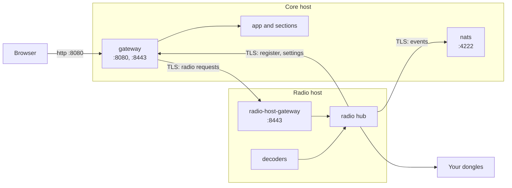

# Run the radios on a second machine

## What it's for

The **radio hub** is the part of Sentinel that talks to your radios. Normally it runs on the same computer as the rest of Sentinel. You can run it, and the voice, APRS and AIS decoders, on a second computer next to the antennas instead: a **radio host**. The main computer (here called the **core host**) keeps the app, the gateway, the event bus and the sections, and your browser keeps using its address.

Do this when your dongles are a long way from the computer that runs Sentinel. Each connected dongle sends the radio hub a heavy stream of raw signal ([how much](hardware.md#the-network)); with the hub beside the dongles, only the light stream to the browser crosses your network.

*Figure: The two computers and what crosses the network between them. Every link between them is TLS.*



**In words:**

1. Your browser talks only to the core host's gateway on port 8080.
2. The core host's gateway passes radio requests, such as the waterfall and audio, over TLS to the radio host's own gateway on port 8443, which hands them to the radio hub.
3. The radio hub reaches back to the core host over TLS: to register and read settings through port 8443, and to send and receive events through the event bus on port 4222.
4. The decoders run next to the radio hub on the radio host and never leave its own Docker network, so no audio crosses your network.

Every link is checked against a certificate authority Sentinel creates for your installation, and every program signs in with its own login. More in [Security](architecture/security.md).

## Before you start

- Both computers can reach each other by a name or address that doesn't change, such as a DHCP reservation or a local DNS name. On this page they are `sentinel.lan` (core host) and `radio.lan` (radio host).
- Both have Docker with Docker Compose, and a copy of Sentinel (`git clone`).
- The radio host can reach your dongles (rtl_tcp or Sentry).
- Sentinel already works on the core host ([Quick start](install.md)).

## Set up the core host

1. Add these lines to the core host's `.env`:

   ```bash
   # The hub runs on the radio host, so don't start one here.
   SENTINEL_RADIO_REPLICAS=0

   # The names the two computers reach each other by.
   SENTINEL_CORE_HOSTNAMES=sentinel.lan
   SENTINEL_RADIO_HOST_HOSTNAMES=radio.lan

   # Open the TLS service entrypoint and the event bus to your network.
   SENTINEL_SERVICE_ENTRYPOINT_ADDRESS=0.0.0.0:8443
   NATS_PUBLISHED_ADDRESS=0.0.0.0:4222
   ```

   Take any decoder profile out of `COMPOSE_PROFILES` (except `adsb`, which stays on the core host). Each variable is explained in [Environment variables](configuration.md#a-second-computer).

2. Apply it, which issues the certificates:

   ```bash
   docker compose up -d
   ```

3. If the event bus was already running, restart it, because it reads its settings only when it starts:

   ```bash
   docker compose restart nats
   ```

4. Export the radio host's credentials into a file:

   ```bash
   docker compose run --rm -T service-credentials \
       python -m backend.scripts.service_credentials_bundle export radio-host > radio-host-credentials.tar.gz
   ```

   The file holds the radio hub's and each decoder's login, the certificate authority's public certificate, and the radio host gateway's certificate and key. It never holds the core host's own login or the certificate authority's private key. **Treat it as a password.**

5. Copy it to the radio host over a trusted connection, then delete it here:

   ```bash
   scp radio-host-credentials.tar.gz <radio-host-user>@radio.lan:<sentinel-folder>/
   rm radio-host-credentials.tar.gz
   ```

## Set up the radio host

1. In the radio host's copy of Sentinel, create `.env`:

   ```bash
   SENTINEL_CORE_ENTRYPOINT_URL=https://sentinel.lan:8443
   SENTINEL_CORE_NATS_URL=tls://sentinel.lan:4222
   SENTINEL_RADIO_HOST_URL=https://radio.lan:8443
   COMPOSE_PROFILES=aprs,ais            # the decoders you want: voice-decoder, aprs, ais, all
   ```

2. Import the credentials, then delete the file:

   ```bash
   docker compose -f compose.radio-host.yaml run --rm -T credentials-import < radio-host-credentials.tar.gz
   rm radio-host-credentials.tar.gz
   ```

3. Start it:

   ```bash
   docker compose -f compose.radio-host.yaml up -d --build
   ```

## Check it works

On the radio host, `docker compose -f compose.radio-host.yaml logs radio` should show:

```text
radio service startup: connected to core at https://sentinel.lan:8443
event bus connected to NATS at tls://sentinel.lan:4222
registration: radio registered with core at https://sentinel.lan:8443
```

Each decoder logs `connected to the radio hub through http://radio:8000`. On the core host, `docker compose logs app` shows `registry: radio radio registered from https://radio.lan:8443`.

Then, in the browser:

1. Re-add your Sentry hosts under **Settings › SDR › Sentry Hosts**. They are kept in the radio hub's own database, which starts empty on a new radio host.
2. Check each radio's address in **Settings › SDR › SDR Devices**. Addresses are now as seen from the radio host: for an rtl_tcp on the radio host itself, use `host.docker.internal`.
3. Open **SDR**. The waterfall and audio work as before.

## Changing things later

- **A new or changed host name.** Update `SENTINEL_CORE_HOSTNAMES` or `SENTINEL_RADIO_HOST_HOSTNAMES`, then on the core host run `docker compose up -d` and `docker compose restart nats gateway`. The certificates are reissued, so export a new credentials file and import it on the radio host.
- **Replacing a login.** Delete its `credentials/<caller>/` folder on the `service_credentials` volume, run `docker compose up -d` on the core host, then export and import again.
- **Moving the hub back.** On the radio host, run `docker compose -f compose.radio-host.yaml down`. On the core host, remove `SENTINEL_RADIO_REPLICAS=0` from `.env` and run `docker compose up -d`. Sentry hosts added on the radio host stay there, so add them again.

## Troubleshooting

| What you see | Likely cause |
|---|---|
| Hub logs `waiting for core to answer (… certificate verify failed …)` | The host in `SENTINEL_CORE_ENTRYPOINT_URL` isn't in `SENTINEL_CORE_HOSTNAMES`, or the credentials file is older than a host-name change. |
| Hub logs `waiting for core to answer (… Connection refused …)` | `SENTINEL_SERVICE_ENTRYPOINT_ADDRESS` still binds `127.0.0.1`, or a firewall blocks port 8443. |
| Hub never logs `event bus connected` | `NATS_PUBLISHED_ADDRESS` isn't open, or `nats` wasn't restarted after a host-name change. |
| SDR shows the radio hub unavailable | The core host can't reach `SENTINEL_RADIO_HOST_URL`: check port 8443 on the radio host, and that its name is in `SENTINEL_RADIO_HOST_HOSTNAMES`. |
| `registration: core refused radio (401)` | The credentials no longer match the core host's (its volume was recreated). Export and import again. |
| Gateway or nats won't start on the core host | Port 8443 or 4222 is already used by something else on it. |
