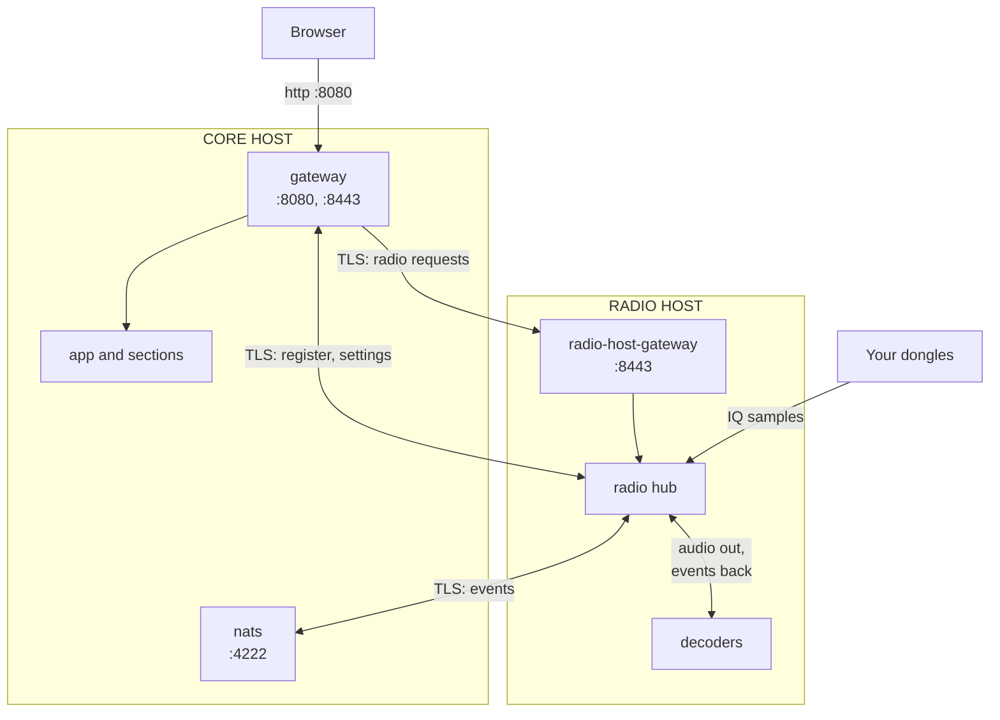

# Radio host

Run the radio hub and the voice, APRS and AIS decoders on a second computer by the antennas. Only the light browser stream then crosses your network. The main computer (the **core host**) keeps everything else.

*Figure: The two computers and the TLS links between them.*



- The browser only talks to the core host on :8080.
- Radio requests cross to the radio host's gateway on :8443; the hub calls back on :8443 and :4222.
- Decoders stay on the radio host's own network, so no audio crosses the LAN.

You need fixed names for both (here `sentinel.lan` and `radio.lan`), Docker and a Sentinel checkout on each.

## Core host

1. Add to `.env` (and take decoder profiles except `adsb` out of `COMPOSE_PROFILES`):

   ```bash
   SENTINEL_RADIO_REPLICAS=0
   SENTINEL_CORE_HOSTNAMES=sentinel.lan
   SENTINEL_RADIO_HOST_HOSTNAMES=radio.lan
   SENTINEL_SERVICE_ENTRYPOINT_ADDRESS=0.0.0.0:8443
   NATS_PUBLISHED_ADDRESS=0.0.0.0:4222
   GUARD_SERVICE_HOSTS=192.168.1.30
   ```

   `GUARD_SERVICE_HOSTS` is the radio host's **IP address** (not its name). The [request guard](security-guard.md#radio-hosts) refuses its registration and settings reads without it.

2. Apply, and export the radio host's credentials (treat the file as a password):

   ```bash
   docker compose up -d
   docker compose restart nats
   docker compose run --rm -T service-credentials \
       python -m backend.scripts.service_credentials_bundle export radio-host > radio-host-credentials.tar.gz
   scp radio-host-credentials.tar.gz <radio-host-user>@radio.lan:<sentinel-folder>/
   rm radio-host-credentials.tar.gz
   ```

## Radio host

1. Create `.env`:

   ```bash
   SENTINEL_CORE_ENTRYPOINT_URL=https://sentinel.lan:8443
   SENTINEL_CORE_NATS_URL=tls://sentinel.lan:4222
   SENTINEL_RADIO_HOST_URL=https://radio.lan:8443
   COMPOSE_PROFILES=aprs,ais
   GUARD_SERVICE_HOSTS=192.168.1.20
   ```

   `GUARD_SERVICE_HOSTS` is the core host's **IP address**: core's health checks and the SDR section's recording copies come from there.

2. Import and start:

   ```bash
   docker compose -f compose.radio-host.yaml run --rm -T credentials-import < radio-host-credentials.tar.gz
   rm radio-host-credentials.tar.gz
   docker compose -f compose.radio-host.yaml up -d --build
   ```

## Check

- Radio host, `docker compose -f compose.radio-host.yaml logs radio`: `connected to core at https://sentinel.lan:8443`, `event bus connected`, `registration: radio registered`.
- Core host, `docker compose logs app`: `registry: radio radio registered from https://radio.lan:8443`.
- In the browser: check radio addresses as seen from the radio host (`host.docker.internal` for one on the radio host itself).

## Later

- **Host name changed:** update the hostnames, `docker compose up -d` and `docker compose restart nats gateway` on the core host, then export and import again.
- **Replace a login:** delete its `credentials/<caller>/` folder on the `service_credentials` volume, `docker compose up -d`, export and import again.
- **Move the hub back:** `docker compose -f compose.radio-host.yaml down` on the radio host; remove `SENTINEL_RADIO_REPLICAS=0` on the core host and `docker compose up -d`.

## If it's not working

| Hub log or symptom | Cause |
|---|---|
| `… certificate verify failed …` | The name in `SENTINEL_CORE_ENTRYPOINT_URL` isn't in `SENTINEL_CORE_HOSTNAMES`, or the credentials predate a name change |
| `… Connection refused …` | :8443 still on `127.0.0.1`, or a firewall |
| `404` registering or reading settings; `guard access refused` in core's log | The radio host's address isn't in `GUARD_SERVICE_HOSTS` on the core host |
| Core shows the hub unreachable; `guard access refused` in the hub's log | The core host's address isn't in `GUARD_SERVICE_HOSTS` on the radio host |
| Never logs `event bus connected` | `NATS_PUBLISHED_ADDRESS` not open, or `nats` not restarted |
| SDR shows the hub unavailable | Core can't reach `SENTINEL_RADIO_HOST_URL` on :8443 |
| `core refused radio (401)` | Credentials out of date: export and import again |
