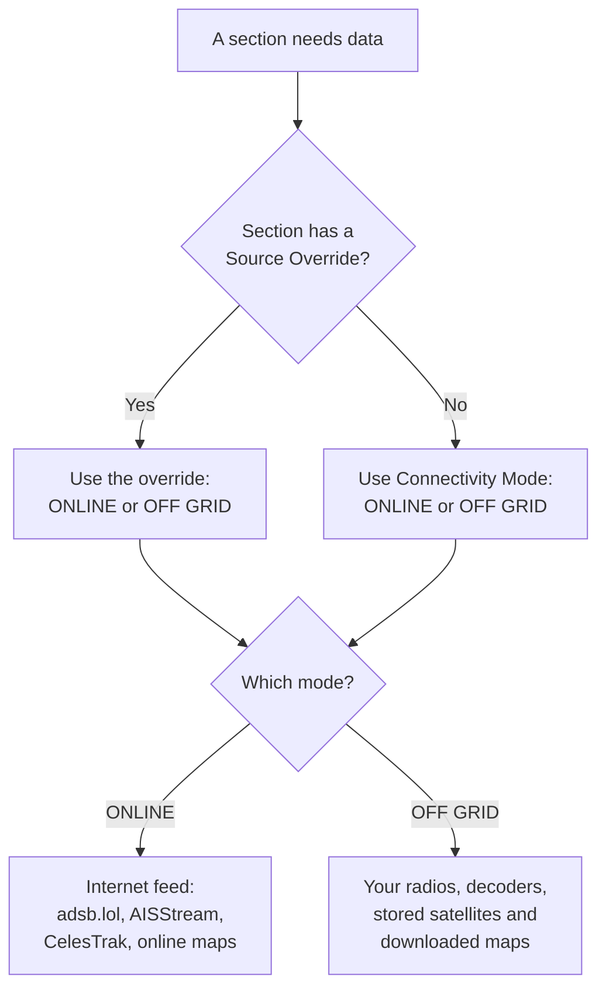

# Run Sentinel with no internet

Sentinel can keep working with no internet connection at all: in a remote place, in a power cut with the router down, or when you don't want to depend on online services. This page puts the off-grid set-up in order. Do the first part while you still have a connection.

## Before you start

- Sentinel installed and running ([Quick start](../install.md)).
- For live aircraft, ships or APRS off grid: an RTL-SDR dongle and antenna for each one you want running at the same time. See [Decode digital signals](../use/sdr/decode.md#why-each-decoder-needs-its-own-dongle).

## What works off grid

| Section | Off grid, it uses | You need |
|---|---|---|
| **AIR** | Your own radio, through the ADS-B decoder | A dongle and a 1090 MHz antenna on a [Sentry host](../use/sdr/add-a-radio.md#add-a-sentry-host) |
| **SPACE** | Satellite data you loaded earlier | Satellites loaded while online |
| **SEA** | Your own radio, through the AIS decoder | A dongle and a marine VHF antenna |
| **LAND** | The built-in repeater directory, and your own radio for APRS | A dongle and a 2 m antenna, for APRS |
| **SDR** | Your radios, as always | Your radios on the local network |
| Maps | Areas you downloaded | Areas downloaded while online |

## While you still have internet

1. **Download maps** for the area you'll be in: [Download maps for offline use](../use/offline-maps.md). Include **Terrain** if you want hills and contours. Without a download, maps are blank off grid.
2. **Load satellites**: **Settings › SPACE › Online Data Source**, choose each category you want, and select **UPDATE TLE**. See [Space](../use/space.md#off-grid).
3. **Build the decoders** you'll need, because building downloads software. For example, all of them:

   ```bash
   docker compose --profile all up -d --build
   ```

   Or only the ones you need: `--profile adsb`, `--profile ais`, `--profile aprs`, `--profile voice-decoder`.

## Set up your radios

1. **Add your radios** in **Settings › SDR**: [Add a radio](../use/sdr/add-a-radio.md).
2. **Give Air its radio** in **Settings › AIR › Off Grid ADS-B SDR**. It must be a dongle on a [Sentry host](../use/sdr/add-a-radio.md#add-a-sentry-host).
3. **Give Sea its radio** in **Settings › SEA › Off Grid AIS SDR**.
4. **Give Land its radio** in **Settings › LAND › Off Grid APRS SDR**.
5. Select **APPLY CHANGES**.

Skip any section you don't need off grid.

## Switch to off grid

1. Open **Settings › App Settings › Connectivity Mode** and choose **OFF GRID**.
2. Select **APPLY CHANGES**.
3. Open each section and check it shows data. A notice at the top of a section says what is missing, if anything.

Choosing **Connectivity Mode** sets every section to that mode and replaces any overrides. To keep one section online, set its **Source Override** afterwards.

## How Sentinel chooses where data comes from

Air and Sea can also use a mode of their own, whatever the rest of Sentinel uses: their **Source Override** setting.

*Figure: For each section, Sentinel checks the section's own override first, then the app-wide mode, to decide where its data comes from.*



**In words:**

1. When a section needs data, Sentinel first checks whether that section has its own **Source Override** (Air and Sea have one).
2. If it has, the override decides. If not, the app-wide **Connectivity Mode** decides.
3. **ONLINE** uses internet feeds: adsb.lol for aircraft, AISStream for ships, CelesTrak for satellites, and online maps.
4. **OFF GRID** uses your radios and decoders, the satellites you stored, and the maps you downloaded.

## Going back online

Choose **ONLINE** in **Connectivity Mode** and select **APPLY CHANGES**. Then refresh the satellites (**UPDATE TLE**), since they drift out of date while offline.

## Troubleshooting

- **The map is blank.** You are outside the areas you downloaded, or you didn't download any. Downloads need internet, so do it when you are next online.
- **Air is empty.** See [Air: Troubleshooting](../use/air.md#troubleshooting).
- **Sea says no receiver is selected.** Set **Off Grid AIS SDR**.
- **Satellite positions look wrong after weeks offline.** The satellite data is old. It will be fixed when you can update it.
