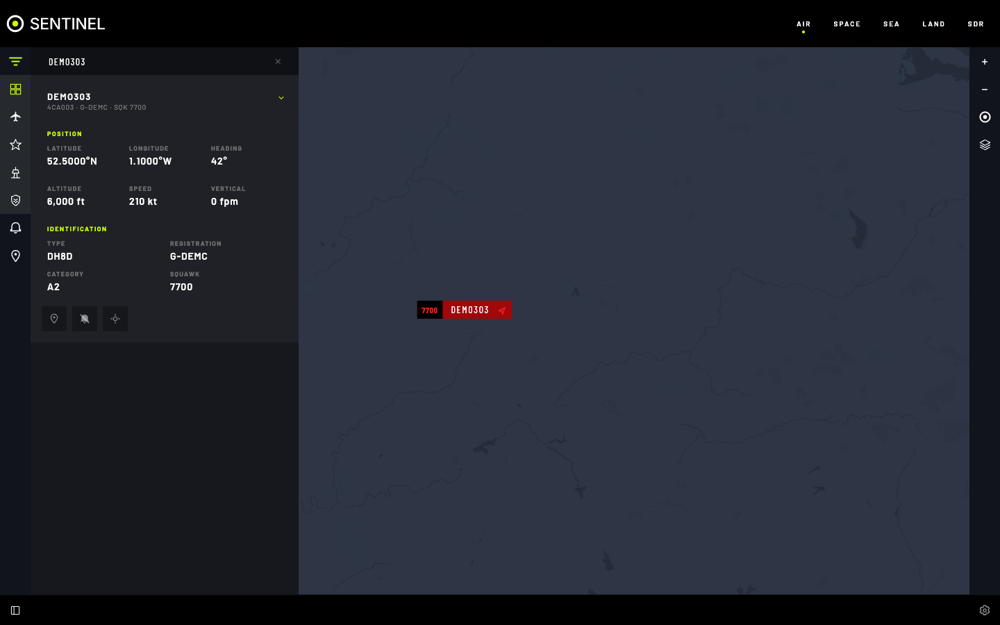

# Air

Live aircraft near you, from ADS-B. Online from [adsb.lol](https://adsb.lol); off grid from your own radio.

## Features

- **Live map** of aircraft within 250 nautical miles of the map centre: off grid every few seconds, online every **Online Refresh Interval** (1 minute by default). The map stops asking while its browser tab is hidden and catches up when you return to it.
- **Aircraft details**: height, speed, heading, climb, type, registration, category and squawk. **SIGNAL LOST** when it stops reporting.
- **Track aircraft**: keep the map on it; it is listed under **TRACKING**.
- **Landing and take-off alerts** for an aircraft you choose (**Enable alerts**).
- **Emergency alerts** for squawks 7700 (emergency), 7600 (radio failure) and 7500 (hijack), even with no browser open.
- **Overhead alerts** when civil or military aircraft come near your location or a Sentry site.
- **Search** by callsign, ICAO address or squawk in **FILTER**.
- **Show** all, civil or military aircraft, airports or military bases.
- **Airport frequencies**: select one to tune your radio to it in AM.
- **Layers**: **RANGE RING**, **A2A REFUELING**, **AWACS**, **TERRAIN**, more under **MAP LAYERS**.

## Off grid

You need a dongle with a 1090 MHz antenna on a [Sentry host](sdr/add-a-radio.md#add-a-sentry-host), and the ADS-B decoder.

1. `docker compose --profile adsb up -d --build`
2. Set **OFF GRID** (**App Wide Connectivity Mode**, or Air's **Source Override**).
3. **Settings › AIR › Off Grid ADS-B SDR**: pick the dongle, then **APPLY CHANGES**.

Opening Air claims the dongle and tunes it to 1090 MHz; closing it lets it go. It uses about 38 Mbps on your network while open.

## Settings

All in **Settings › AIR**.

| Setting | What it does |
|---|---|
| **Source Override** | **ONLINE** or **OFF GRID** for Air only. The settings below show for the mode picked |
| **Off Grid ADS-B SDR** | The Sentry dongle used off grid |
| **Online Data Source** | The online feed. Default `https://api.adsb.lol/v2` |
| **Online Refresh Interval** | Seconds between calls to the online feed, 5 to 280. Default 60. Each call counts against the feed's daily limit: with adsb.lol (500 a day), 60 lasts about 8 hours of use, 173 or more never runs out |
| **Daily Call Limit** | The online feed's daily call limit, for a feed that has one but doesn't state it. 0 (default) uses the feed's own figure |
| **Online API Usage** | The feed in use, its daily limit and where that came from, and the calls made today (UTC days, as adsb.lol counts them), with a warning once 80% is used and when it runs out. The Air map and the alerts panel warn too. Each feed is counted separately; one with no known limit is counted without warnings |
| **Online Squawk Checks** | Seconds between emergency checks of the online feed while no Air map is open and showing. Default 300. Never more often than **Online Refresh Interval**, and each check uses one daily call (300 is 288 a day) |
| **Off Grid Squawk Checks** | Seconds between emergency checks of the local decoder while no Air map is open. Default 20 |
| **Map Layers** | Layers on when the map opens |
| **Aircraft Label Fields** | What each aircraft label shows |
| **Overhead Aircraft Alerts** | Places to watch, civil or military, and how close |

## Tips

- Set **Sentinel Location** first: emergency checks and range rings centre on it.
- Off grid, the map centres on your receiver; it only hears around itself.

## If it's not working

- **Empty off grid:** read the notice at the top of the map. Check **Off Grid ADS-B SDR** and `docker compose --profile adsb ps`. A decoder that streams but accepts 0 messages is an antenna or signal problem.
- **"No data source configured":** **Online Data Source** is empty.
- **Map dimmed with a daily limit warning:** the online feed's daily calls are used up; aircraft return at 00:00 UTC. `docker compose logs air` says `rate limited us (HTTP 429)`. Raise **Online Refresh Interval** if it happens again.
- **AIR greyed out:** `docker compose logs air`.
