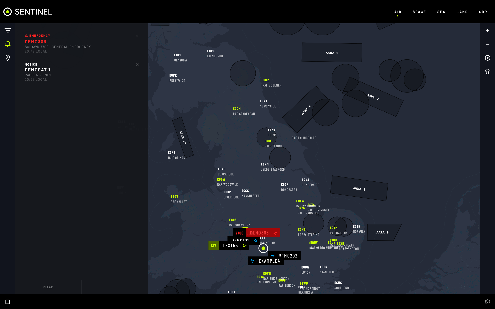

# Alerts

Tells you when something you care about happens, in any section.

## What raises one

| Alert | When | Turn it on |
|---|---|---|
| Aircraft emergency | Squawk 7700, 7600 or 7500, even with no browser open | Always on |
| Landing / take-off | A chosen aircraft lands or takes off | **Enable alerts** on the aircraft |
| Aircraft overhead | Civil or military aircraft near your location or a Sentry site | **Settings › AIR › Overhead Aircraft Alerts** |
| ADS-B quota | 80% of the online feed's daily calls are used, and when they run out (once a day each) | Always on, online |
| Satellite pass | A chosen satellite rises in about five minutes | The bell on a pass |
| Auto-tune | The radio retuned for a pass, or couldn't | **Auto-tune SDR** on a pass |
| SDR device | A Sentry dongle was plugged in or unplugged | Always on |
| Tracking | You started or stopped following something | Automatic |

## Features

- **ALERTS** pane, newest first. The button pulses for unseen alerts.
- **Select an alert** to jump to its aircraft or satellite.
- **Dismiss** (✕) one, **Disable alerts** (crossed bell) for that subject, **Disable autotune** on a pass alert, or **Clear alerts**.
- **Alert Sound** (**Settings › App Settings**).
- **Kept on the server**: alerts raised while no browser was open are waiting next time.
- **Settings › App Settings › Alerts** lists every alert you have set up, each with a switch.

