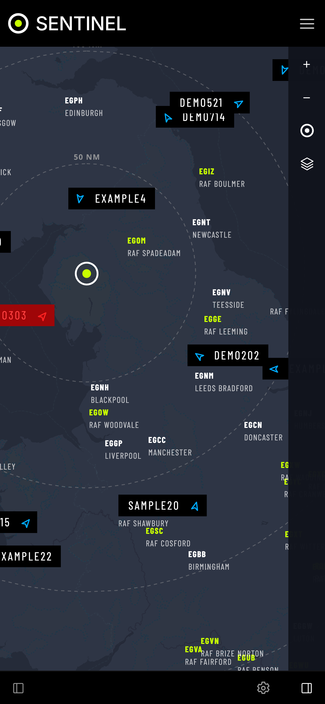

# The screen

Every section uses the same layout.

## Parts

| Part | Where | What it does |
|---|---|---|
| **Section menu** | Top right | **AIR**, **SPACE**, **SEA**, **LAND**, **SDR**. Greyed out = that section has stopped. |
| **Sidebar** | Left | **FILTER** (search and list what is on the map), **ALERTS**, **TRACKING**, plus section extras such as **PASSES**. |
| **Map** | Middle | Select anything to see its details. |
| **Map controls** | Right | Zoom, **GO TO MY LOCATION**, and layer buttons such as **RANGE RING** and **TERRAIN**. |
| **Footer** | Bottom | Sidebar toggle, the frequency a radio is playing, the gear for **Settings**, the map-controls toggle. |
| **Settings** | Full screen | **App Settings**, then one entry per section, then **Docs**. |

## Keyboard

- **Tab** / **Shift+Tab** move between controls; the first **Tab** offers **Skip to main content**.
- **Enter** or **Space** presses a button. Arrow keys move within a group of options.
- **Escape** closes Settings, Docs or a menu.

## On a phone

- The section menu and **SETTINGS** are behind the three-line button.
- Sidebar panes open over the map.

## Tips

- Every **FILTER** list doubles as a text version of the map, for screen readers.
- Audio from the SDR keeps playing in every section; the footer shows what is tuned.
- These docs are built in, so they work offline. Search finds any word on any page.
