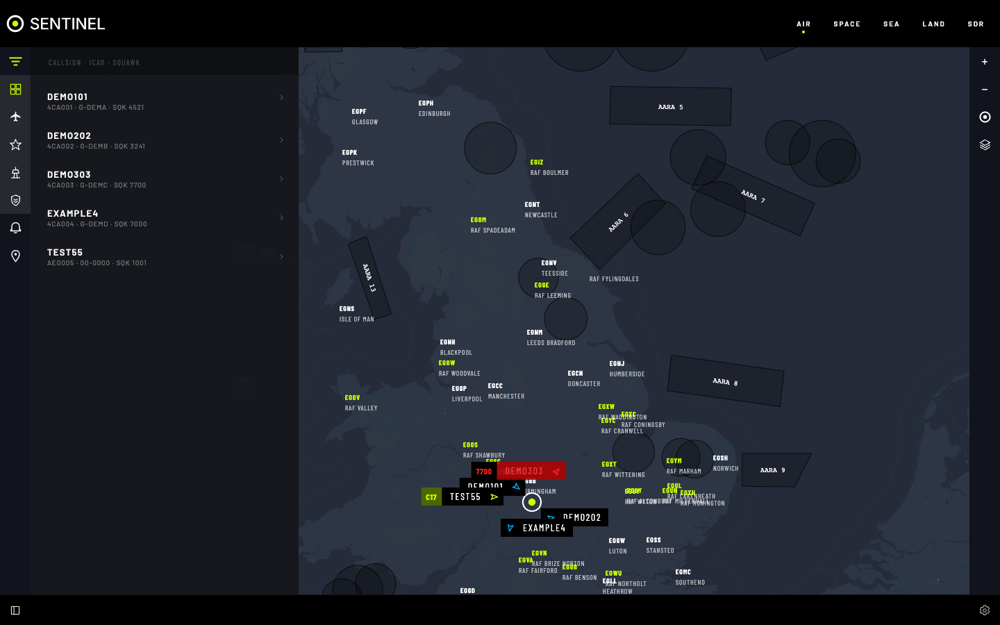

# Find your way around the screen

Every section uses the same layout, so once you know it in one you know it in all of them. This page names each part and says what it is for.

## The parts of the screen

1. **Section menu** (top right): **AIR**, **SPACE**, **SEA**, **LAND** and **SDR**. Select one to open its map or screen. A greyed-out entry is a section that has stopped running; the others keep working.
2. **Sidebar** (left): a narrow rail of buttons that open panes beside the map.
   - **FILTER** searches what is on the map and lists it, for example aircraft by callsign or satellites by name. While it is open, buttons below it choose what the map shows, such as **CIVIL AIRCRAFT** or **REPEATERS**. The list is also a way to read the map without seeing it.
   - **ALERTS** lists things Sentinel has told you about, such as an aircraft emergency or a satellite about to rise. The button pulses when there is one you haven't seen. See [Alerts](alerts.md).
   - **TRACKING** lists the aircraft and satellites you are following.
   - Some sections add their own button, such as **PASSES** in Space.
3. **Map** (middle): the live picture. Select something on the map to see its details.
4. **Map controls** (right edge, on the Air, Space, Sea and Land maps): zoom, **GO TO MY LOCATION**, and buttons that turn map layers on and off, such as **RANGE RING** or **TERRAIN**. Hover over or focus a button to see its name.
5. **Footer** (bottom):
   - the button at the left opens and closes the sidebar;
   - while a radio is playing, the frequency it is tuned to shows at the right, on every section;
   - the gear opens **Settings**;
   - the button at the far right opens and closes the map controls.
6. **Settings** fills the screen and has its own menu: **App Settings** for the whole app, then one entry per section. **Docs**, at the bottom of that menu, opens this documentation. Closing Settings or Docs takes you back to the section you came from.

## Using the keyboard

- Press **Tab** to move between controls and **Shift+Tab** to go back. The first **Tab** on a page offers **Skip to main content**.
- Press **Enter** or **Space** to use the focused button.
- Press **Escape** to close Settings, Docs or an open menu.
- In a group of options, such as the radio modes, use the arrow keys to move between them.

## On a phone

The layout adapts to a small screen:

- The section menu moves behind the menu button (three lines) at the top right. **SETTINGS** is at the bottom of that menu.
- Sidebar panes open over the map, with a close button.
- The SDR radio panel scrolls if your screen is too short to show it all.

## Docs

These docs are part of Sentinel, so they work with no internet. Search at the top of the docs finds any word on any page; pages with more of your words come first.
