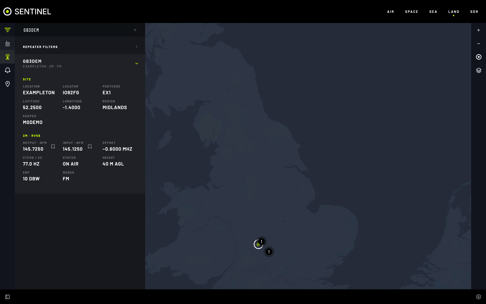

# Land

For radio amateurs: every UK repeater, and the APRS stations your radio hears. Two map layers, shown one at a time.

## Features

- **REPEATERS**: every UK amateur repeater from [ukrepeater.net](https://ukrepeater.net/), updated daily, with a built-in copy for offline use.
- **Repeater details**: site, locator, keeper, and per channel the output and input frequencies, offset, CTCSS / colour code, status, height, ERP and modes.
- **Listen**: select an **OUTPUT** frequency to tune your radio in the right mode.
- **SAVE FREQUENCY**: add a repeater to SDR's saved frequencies.
- **Search** by callsign, town, band or mode; filter by **Band**, **Mode** and **Status**.
- **APRS STATIONS**: stations heard by your radio, with their symbols and details. **RAW** shows the packet as received.

## Switch Land on

Land starts switched off.

1. **Settings › App Settings › Application Config › EDIT**.
2. Under `"land": {`, change `"enabled": false,` to `"enabled": true,`.
3. **APPLY CHANGES**. Reload if **LAND** doesn't appear.

## Hear APRS stations

You need a dongle you can give to APRS full time and a 2 m antenna.

1. `docker compose --profile aprs up -d --build`
2. **Settings › LAND › Off Grid APRS SDR**: pick the radio, then **APPLY CHANGES**.
3. In **LAND**, choose **APRS STATIONS** under **FILTER**.

Decoding runs in the background, even with no browser open.

## Settings

All in **Settings › LAND**.

| Setting | What it does |
|---|---|
| **Off Grid APRS SDR** | The radio that decodes APRS |
| **APRS Channel** | Default 144.800 MHz; 144.390 MHz in North America |
| **APRS Label Fields** | What each station label shows |
| **APRS Retention** | Minutes a station stays after it was last heard. Default 5 |
| **Repeater Label Fields** | What each repeater label shows |
| **Repeater Directory (JSON)** | Edit or replace the directory; a replacement is kept 30 days |

## Tips

- Works fully off grid: the built-in directory takes over, and APRS is always your own radio.

## If it's not working

- **APRS STATIONS greyed out** (**NO SDR SET**): pick a radio in **Off Grid APRS SDR**.
- **APRS hears nothing:** check `docker compose --profile aprs ps`, and that the radio is on channel. Find its id with `curl -s http://localhost:8080/api/sdr/radios`, then `curl -s http://localhost:8080/api/sdr/aprs/status/<id>`: `"on_channel": false` means something moved it (it moves back within about 15 seconds).
