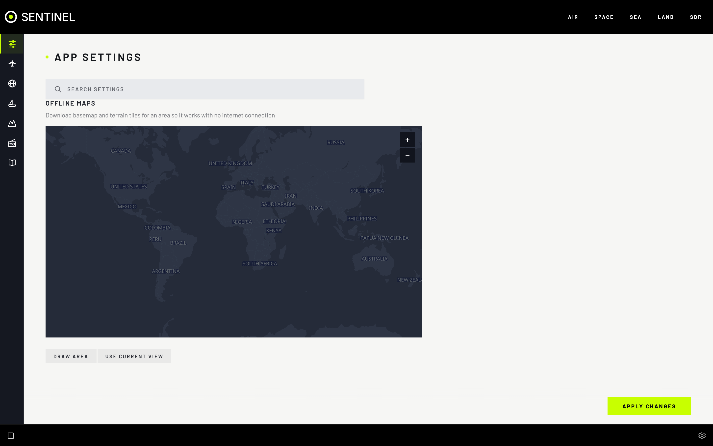

# Maps

Every map shares one base map and one look. Download areas to keep maps working offline.

## Features

- **Map Style**: **DARK** (dim, night-friendly) or **LIGHT** (OpenStreetMap colours).
- **Base map layers**: **Roads**, **Location names**, **Borders**.
- **TERRAIN**: hill shading and contours, for judging line of sight. Needs terrain downloaded.
- **RANGE RING** around your location or a Sentry host (**Range Ring Origin**).
- **Sentry sites** marked on every map.
- **Offline areas**: download a region's basemap and terrain, to the depth you choose.

All of these are in **Settings › App Settings**.

## Download an area

Do this while online: downloading is turned off in **OFF GRID**.

1. **Settings › App Settings › Offline Maps**.
2. Choose the area: **DRAW AREA**, **USE CURRENT VIEW**, or type **NORTH**, **SOUTH**, **EAST**, **WEST**.
3. **DEPTH**: 6 (countries) to 14 (streets). Each step can take up to four times the space.
4. Tick **Basemap** and/or **Terrain**.
5. Check the size against **Free space**, then **DOWNLOAD**.



- Runs on the Sentinel computer: you can close the browser. One at a time; others wait as **QUEUED**. **CANCEL** stops one.
- Finished areas are listed with size and date; delete one with its button.
- Maps update as soon as a download finishes. No restart.

## Tips

- Keep it small: a large area at low depth, plus a small area at high depth where you are.
- Terrain stops adding detail at depth 12.
- Off grid, outside your downloaded areas the map is blank.

## Advanced: a base archive

Sentinel also reads hand-made [PMTiles](https://protomaps.com) files in `frontend/assets/tiles/`, used wherever no download covers the map. Cut them with the `pmtiles` tool (`--bbox` is `west,south,east,north`; `YYYYMMDD` is a current build from [build.protomaps.com](https://build.protomaps.com)):

```bash
pmtiles extract https://build.protomaps.com/YYYYMMDD.pmtiles frontend/assets/tiles/surroundings.pmtiles --maxzoom=6
pmtiles extract https://build.protomaps.com/YYYYMMDD.pmtiles frontend/assets/tiles/uk.pmtiles --bbox=-8.65,49.84,1.77,60.86 --maxzoom=14
pmtiles extract https://download.mapterhorn.com/planet.pmtiles frontend/assets/tiles/uk-terrain.pmtiles --bbox=-8.65,49.84,1.77,60.86 --maxzoom=12
```

## About the map data

Basemaps come from the newest [Protomaps](https://protomaps.com) build, found automatically; terrain from [Mapterhorn](https://mapterhorn.com). `OFFLINE_BASEMAP_SOURCE_URL` and `OFFLINE_TERRAIN_SOURCE_URL` in `.env` change them.

National park boundaries (`frontend/assets/national-parks.geojson`) are the ONS _National Parks (December 2022) Boundaries GB BGC_: Office for National Statistics, [Open Government Licence v3.0](https://www.nationalarchives.gov.uk/doc/open-government-licence/version/3/); contains OS data © Crown copyright and database right 2022.
