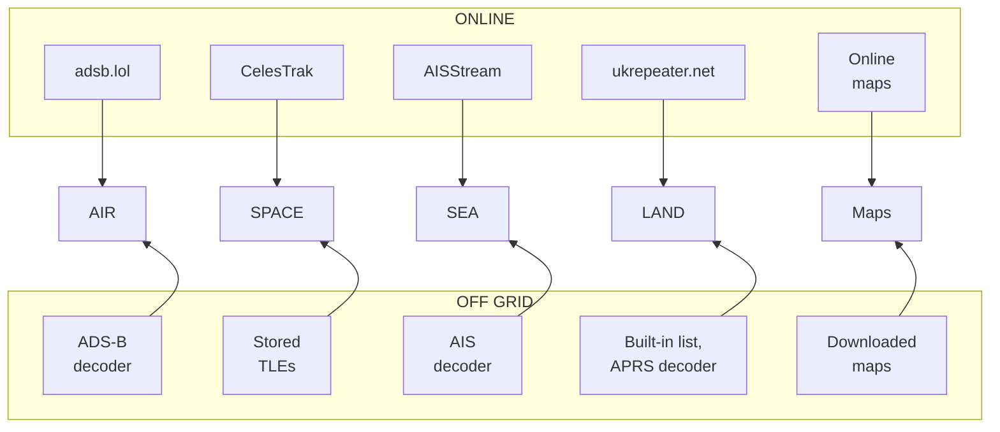

# Off grid

Sentinel keeps working with no internet: your own radios, maps you downloaded and data already stored.

## What changes

*Figure: Each section in the middle, fed from its online source above or its off-grid source below.*

| Section | Online | Off grid | You need |
|---|---|---|---|
| **AIR** | adsb.lol | ADS-B decoder | A dongle and 1090 MHz antenna on a Sentry host |
| **SPACE** | CelesTrak | Stored TLEs | TLEs loaded while online |
| **SEA** | AISStream | AIS decoder | A dongle and marine VHF antenna |
| **LAND** | ukrepeater.net | Built-in list; APRS always from your radio | A dongle and 2 m antenna, for APRS |
| **SDR** | Your radios | Your radios | — |
| **Maps** | Online | Downloaded areas | Areas downloaded while online |

## Before you lose internet

1. [Download maps](maps.md#download-an-area), with **Terrain** if you want it.
2. **Settings › SPACE › UPDATE TLE**.
3. Build the decoders you need: `docker compose --profile all up -d --build`.

## Switch over

1. **Settings › App Settings › App Wide Connectivity Mode › OFF GRID**, then **APPLY CHANGES**.
2. Give each section its radio, then **APPLY CHANGES**: **Off Grid ADS-B SDR** (AIR), **Off Grid AIS SDR** (SEA), **Off Grid APRS SDR** (LAND). Air's and Sea's only show once the section is off grid.
3. Open each section. A notice at the top says what is missing, if anything.

To keep one section online, set its **Source Override** afterwards. A section's override wins over **App Wide Connectivity Mode**.

## Coming back

**App Wide Connectivity Mode › ONLINE**, **APPLY CHANGES**, then **UPDATE TLE**.

## If it's not working

- **Blank map:** you are outside your downloaded areas.
- **Positions wrong after weeks offline:** TLEs are old; update when you can.
