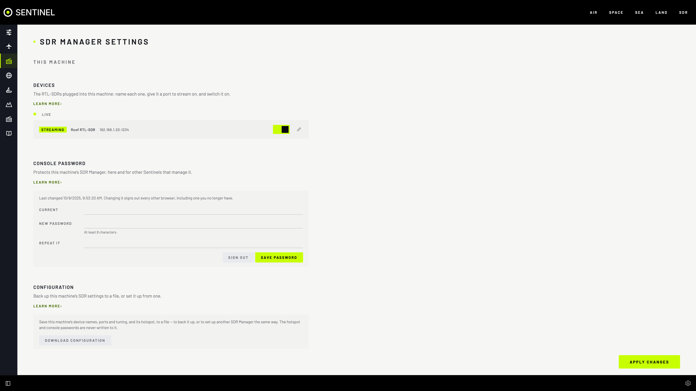
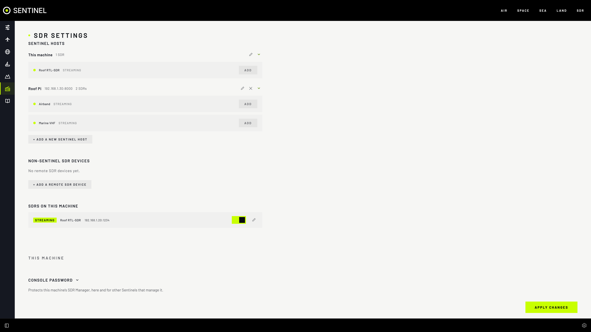

# SDR Manager

One place to manage your RTL-SDR dongles: the ones plugged into this computer and the ones on other computers running Sentinel. Both are in **Settings › SDR › DEVICES**: under **SENTINEL HOSTS**, this computer first, as **This machine**, then the other computers. This computer's password, configuration and hotspot are under **THIS MACHINE** below. In [SDR Manager only](../sdr-manager-local-only.md) mode, this computer has a page of its own, **Settings › SDR Manager**.

## Features

- **This machine's dongles**, found as you plug them in: name each one, give it a port, switch its stream on and off.
- **Shared with other Sentinels**: each dongle streams over `rtl_tcp`, and other Sentinels can add this computer as a Sentinel host.
- **Sentinel hosts**: add another computer running SDR Manager (a Raspberry Pi by the antenna, say), see its status, uptime, devices and position.
- **FLASH SERIAL** gives a dongle a unique serial, so two identical dongles stay apart after a replug (marked **NEEDS ID**).
- **Console password** protects this computer's SDR Manager, here and for every Sentinel that manages it.
- **Configuration** to a file: back it up, or set up another SDR Manager the same way.
- **Hotspot** (Linux only): a Wi-Fi network this computer offers, so a phone can reach Sentinel where there is no other network.
- **Host sites** on every map, usable as range-ring centres and overhead-alert places.
- **SDR Manager only** mode for a small computer that just shares its dongles: [SDR Manager only](../sdr-manager-local-only.md).

## Switch on this machine

This computer's dongles and **THIS MACHINE** show only when SDR Manager for this computer runs. Pick your setup once in `.env`:

| Computer              | `.env`                                                              | Guide                                      |
| --------------------- | ------------------------------------------------------------------- | ------------------------------------------ |
| Linux or Raspberry Pi | `COMPOSE_PROFILES=sdr-manager-local`                                | [Linux and Pi](../sdr-manager-linux.md)    |
| Mac                   | `SDR_MANAGER_LOCAL_NATIVE=1`, then `sdr-manager-local install` once | [Mac, step by step](../sdr-manager-mac.md) |

Then `docker compose up -d`. Windows can't manage its own dongles; it can still manage Sentinel hosts.

## This machine

### Set up a dongle

1. Set a **Console Password** first: until you do, **This machine** shows only the notice asking for one.
2. Plug the dongle in. Within a few seconds it is listed under **This machine**, with a yellow dot (**New**) and **NOT SET UP**.
3. Select the pencil, then fill in **NAME** and **OUTPUT PORT** (a free one is suggested), and optionally **ANTENNA** and **NOTES**. Set **VISIBILITY** to **PUBLIC** to share it with other Sentinels.
4. **APPLY CHANGES**. Its dot stays yellow (**Ready**).
5. Switch its stream on, then **APPLY CHANGES**. Its dot turns green (**Streaming**).
6. **ADD** at the end of its row makes it a radio in the SDR panel; it then reads **ADDED**, and its cross removes the radio (the dongle stays).

The dot at the start of each row shows the dongle's state; point at it to read the state, and an error's reason.

| Dot    | State                          | Means                                                        |
| ------ | ------------------------------ | ------------------------------------------------------------ |
| Green  | Streaming                      | Stream on                                                    |
| Yellow | New, Ready, Starting, Degraded | Not set up, stream off, starting, or streaming with problems |
| Red    | Stopped, Error, Not plugged in | Stopped, failed (the reason is in the tooltip) or unplugged  |

### Device settings

| Setting                | What it does                                                                                                                          |
| ---------------------- | ------------------------------------------------------------------------------------------------------------------------------------- |
| **NAME**               | How it is shown here and in every Sentinel that uses it                                                                               |
| **OUTPUT PORT**        | Where it streams (`rtl_tcp`), such as `1234`; its control port is two above                                                           |
| **ANTENNA**, **NOTES** | Kept with the dongle                                                                                                                  |
| **VISIBILITY**         | **PUBLIC**: can be added as a radio, here and in other Sentinels. **PRIVATE** (the default): this machine and the Sentinels in [Private Access](#private-access) only. Connections from anywhere else are refused |
| The switch             | Stream on or off                                                                                                                      |

A dongle you unplug stays listed as **NOT PLUGGED IN**, with its settings, until you plug it back in or **Forget** it (the cross).

### The other cards

They start folded: click a card's title to open it. **Console Password** opens itself while this machine has no password.

| Card                 | For                                                                                                                                 |
| -------------------- | ----------------------------------------------------------------------------------------------------------------------------------- |
| **Console Password** | Set or change it (8 characters or more); **SIGN OUT**. Changing it signs out every other browser                                    |
| **Configuration**    | **DOWNLOAD CONFIGURATION** saves names, ports, tuning and hotspot; **IMPORT** a file to apply them. Passwords are never in the file |
| **Hotspot**          | **ALLOW CHANGES**, then a network name, password, band and channel; **START**, then confirm it within 2 minutes or it is undone     |

This machine's position is **Settings › App Settings › Sentinel Location**. Set it, or other Sentinels can't show where your dongles are (**SET LOCATION** in the notice takes you there).

## Use a dongle as a radio

SDR Manager looks after dongles; the SDR section listens to them. To listen to one:

1. **Settings › SDR › DEVICES › SENTINEL HOSTS** lists each host's dongles under its name; select the name to fold them away or show them again.
2. **ADD** beside the dongle. It becomes a radio in the SDR panel.

**ADD** is greyed out while the dongle is switched off or has no port, or is private and its host doesn't allow this Sentinel.

On a host set to **ADD SDRS: AUTOMATICALLY** there is no **ADD**: every usable dongle with a port is a radio already. To keep another machine's dongle out, make it **PRIVATE** on its host; a dongle that isn't a radio says why (**PRIVATE** or **NOT SET UP**).

## Share this machine with other Sentinels

1. Set a **Console Password** (the notice says so until you do).
2. On the other Sentinel: **Settings › SDR › + ADD A NEW SENTINEL HOST**, this computer's address, port `8000`, the console password, **ADD**, then compare the certificate fingerprint ([Certificates](#certificates)) and **TRUST AND ADD**.

A program that only speaks `rtl_tcp` (SDR++, GQRX) can use any public streaming dongle at `<this computer>:<OUTPUT PORT>` with no password.

### Private Access

A **PRIVATE** dongle works on this machine and for the Sentinels listed in **Private Access**, under **THIS MACHINE**. Everyone else is refused.

1. Set a **Console Password**. The list can't be changed without one.
2. Open **Private Access**, enter the other Sentinel's IP address, **ADD ADDRESS**.

Only single addresses work, not ranges. Give each listed Sentinel a fixed address, because whoever gets that address gets access. Adding or removing one restarts private dongles' streams for a moment, which is what disconnects a Sentinel you remove. The other Sentinel still needs the console password to add this host.

## Sentinel hosts

1. **Settings › SDR › DEVICES › + ADD A NEW SENTINEL HOST**: **IP ADDRESS**, **LABEL**, **PORT** (usually `8000`), **CONSOLE PASSWORD**, **ADD SDRS**, **ADD**.
2. Compare the **FINGERPRINT** shown with the host's own ([Certificates](#certificates)), then **TRUST AND ADD**.
3. The host is listed under **SENTINEL HOSTS** with its address and how many SDRs it has, and its dongles below it.

| **ADD SDRS**               | What it does                                                                                                                              |
| -------------------------- | ----------------------------------------------------------------------------------------------------------------------------------------- |
| **MANUALLY** (the default) | Each dongle becomes a radio when you press **ADD**                                                                                        |
| **AUTOMATICALLY**          | Every public dongle on the host becomes a radio within a few seconds, and stops being one when made private. Private dongles stay radios on **This machine** and on a Sentinel its host allows. Radios can't be removed here |

- The pencil opens a host: its details, devices and site map, **TEST CONNECTION**, and edits (they wait for **APPLY CHANGES**). The cross removes it.
- A host that can't be reached says why under its name.
- **This machine** is listed first and added for you. Only its label and **ADD SDRS** can be changed, and it can't be removed.
- An SDR added by IP and port at a host's own address is listed under that host. If the host already lists it, a note says so: delete one, so it is listed once.

- Selecting a host's marker on any map opens it here.

### Certificates

Sentinel talks to a host over HTTPS, so the console password never crosses the network readable. The first time, you confirm that the host is the one you mean by its certificate fingerprint. The host shows its own:

- in its **Settings › SDR › THIS MACHINE › Certificate** (SDR Manager-only: **Settings › SDR Manager**);
- in its log when SDR Manager starts: `docker compose logs sdr-manager-local | grep fingerprint`;
- on a Mac, in `uv run --project backend sdr-manager-local doctor`.

If the two match, trust it. If not, don't: something else is answering at that address.

An open host says how its connection is secured:

| State                   | Meaning                                                                                        |
| ----------------------- | ---------------------------------------------------------------------------------------------- |
| **ENCRYPTED**           | HTTPS, checked against the certificate you trusted                                            |
| **NOT ENCRYPTED**       | Plain HTTP. The host doesn't offer HTTPS, or was added before Sentinel did                    |
| **NOT TRUSTED YET**     | Its address changed. Nothing is sent to it until you trust its certificate again              |
| **CERTIFICATE CHANGED** | It presented a different certificate, so nothing is sent to it                                 |

**CHECK CERTIFICATE** reads the host's certificate now, to trust it. Use it to move a **NOT ENCRYPTED** host to HTTPS once it offers it: an SDR host updated to serve HTTPS is unreachable over plain HTTP until you do.

A host that doesn't offer HTTPS can be added with **ADD WITHOUT ENCRYPTION**. Do that only on a network you trust.

## Tips

- Several programs can listen to one dongle at once; only one tunes it at a time, and the rest follow its frequency.
- Plug dongles straight in or into a powered hub. Each needs about 33 Mbps of network to the radio hub.
- Two dongles with the same serial get **NEEDS ID**: flash one, then replug it.
- `<computer>:8000/api/v1/sdrs` lists the public dongles without a password, by design. Use a firewall if your network isn't trusted.

## If it's not working

- **No dongles under This machine, and no THIS MACHINE:** SDR Manager for this computer isn't running. Linux: `docker compose ps sdr-manager-local`. Mac: `uv run --project backend sdr-manager-local status`.
- **This machine "not running":** the same; it comes back within 10 seconds of starting.
- **CERTIFICATE CHANGED:** the host's credentials were made again (for example, its Docker volumes were removed), or another machine has its address. Compare fingerprints ([Certificates](#certificates)), then **CHECK CERTIFICATE** and trust it.
- **"doesn't offer HTTPS":** the host runs an SDR Manager from before HTTPS. Update it, or add it without encryption.
- **A NOT ENCRYPTED host became unreachable after it was updated:** it now serves HTTPS. **CHECK CERTIFICATE** and trust it.
- **A remote host says unauthenticated:** a wrong console password, or the host runs the old Sentry program. Replace Sentry with SDR Manager there ([Linux and Pi](../sdr-manager-linux.md)).
- **"port … is already in use":** something else has port 8000. Stop it, or set `SDR_MANAGER_LOCAL_HTTP_PORT` in `.env`.
- **A dongle never appears:** Linux: unplug it, plug it in again and see [Linux and Pi](../sdr-manager-linux.md#if-its-not-working). Mac: `rtl_test -t`.
- **Other Sentinels can't reach it:** a firewall on this computer blocks port 8000 or the dongle's port.
