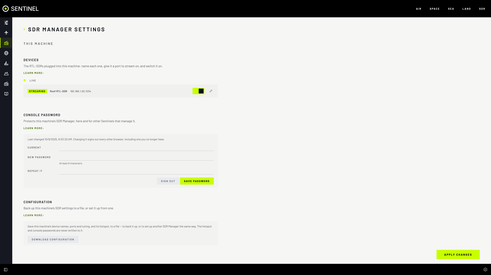
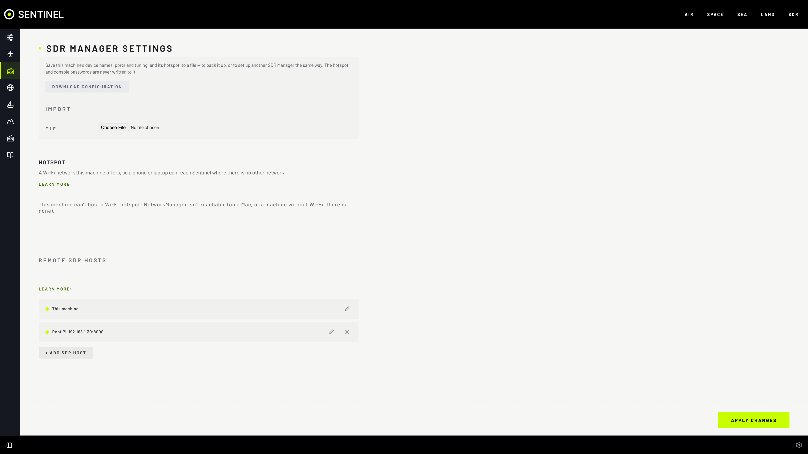

# SDR Manager

One place to manage your RTL-SDR dongles: the ones plugged into this computer (**THIS MACHINE**) and the ones on other computers (**REMOTE SDR HOSTS**). It is in **Settings › SDR Manager**.

## Features

- **This machine's dongles**, found as you plug them in: name each one, give it a port, switch its stream on and off.
- **Shared with other Sentinels**: each dongle streams over `rtl_tcp`, and other Sentinels can manage this computer as a remote SDR host.
- **Remote SDR hosts**: add another computer running SDR Manager (a Raspberry Pi by the antenna, say), see its status, uptime, devices and position.
- **FLASH SERIAL** gives a dongle a unique serial, so two identical dongles stay apart after a replug (marked **NEEDS ID**).
- **Console password** protects this computer's SDR Manager, here and for every Sentinel that manages it.
- **Configuration** to a file: back it up, or set up another SDR Manager the same way.
- **Hotspot** (Linux only): a Wi-Fi network this computer offers, so a phone can reach Sentinel where there is no other network.
- **Host sites** on every map, usable as range-ring centres and overhead-alert places.
- **SDR Manager only** mode for a small computer that just shares its dongles: [SDR Manager only](../sdr-manager-local-only.md).

## Switch on this machine

**THIS MACHINE** shows only when SDR Manager for this computer runs. Without it you see a **THIS MACHINE** notice saying how to start it. Pick your setup once in `.env`:

| Computer | `.env` | Guide |
|---|---|---|
| Linux or Raspberry Pi | `COMPOSE_PROFILES=sdr-manager-local` | [Linux and Pi](../sdr-manager-linux.md) |
| Mac | `SDR_MANAGER_LOCAL_NATIVE=1`, then `sdr-manager-local install` once | [Mac, step by step](../sdr-manager-mac.md) |

Then `docker compose up -d`. Windows can't manage its own dongles; it can still manage remote SDR hosts.

## This machine

### Set up a dongle

1. Plug it in. Within a few seconds it is listed under **Devices** as **NEW** and **NOT SET UP**.
2. Select the pencil, then fill in **NAME** and **OUTPUT PORT** (a free one is suggested), and optionally **ANTENNA** and **NOTES**. Set **VISIBILITY** to **PUBLIC** to listen to it in Sentinel.
3. **APPLY CHANGES**. It shows **READY**.
4. Switch its stream on, then **APPLY CHANGES**. It shows **STREAMING**.

| State | Means |
|---|---|
| **NEW** | Plugged in, not set up |
| **READY** | Set up, stream off |
| **STARTING** / **STREAMING** | Stream starting / on |
| **DEGRADED** | Streaming with problems |
| **STOPPED** / **ERROR** | Stopped / failed (the reason shows beside it) |

### Device settings

| Setting | What it does |
|---|---|
| **NAME** | How it is shown here and in every Sentinel that uses it |
| **OUTPUT PORT** | Where it streams (`rtl_tcp`), such as `1234`; its control port is two above |
| **ANTENNA**, **NOTES** | Kept with the dongle |
| **VISIBILITY** | **PUBLIC**: can be added as a radio, here and in other Sentinels. **PRIVATE** (the default): hidden from every Sentinel, this one too |
| The switch | Stream on or off |

A dongle you unplug stays listed as **NOT PLUGGED IN**, with its settings, until you plug it back in or **Forget** it (the cross).

### The other cards

| Card | For |
|---|---|
| **Console Password** | Set or change it (8 characters or more); **SIGN OUT**. Changing it signs out every other browser |
| **Configuration** | **DOWNLOAD CONFIGURATION** saves names, ports, tuning and hotspot; **IMPORT** a file to apply them. Passwords are never in the file |
| **Hotspot** | **ALLOW CHANGES**, then a network name, password, band and channel; **START**, then confirm it within 2 minutes or it is undone |

This machine's position is **Settings › App Settings › Sentinel Location**. Set it, or other Sentinels can't show where your dongles are (**SET LOCATION** in the notice takes you there).

## Use a dongle as a radio

SDR Manager looks after dongles; the SDR section listens to them. To listen to one:

1. **Settings › SDR › DEVICES** lists each SDR host's dongles under its name, this machine's too.
2. **ADD** beside the dongle. It becomes a radio in the SDR panel.

**ADD** is greyed out while the dongle is private, switched off or has no port. **SDR MANAGER** beside a host's name opens it here.

## Share this machine with other Sentinels

1. Set a **Console Password** (the notice says so until you do).
2. On the other Sentinel: **Settings › SDR Manager › + ADD SDR HOST**, this computer's address, port `8000`, the console password, **ADD**.

A program that only speaks `rtl_tcp` (SDR++, GQRX) can use any streaming dongle at `<this computer>:<OUTPUT PORT>` with no password.

## Remote SDR hosts

1. **Settings › SDR Manager › + ADD SDR HOST**: **IP ADDRESS**, **LABEL**, **PORT** (usually `8000`), **CONSOLE PASSWORD**, **ADD**.
2. Its dongles appear in **Settings › SDR › DEVICES**.

- The pencil opens a host: its details, devices and site map, **TEST CONNECTION**, and edits (they wait for **APPLY CHANGES**).
- **This machine** is listed first and added for you. Only its label can be changed, and it can't be deleted.

- Selecting a host's marker on any map opens it here.

## Tips

- Several programs can listen to one dongle at once; only one tunes it at a time, and the rest follow its frequency.
- Plug dongles straight in or into a powered hub. Each needs about 33 Mbps of network to the radio hub.
- Two dongles with the same serial get **NEEDS ID**: flash one, then replug it.
- `<computer>:8000/api/v1/sdrs` lists the public dongles without a password, by design. Use a firewall if your network isn't trusted.

## If it's not working

- **No THIS MACHINE group:** SDR Manager for this computer isn't running. Linux: `docker compose ps sdr-manager-local`. Mac: `uv run --project backend sdr-manager-local status`.
- **This machine "— not running":** the same; it comes back within 10 seconds of starting.
- **A remote host says unauthenticated:** a wrong console password, or the host runs the old Sentry program. Replace Sentry with SDR Manager there ([Linux and Pi](../sdr-manager-linux.md)).
- **"port … is already in use":** something else has port 8000. Stop it, or set `SDR_MANAGER_LOCAL_HTTP_PORT` in `.env`.
- **A dongle never appears:** Linux: unplug it, plug it in again and see [Linux and Pi](../sdr-manager-linux.md#if-its-not-working). Mac: `rtl_test -t`.
- **Other Sentinels can't reach it:** a firewall on this computer blocks port 8000 or the dongle's port.
