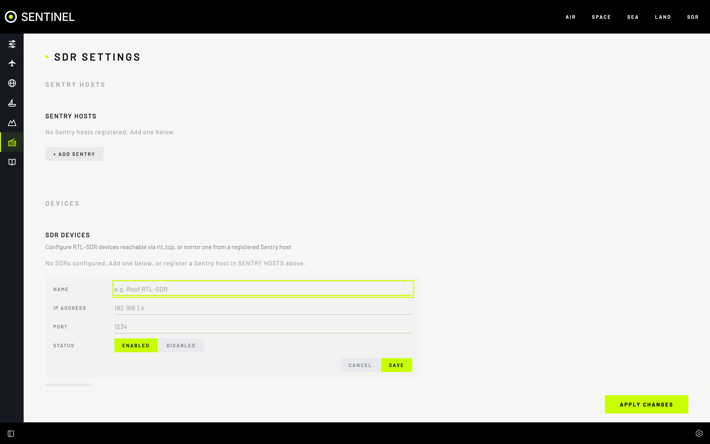
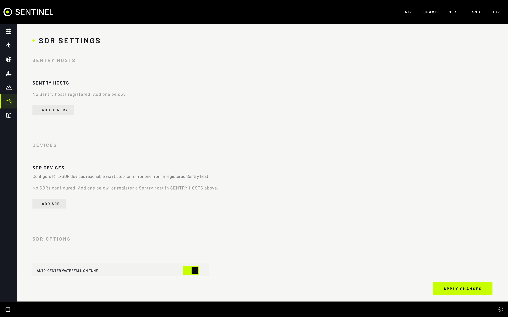

# Radios

The SDR section turns cheap RTL-SDR dongles into a wide-band receiver you control from the browser. Sentinel reaches every dongle over your network, so it can sit by the antenna on another computer.

## Features

- **rtl_tcp radios**: one dongle per `rtl_tcp` program.
- **Sentry hosts**: a Raspberry Pi sharing several dongles. Sentinel can claim one, tune it and hand it back.
- **Host details**: status, uptime, software versions, device counts (**PRESENT**, **CONFIGURED**, **STREAMING**, **DEGRADED**, **ERROR**, **NEEDS ID**) and its position on a map.
- **Plug and unplug alerts** when a Sentry dongle appears or disappears.
- **FLASH SERIAL** gives a dongle a unique serial so Sentry can tell it apart (marked **NEEDS ID**).
- **Per dongle**: output port, antenna and notes, kept on the Sentry.
- **Sentry sites** on every map, usable as range-ring centres and overhead-alert places.
- **RESERVED** marks a radio held by a decoder, so nothing knocks it off its channel.

## Add an rtl_tcp radio

1. On the computer with the dongle: `rtl_tcp -a 0.0.0.0 -p 1234`.
2. **Settings › SDR › SDR Devices › + ADD SDR**: **NAME**, **IP ADDRESS**, **PORT** (usually `1234`), **SAVE**.
3. Open **SDR** and pick it at the top of the radio panel. It shows **CONNECTED** and the waterfall starts.

## Add a Sentry host

1. **Settings › SDR › Sentry Hosts › + ADD SENTRY**: **IP ADDRESS**, **LABEL**, **PORT** (usually `8000`), **CONSOLE PASSWORD**, **SAVE**.
2. Its dongles are listed under **SDR Devices**. Add the ones you want.

A dongle marked private or disabled on its Sentry can't be added until you change it there.

## The radio panel

| Tab | For |
|---|---|
| **RADIO** | Pick a radio, tune, listen, record; **FAVOURITES**, **SCANNER**, **SEARCH** |
| **FREQUENCY MANAGER** | Saved frequencies |
| **GROUPS** | Colour-coded groups |
| **SEARCH RANGES** | Saved ranges to sweep |
| **RECORDINGS** | Play, download, note and delete recordings |

## Tips

- Each dongle serves one program at a time. Another connection shows **DISCONNECTED** here.
- `rtl_tcp` has no password; only share it on a network you trust.
- Without the radio hub (`radio`), saved frequencies and recordings still show, but no waterfall or audio.

## If it's not working

- **DISCONNECTED:** check `rtl_tcp` or Sentry is running, the address and port, and that nothing else is connected.
- **"USB buffer" errors on a Linux radio computer:** as root there, `echo 0 > /sys/module/usbcore/parameters/usbfs_memory_mb`.
- **Sentry won't connect:** `docker compose logs radio`. A refused login means a wrong console password.
- **RESERVED and can't be picked:** a decoder holds it. Choose another radio in that section's settings.
