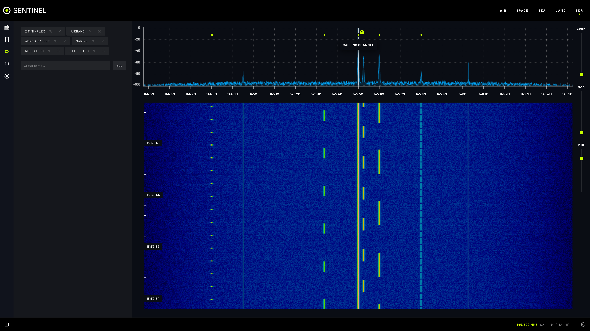
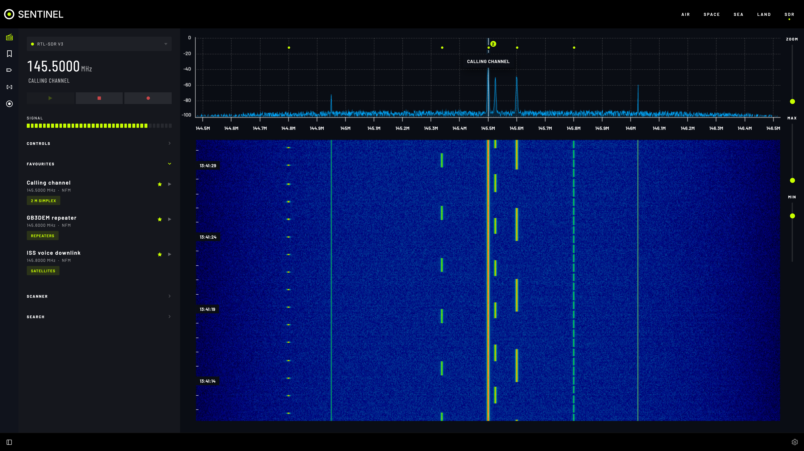
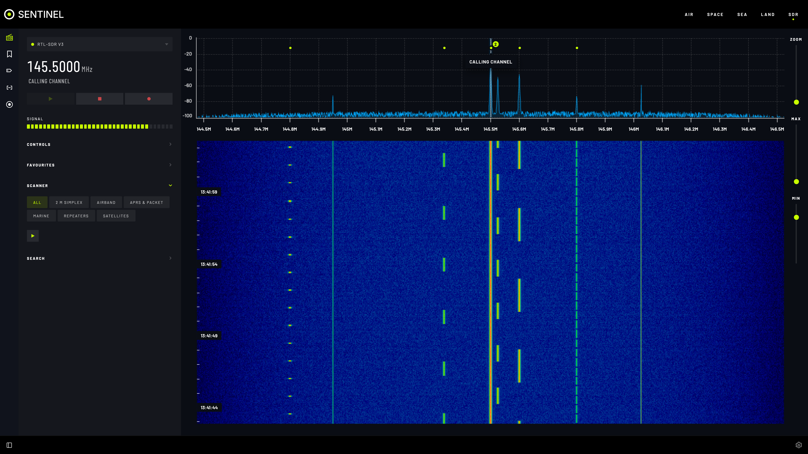
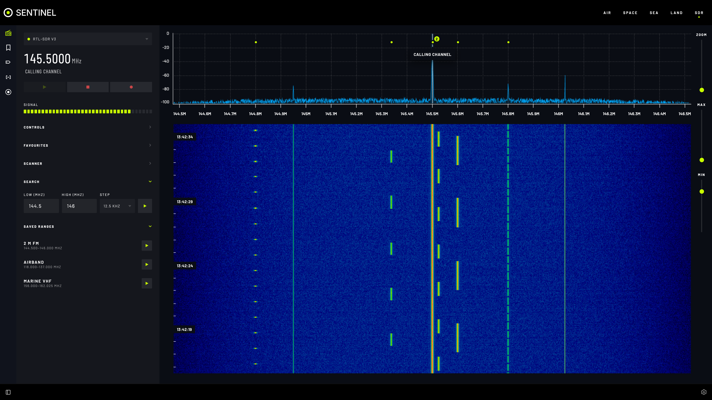
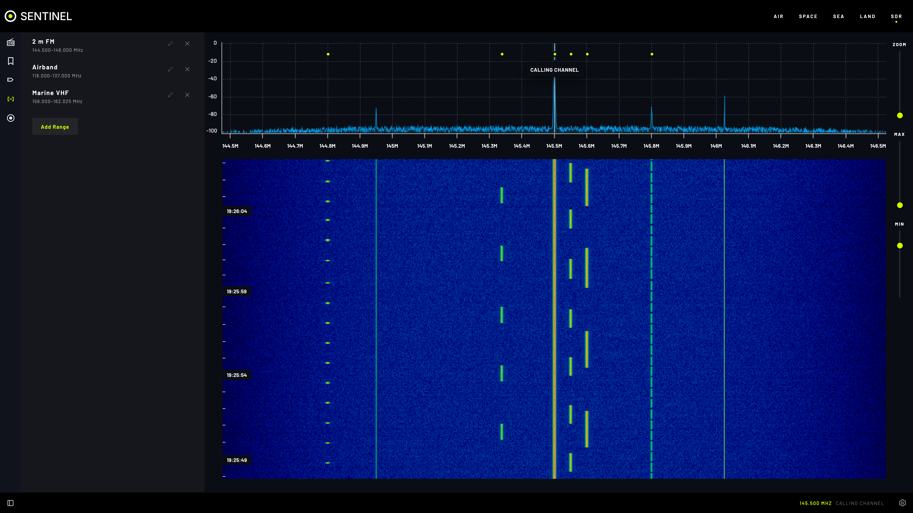

# Frequencies and scanning

Save frequencies, group them, and let Sentinel scan or sweep for activity.

## Features

- **Saved frequencies** with label, mode, groups and notes, marked on the waterfall. Each can keep its own radio settings (gain, squelch, bandwidth, volume, sample rate, zoom, waterfall range).
- **Favourites** (the star): one-click tuning from **FAVOURITES** on the **RADIO** tab.
- **Groups**: colour-coded; filter the list by group.
- **Scanner**: steps through saved frequencies (all, or chosen groups) and stops on a signal.
- **Search**: sweeps a range in steps for signals you haven't saved.
- **Saved ranges**: keep a range with its step, dwell time, mode and threshold.
- **Saved from other sections**: **SAVE FREQUENCY** on a Land repeater lands here.
- **JSON editor** for every frequency, group and range at once; **EXPORT** to back up or copy.

## Save a frequency

1. **FREQUENCY MANAGER › ADD FREQUENCY**: **LABEL**, **FREQ (MHz)**, **MODE**, optional **GROUPS** and **NOTES**.
2. **SAVE**. Use **Tune to** beside any saved frequency to listen.

Groups: **GROUPS** tab, type a name, **ADD**. Deleting a group keeps its frequencies.

## Scan

1. **RADIO › SCANNER**: choose **All** or some groups.
2. Set **SQUELCH** just above the noise: anything louder counts as a signal.
3. **Start scan**. It reads **SCANNING**, then **SCANNING PAUSED** while a signal plays, and carries on when it ends.

## Search a range

1. **RADIO › SEARCH**: **LOW (MHz)**, **HIGH (MHz)**, **STEP** (use the band's channel spacing, such as 12.5 kHz).
2. **Start search**. It stops on signals like the scanner.

To keep a range: **SEARCH RANGES › ADD RANGE**. It then appears under **SAVED RANGES** with its own start button.

## Settings

| Setting | What it does |
|---|---|
| **SDR Options › Scan / Search Resume Delay (Seconds)** | Wait after a signal ends before moving on |
| **Frequencies & Groups (JSON)** | Every frequency, group and range; **EDIT** or **EXPORT** |

## Tips

- Raise the resume delay to hear both sides of a conversation.
