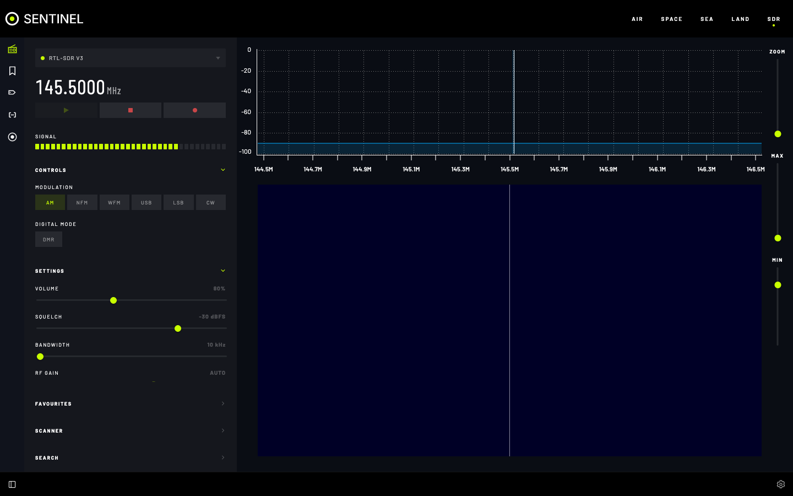

# Listen to a frequency

This page shows you how to find a signal on the waterfall, tune to it and listen. You need a radio added first; see [Add a radio](add-a-radio.md).

## Read the waterfall

The **spectrum** across the top shows signal strength across the band right now: a peak is a signal. The **waterfall** below shows the same over time, newest at the top, so a signal that comes and goes leaves a trail. Brighter means stronger.

- Saved and known frequencies are marked along the waterfall. Select a marker to see its name.
- With **Show Band Plan** on (in **Settings › SDR › SDR Options**), a coloured strip shows which service each part of the band belongs to.
- **ZOOM** spreads a narrower part of the band across the screen. Drag the frequency scale to move along the band.
- The minimum and maximum dB sliders set how faint a signal shows and when it is drawn at full brightness. Lower the maximum to make weak signals stand out.

## Tune and listen

1. Open **SDR** and pick your radio at the top of the **RADIO** tab.
2. Tune to a frequency in one of these ways:
   - select a signal on the waterfall;
   - type the frequency in MHz in the frequency box and press **Enter**;
   - scroll the mouse wheel over a digit of the frequency to step it up or down.
3. Under **CONTROLS › MODULATION**, choose the mode that matches the signal (see below).
4. Select **Tune** (▶) to start the audio. **SIGNAL** shows how strong the signal is.
5. Select **Stop audio** (■) to stop.

Your browser may block sound until you have selected something on the page. If there is no sound, select **Tune** again.

### Which mode to use

| Mode | Use it for |
|---|---|
| **NFM** | Narrow FM: most two-way radio, amateur repeaters, PMR446, marine VHF. |
| **WFM** | Wide FM: FM broadcast radio. |
| **AM** | Airband (aircraft and airports), and some older services. |
| **USB** | Upper sideband: amateur voice above 10 MHz, and many data modes. |
| **LSB** | Lower sideband: amateur voice below 10 MHz. |
| **CW** | Morse code. |

## Fine-tune the sound

The settings under **CONTROLS** shape what you hear:

- **VOLUME**.
- **SQUELCH** silences the audio until a signal is stronger than this level (in dBFS), so you don't hear noise between transmissions. Raise it until the hiss stops, then a little more.
- **BANDWIDTH** is how wide a slice around the tuned frequency you hear. Narrower cuts out neighbouring signals; too narrow cuts the voice. You can also drag the edges of the highlighted band on the waterfall.
- **RF GAIN** amplifies the signal from the antenna. Too little and weak signals vanish; too much and strong signals swamp everything. Or tick **AGC (Automatic Gain Control)** to let the dongle choose.
- **SAMPLE RATE** is how much of the band the radio takes in at once. Higher shows more of the band, at the cost of more network traffic and CPU.

## Keep listening while you look elsewhere

Audio keeps playing when you go to another section, Settings or the Docs. The tuned frequency stays in the footer so you can see what is playing from anywhere. Stop it from the **SDR** section.

## Settings

The listening options are in **Settings › SDR › SDR Options**:

| Setting | What it does | When to change it |
|---|---|---|
| **Auto-center Waterfall on Tune** | Moves the waterfall so the tuned frequency is in the middle. | Turn off to keep the view still while you tune around. |
| **Snap to Known Frequencies** | Selecting near a known frequency tunes exactly to it. | Turn off to tune freely. |
| **Show Band Plan** | Shows the coloured band strip. | Turn off for a cleaner waterfall. |
| **Display Known Frequencies** | Marks saved and known frequencies on the waterfall. | Turn off for a cleaner waterfall. |
| **Mute Audio While Decoding** | Silences the audio while a digital decoder is running. | Turn on if decoder noise bothers you. |
| **Show Waterfall Timestamps** and **Waterfall Timestamp Interval (Seconds)** | Writes the time down the side of the waterfall, every so many seconds. | To tell when a signal was heard. |

## Troubleshooting

- **No sound.** Check that **Tune** is on, the volume is up, and the squelch isn't higher than the signal. Then select something on the page in case the browser blocked sound. If the panel says why audio is unavailable, follow what it says.
- **Distorted or full of other stations.** Lower **RF GAIN**, or narrow **BANDWIDTH**.
- **Only noise.** Check the mode, and that your antenna suits the band.
