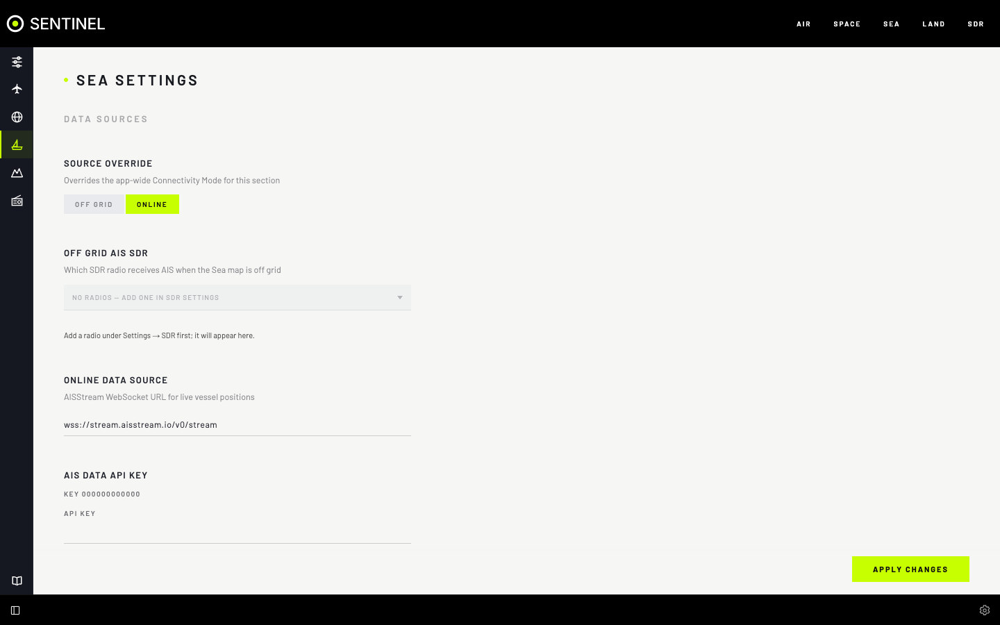

# Sea: ships (AIS)

## What it's for

The **SEA** section shows ships on a live map. Ships broadcast their identity, position, course and destination over a marine radio system called **AIS**. Use Sea to:

- see the shipping near you, coloured by type;
- look up a ship: its name, type, destination, speed and recent track;
- find a port and tune your radio to its VHF channels;
- follow ships with no internet, from your own antenna.

Online, ships come from [AISStream](https://aisstream.io), a free online feed that needs a key. Off grid, they come from your own radio.

## Start it

Sea starts with the rest of Sentinel. To run it on its own:

```bash
docker compose up -d gateway sea
```

## Before you start

- **Online:** an internet connection and a free AISStream key (see [Add your AISStream key](#add-your-aisstream-key)).
- **Off grid:** a radio with a VHF marine antenna, and the AIS decoder. See [Off grid](#off-grid).

## Using it

### Add your AISStream key

1. Open **Settings › SEA › AIS Data API Key** and select **GET AIS API KEY**. The AISStream website opens in a new tab.
2. Sign in there (a GitHub account works) and create an API key.
3. Paste the key into **API KEY** and select **APPLY CHANGES**.



Ships start to appear within a minute. The key is kept secret: it never shows in the config file or in an exported configuration. To remove it, select **FORGET KEY**.

> [!IMPORTANT]
> AISStream allows **one connection per key**. Use each key in one Sentinel only. If two use the same key, both keep losing the feed, and reconnecting too often can get the key locked out for a while. Sentinel reconnects slowly on purpose for this reason.

### Choose how much of the world to cover

By default Sea receives ships worldwide, which is hundreds of messages a second. On a small computer, choose a smaller area: open **Settings › SEA › Coverage Area**, move the Sea map to your area and select **USE CURRENT MAP VIEW**, or type the **NORTH**, **SOUTH**, **EAST** and **WEST** edges. **WORLDWIDE** goes back to the whole world.

### Look at a ship

Select a ship on the map to show its recent track and its details: **VESSEL** (type, MMSI number, IMO number, callsign, navigation status and when its position was last heard), **VOYAGE** (destination), **POSITION** and **MOVEMENT** (speed, course and heading). Between reports Sentinel moves each ship along its course, so the map doesn't jump every few seconds.

Ships not heard for 30 minutes leave the map.


### Find a ship or port

Open **FILTER** and type a name, MMSI number, type or destination. The buttons under **FILTER** show one type of ship at a time, or **ALL VESSELS**. The list is also a way to read the map without seeing it.

### Listen to a port

Turn on the **Ports** layer (**MAP LAYERS** in the map controls, or **Settings › SEA › Map Layers**). Select a port to see its **VHF CHANNELS**. Select a channel to tune your radio to it. You need a radio set up in the SDR section; see [Add a radio](sdr/add-a-radio.md).

### Map layers

**Settings › SEA › Map Layers** chooses what the map draws: **Vessel labels**, **Range rings**, **Ferry routes** (the regular ferry crossings) and **Ports**. Changes show on the map at once, and **APPLY CHANGES** keeps them as the defaults for every device. **Settings › SEA › Vessel Label Fields** chooses what each ship's label shows.

## Off grid

Off grid, Sea decodes AIS from your own radio instead of AISStream, using the AIS decoder. The map, tracks and ship types work the same way. You need a radio you can give to AIS full time and a marine VHF antenna. [Track ships off grid with your own radio](../tasks/track-ships-off-grid.md) has the steps.

## Settings

All under **Settings › SEA**:

| Setting | What it does | When to change it |
|---|---|---|
| **Source Override** | Uses **ONLINE** or **OFF GRID** for Sea only. | When Sea should use your radio while other sections stay online, or the other way round. |
| **Off Grid AIS SDR** | The radio that receives AIS off grid. | When you set up off-grid Sea. |
| **Online Data Source** | The AISStream address. Default `wss://stream.aisstream.io/v0/stream`. | Rarely. |
| **AIS Data API Key** | Your AISStream key. | Once, when you set Sea up, or if the key changes. |
| **Coverage Area** | The area to receive ships for. Default worldwide. | On a small computer, or to see only your area. |
| **Map Layers** | Which layers the map draws. | To change what you see by default. |
| **Vessel Label Fields** | What each ship's label shows. | To show more or less on the map. |

## Troubleshooting

The notice at the top of the Sea map says what is wrong:

- **"No AISStream API key configured."** Add your key (see [Add your AISStream key](#add-your-aisstream-key)).
- **"AISStream rejected the API key."** Check the key. Sentinel tries a rejected key again once an hour, or straight away when you change it.
- **"No off-grid AIS receiver selected."** Pick a radio in **Off Grid AIS SDR**.
- **"The AIS decoder is not running"** Start it with `docker compose --profile ais up -d`.
- **"The AIS receiver has been tuned away from the AIS channels"** Something else tuned the radio. It retunes itself within about 15 seconds.
- **No ships off grid, and no notice.** AIS is line of sight. Put the antenna higher, and check it is a marine VHF antenna (around 162 MHz). Inland, there may be no ships in range.
