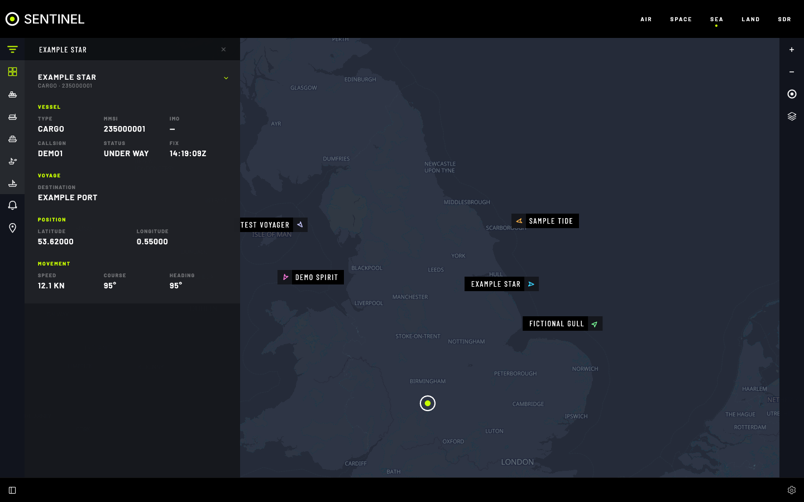

# Sea

Live vessels near you, from AIS. Online from [AISStream](https://aisstream.io) (free key); off grid from your own radio.

## Features

- **Live map** of ships, coloured by type, moved smoothly along their course between reports.
- **Ship details**: name, type, MMSI, IMO, callsign, status, destination, speed, course, heading, and recent track.
- **Search** by name, MMSI, type or destination in **FILTER**; show one ship type at a time.
- **Ports** layer: select a port for its VHF channels, then a channel to tune your radio.
- **Layers**: vessel labels, range rings, ferry routes, ports.
- **Coverage area**: receive the whole world or only your area.

Ships not heard for 30 minutes leave the map.

## Add your AISStream key

1. **Settings › SEA › AIS Data API Key › GET AIS API KEY** (opens AISStream).
2. Sign in there and create a key.
3. Paste it into **API KEY**, then **APPLY CHANGES**.

Ships appear within a minute. The key never appears in the config file or exports. **FORGET KEY** removes it.

> [!IMPORTANT]
> One connection per key. Use each key in one Sentinel only, or both lose the feed and the key can be locked out.

## Off grid

You need a dongle you can give to AIS full time and a marine VHF antenna (about 162 MHz), mounted high.

1. `docker compose --profile ais up -d --build`
2. Set **OFF GRID** (app-wide, or Sea's **Source Override**).
3. **Settings › SEA › Off Grid AIS SDR**: pick the radio, then **APPLY CHANGES**.

The decoder keeps the radio on both AIS channels and runs in the background, even with no browser open.

## Settings

All in **Settings › SEA**.

| Setting | What it does |
|---|---|
| **Source Override** | **ONLINE** or **OFF GRID** for Sea only. **Off Grid AIS SDR** shows off grid; the AISStream settings below it show online |
| **Off Grid AIS SDR** | The radio used off grid |
| **Online Data Source** | The AISStream address |
| **AIS Data API Key** | Your AISStream key |
| **Coverage Area** | **WORLDWIDE**, **USE CURRENT MAP VIEW**, or edges |
| **Map Layers** | Layers on when the map opens |
| **Vessel Label Fields** | What each ship label shows |

## Tips

- On a small computer, shrink **Coverage Area**: worldwide is hundreds of messages a second.
- AIS is line of sight. Height beats everything.

## If it's not working

Read the notice at the top of the map:

- **"No AISStream API key configured":** add your key.
- **"AISStream rejected the API key":** check it. A rejected key is retried hourly, or at once when changed.
- **"No off-grid AIS receiver selected":** set **Off Grid AIS SDR**.
- **"The AIS decoder is not running":** `docker compose --profile ais up -d`.
- **"Tuned away from the AIS channels":** it retunes itself within about 15 seconds.
