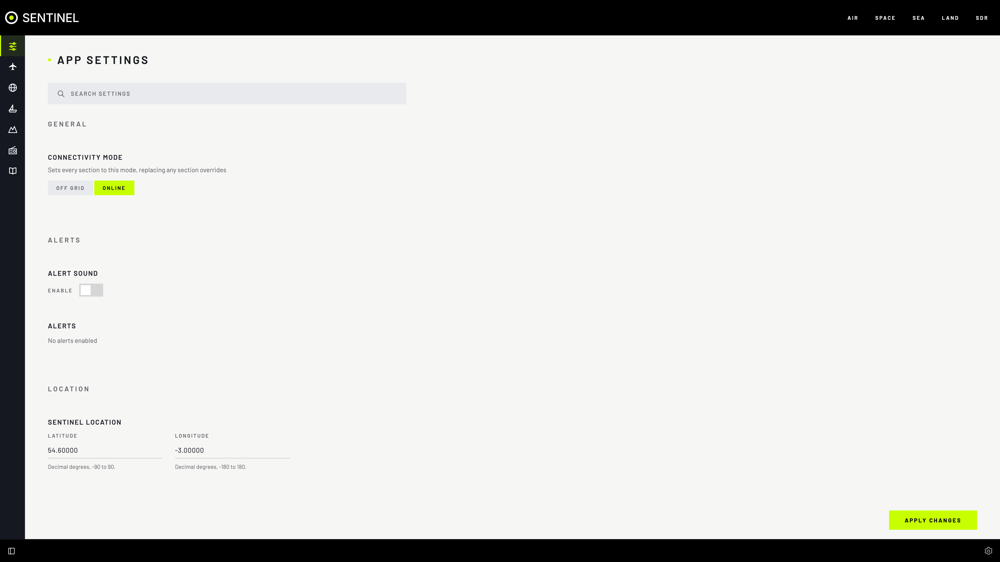

# Settings and the config file

Every setting is in **Settings** (the gear, bottom right) and in one live file, `backend/data/sentinel_config.json`.

## Features

- **One page per section**, each with its own address such as `/settings/sea`.
- **SEARCH SETTINGS** finds any setting by name or description.
- **Doc links** beside a setting open its page here.
- **APPLY CHANGES** saves everything at once and updates every browser in place, with no reload. **NO CHANGES** means nothing was changed.
- **Shared**: settings live on the Sentinel computer, so every device sees the same.
- **App Wide Connectivity Mode**: **ONLINE** or **OFF GRID** for every section; Air, Space and Sea also have a **Source Override**.
- **One mode at a time**: a section shows only the data source settings for the mode picked, and swaps them as soon as you switch. Anything chosen in the other mode is kept.
- **Export All Configuration**: settings, frequencies and band plan as three files.
- **Application Config**: view, **EDIT** or **EXPORT** the config file in the browser. The editor has line numbers, marks JSON errors, and **FORMAT** (or Shift+Alt+F) tidies the indenting. Tab indents; press Ctrl+M (Ctrl+Shift+M on a Mac) first to move on with Tab instead.



## Things to know

- Changes wait for **APPLY CHANGES**. Leaving the page without it throws them away.
- These act at once: **UPDATE TLE**, adding or removing a radio or Sentry host, **DOWNLOAD**, **EXPORT**.
- Choosing **App Wide Connectivity Mode** resets every **Source Override**.

## The config file

A live, two-way copy of every setting.

- Sentinel rewrites it within a second of any change.
- Save an edit and Sentinel applies it within a second or two; browsers update in place.
- An invalid file is ignored and logged (`docker compose logs app`); fix it before the next change overwrites it.
- In **Application Config › EDIT**, you can send only the keys you want to change. A nested value (such as `location`) is replaced whole.

```json
{
  "app": {
    "location": { "latitude": 51.5072, "longitude": -0.1276 },
    "connectivityMode": "offgrid"
  },
  "land": { "enabled": true, "aprsChannelHz": 144390000 },
  "sea": { "aisBoundingBoxes": [[[49.5, -11.0], [61.0, 2.5]]] }
}
```

| Key | Values |
|---|---|
| `app.connectivityMode`, `<section>.sourceOverride` | `"online"` or `"offgrid"` |
| `app.location` | `latitude` and `longitude`, both set or both empty |
| `app.mapTheme` | `"dark"` or `"light"` |
| `<section>.enabled` | `true` or `false` |
| `sea.aisBoundingBoxes` | Boxes of `[[south, west], [north, east]]` |
| `sea.aisSdrRadioId`, `sdr.aprs_radio_id`, `air.offgridSdrSource` | A radio `id` from `sdr.radios`, or `null` |
| `sdr.radios` | The radio list; sending it replaces the whole list |

The full defaults are in `backend/default_config.json`.

## Not in the file

- The AISStream key (set it on each Sentinel).
- Saved frequencies, groups, ranges, band plan and satellite frequencies: each has its own JSON editor in Settings.
- `.env` settings: see [Environment variables](../configuration.md).

## Copy settings to another Sentinel

**EXPORT** on the first, then on the second paste it into **Application Config › EDIT** and **APPLY CHANGES** (or replace its file).
