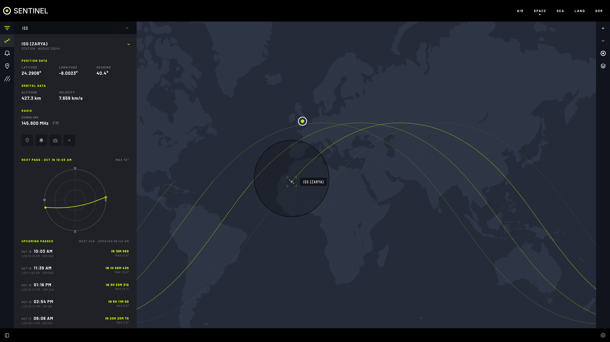
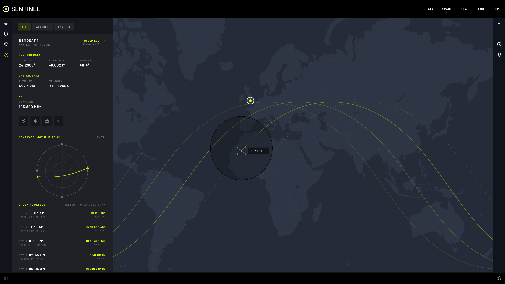

# Space

Satellites on a globe, and when they pass over you. Positions are worked out on your computer from TLEs (orbit data), so Space works offline once they are loaded.

## Features

- **Find a satellite** by name, NORAD ID or category in **FILTER**.
- **Satellite details**: ground track for the next orbits, footprint, radio frequencies and upcoming passes.
- **Track satellite**: keep the map on it; listed under **TRACKING**.
- **PASSES** pane: the next passes over you, soonest first, with rise time, highest elevation and length. Select one for its sky plot.
- **Pass alerts**: about five minutes before it rises (the bell on a pass).
- **Auto-tune SDR**: your radio tunes to the downlink at rise and goes back at set.
- **Record pass**: records while auto-tuned.
- **DAY / NIGHT** shading and **LOCATION NAMES**.

## Load satellites

**Settings › SPACE › Online Data Source**: pick categories, then **UPDATE TLE**.

With no internet, use **TLE Import**: a `.txt` file, three lines per satellite (name, then the two element lines).

## Catch and record a pass

1. Set **Sentinel Location** and [add a radio](sdr/add-a-radio.md).
2. In **PASSES**, on the pass: turn on **Auto-tune SDR**, then **Record pass**.
3. Leave Sentinel open in a browser tab. The browser does the tuning.

The recording appears in SDR's **RECORDINGS**.

## Settings

All in **Settings › SPACE**.

| Setting | What it does |
|---|---|
| **Online Data Source** | TLE categories to download; **UPDATE TLE** |
| **TLE Import** | Load TLEs from a `.txt` file |
| **TLE Database** | What is stored; clear one category or all |
| **Satellite Frequencies (JSON)** | Downlinks used by auto-tune |
| **Filter Hover Behaviour** | Whether hovering a satellite in **FILTER** moves the map |

## Tips

- Higher maximum elevation means a clearer signal.
- TLEs drift a few kilometres a day: update weekly, and before going off grid.

## If it's not working

- **"No satellite data available":** load TLEs.
- **No auto-tune on a satellite:** add its downlink to **Satellite Frequencies (JSON)**.
- **Pass came and went, nothing tuned:** no browser had Sentinel open, no radio was connected, or a decoder holds the radio.
